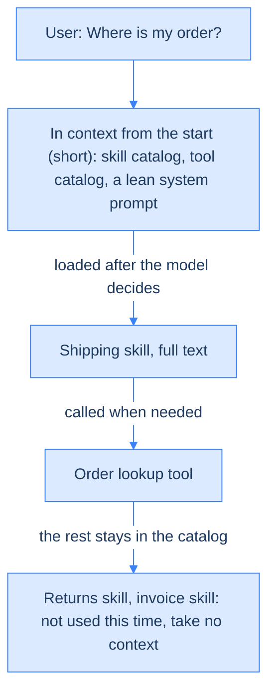
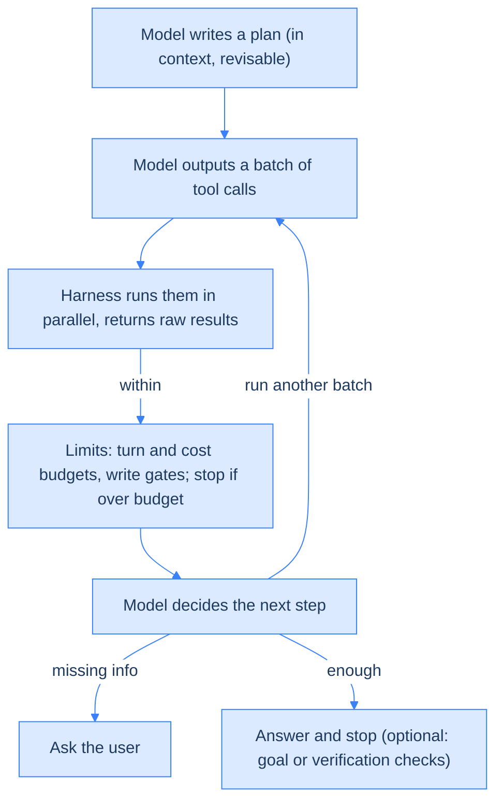
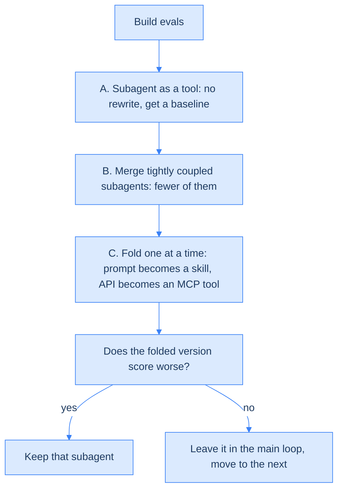
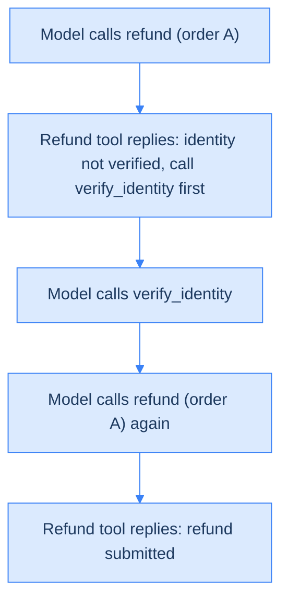
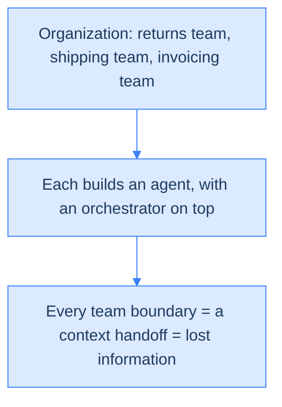
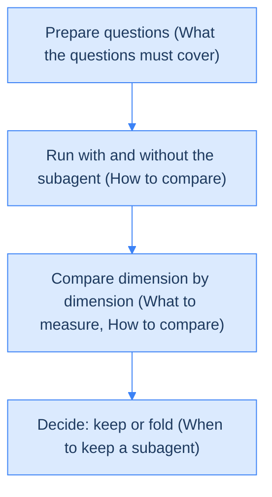

<!--more-->

## A subagent that was right, and still lost the invoice

A customer asks the support agent: "Can I return this order? What happens to the invoice?" The system hands the question to a small agent that only handles returns. It reads the order and reports back one line: "returnable". That is correct. But this order's invoice has already been issued and must be voided first. Invoices are outside the returns agent's job, so the fact never makes it into the report, and the agent answering the customer never learns it. Nobody made a mistake, and information still got lost in the handoff. (This is a made-up scenario; the post keeps coming back to it.)

Handoffs like this are everywhere in company agent systems. An agent here means an LLM program that repeatedly calls tools, looks at the results and decides what to do next. A typical enterprise setup looks like this: every team builds its own subagent (an agent that a higher-level agent calls to handle one subtask), and a platform team stacks an orchestrator on top (the higher-level agent that routes each question to the right subagent). A recent Anthropic article argues that, much of the time, this setup can be folded back into a single agent loop.

The core reason: every subagent boundary is a lossy handoff of context (everything the model can see at that moment), and many of those boundaries are just a projection of the org chart, not something the problem requires. That is Conway's law: a system's structure copies the communication structure of the organization that designed it. A whole section below is devoted to it.

Not everything should be folded, though. The article lists three situations where a subagent is still worth keeping; the section "One question before you split off another agent" gives an example of each.

First we look at why multi-subagent systems go wrong. Then at the single loop the article wants, how to fold your way there step by step, and what teams own afterwards. Finally, why agents end up shaped like org charts, and where the article's evidence is thin.

Source: [Building agents: When to fold subagents into your main agent loop](https://claude.com/resources/articles/building-agents-when-to-fold-subagents-into-your-main-agent-loop) (Anthropic, Diane Sarkis, 2026-10-22). Throughout this post, "(my inference)" marks the writer's reasoning beyond the article, "(made-up)" marks scenarios invented to explain a point, and "(general knowledge)" marks common industry background; everything unmarked comes from the article.

## Why multi-subagent systems go wrong

Start with the problem. "Each team builds a subagent, then stack an orchestrator on top" looks like the easiest path. Why does the article think it often isn't worth it?

### Five failure modes

Once this setup is running, complexity keeps piling up. The article lists five failure modes (an eval, in the table, is a fixed set of test questions used to score an agent):

| Failure mode | What happens |
| --- | --- |
| Context management | Someone has to decide what information agents exchange, and details drop out as it passes back and forth |
| Subagent sprawl | Every team ships one, and you end up with many overlapping subagents with no standards and no owner |
| Frankenprompt | Every team adds a line to the system prompt; the rules conflict and the tone is inconsistent |
| Over-local evals | Each team tunes the score for its own subtask, nobody maintains the whole, and decisions rest on diluted scores |
| Latency | Layered architectures are slow by nature. One customer replaced a multi-agent harness (the program wrapped around the model that runs tools and sets limits) with a single loop and saw runs about 2 times faster (a single case; see "How solid are these claims?") |

### The root problem: every handoff is a lossy summary

Of the five, the first is the root. When a subagent finishes, it hands the main agent a summary it wrote itself, not the raw data, and the main agent has no way to see what the summary left out.

Back to the opening example (made-up). The user asks: "Can I return this order? What happens to the invoice?" Here is how the information flows in the two designs:

|  | Split into subagents | Single loop |
| --- | --- | --- |
| Who reads the order | The returns agent reads the full order | The main agent reads the full order itself |
| What the main agent gets | Only a summary: returnable | The raw order, invoice status included |
| Outcome | The main agent doesn't know the invoice was issued and must be voided first | The answer covers voiding the invoice too |

Figure 1 — The same question in two designs: the difference is who writes the summary, and the main agent never sees the details that were left out. (Made-up example)

The returns agent did nothing wrong; "returnable" is true. The invoice status was simply outside its task, so it never entered the summary. Where these handoff boundaries come from is the subject of "The idea to keep: Conway's law".

In short: multi-subagent systems have many problems, but the root one is that every handoff passes through a summary someone else wrote, and whatever it leaves out is gone.

## The target: one loop plus progressive disclosure

With the problem clear, here is what the article wants instead: a loop that repeatedly calls tools, looks at the results and decides the next step, with knowledge and tools kept as a catalog and loaded only when needed.

Concretely: one model, one [context window](../context-engineering/) (everything the model can see at once: instructions, conversation history and tool results). Domain knowledge is written as skills (how-to instructions written for the agent), capabilities become tools (functions the agent can call, such as looking up an order), and normally only a catalog of each is loaded. This section takes four steps: loading on demand, why it beats subagents, how the loop runs, and where the old components go.

### Progressive disclosure: a catalog first, the full text on demand

Progressive disclosure means the agent starts out seeing only each skill's and tool's name plus a one-line description, and loads the full text or full definition into context only when it actually needs it.

Same support example (made-up), but this time the user asks "Where is my order?":

Figure 2 — Progressive disclosure: the skill catalog holds names plus one-line descriptions, the tool catalog names plus short summaries; only the skills and tools used this time enter the context. (Made-up example)

The idea applies to two things:

- **Skill**: how-to instructions for the agent, covering steps, rules and how to make judgment calls. The expertise that used to live in each subagent's prompt moves here.
- **Tool search**: the same idea applied to tools. Tool definitions are searched for and loaded only when needed.

The main reason to split into subagents in the first place was "all that expertise in one prompt would be too long". Once knowledge loads on demand, that reason no longer holds.

### Why it beats splitting into subagents

The article gives three reasons:

| Reason | What it means |
| --- | --- |
| Shared context | The raw results of every earlier step sit in the same window, so the agent can connect them itself (the invoice status in Figure 1 is an example) |
| No context bloat | Knowledge sits in skills loaded on demand instead of being stuffed into the prompt up front |
| Models got stronger | One loop can handle more, so the harness no longer has to break the work into steps for the model |

The first two reasons each come with a piece of evidence:

- **Shared context**: in comparisons across several enterprise deployments, a single agent with skills "often" beat both one big prompt and subagent designs on quality, and was "frequently" cheaper and faster too.
- **No context bloat**: [Claude Code](../claude-code/) cut its system prompt by more than 80% for stronger models. The cut "includes" the effect of progressive disclosure but isn't all its doing (the article doesn't say where the rest came from).

How solid that evidence is gets checked later, in "How solid are these claims?": the first has no numbers, and the second is Claude Code's own experience.

On the third reason, the article says that starting with Opus 4.5, models can handle far more in a single loop than most teams expect. Recent models report progress as they go and check their own results, which makes parts of the harness redundant. Each new model generation lets more decisions move from the harness to the model, and an overly rigid multi-agent structure is often what keeps a new model from showing what it can do.

So how strong does a model have to be before you fold? The article gives no threshold. It replaces one with symptoms and evals: keep a subagent only if the folded version scores worse, and weigh that against the three keep-a-subagent situations from the opening (context bloat, a need for parallel clean contexts, wrong tool choices or conflicting instructions; see "One question before you split off another agent"). Weaker models will show those symptoms sooner; the process still applies, just with fewer subagents that can be folded in (my inference).

### How the loop runs: the planner is the executor

Now that we know what sits in the context, here is how the loop itself turns. The [harness](../harness-engineering/) here is the program wrapped around the model; the model makes every decision, and the harness only runs tools and sets limits:

Figure 3 — How the single loop runs: the model makes the decisions, the harness only executes and sets limits.

The biggest difference from an orchestrator design: the model that writes the plan is the model that carries it out. In an orchestrator design, a planner writes the plan and hands it to a specialist (a subagent responsible for one domain), and fixing the plan midway is hard. In a single loop, the model can revise the plan on the spot every time a new batch of results comes back.

The article doesn't define the write gate in the figure; read it as a check or approval before data is changed (my inference).

### Where the old components go

Folding into a single loop doesn't make the parts of a multi-agent system vanish; each finds a new home. The router and intent classifier in the first row are the components that first decide "which subagent should get this question", the dispatching step (general knowledge):

| Old component | Where it goes | Why |
| --- | --- | --- |
| Router, intent classifier | The model reads the catalog and picks skills and tools itself | Choosing is exactly the kind of judgment models are good at (my inference; the article only says the router is folded into the main loop) |
| Code that rewrites the plan by rules | Not needed | The model decides each step itself |
| Step order, domain workflows | Skills | This is knowledge about "how the team does things" |
| Hard constraints (validation, approval gates) | Inside tools | They must be followed without exception, not left to the model's memory |
| Things needed only mid-conversation (such as memory lookup) | Tools | Called only when needed |
| Cheap things used almost every time (such as entity resolution, mapping a casual reference to a specific order) | Preloaded by code | Not worth having the model decide every time |
| Mechanical work (building API requests, parsing streams, picking the flow back up after asking the user) | Code, wrapped in a tool | Fixed steps |

Two terms from the table, briefly. Entity resolution maps something like "that order from last week" to a concrete order ID in the system (general knowledge). "Picking the flow back up after asking the user" is the article's "resuming a clarification"; the article doesn't explain it, and this reading is my inference.

"Put hard constraints in tools" deserves one more sentence. A rule in the prompt only *asks* the model to comply; a rule in the tool's code blocks the call when conditions aren't met and returns a message the model can act on. Figure 5 in "Tool design: group by intent, enforce rules in code" shows how.


Anything that needs judgment goes to the model or a skill, anything that must never be violated goes into tool code, and fixed mechanical steps stay in ordinary code.


In short: the single loop solves "the prompt is too long" with progressive disclosure, and lets the model write and revise its own plan. What used to be scattered across subagents moves into skills, tools and code, sorted by "needs judgment, must never break, fixed steps".

## How to fold: a staged migration gated by evals

With the target clear, the practical question: you already have a pile of subagents running, so how do you get there? The principle is to change one thing at a time and confirm with evals at every step that nothing regressed. Whether to fold is decided by scores, not by gut feeling.

### Build the evals first

Evals come in two layers: a central team maintains one end-to-end eval suite, and each team ships every skill with a small eval that tests only that skill. To start, 10 golden examples (examples whose correct answers a person has checked) are enough. What to measure, what the questions should cover, how to compare and how to decide what stays are collected at the end, in "Deep dive: five things to evaluate when folding a subagent".

### Three approaches, in order

The article offers three approaches. This post reads them as stages done in order (my inference; the article doesn't say so explicitly, and the reasoning is in the collapsed note at the end of this section):

**A. Call the subagent as a tool.** The main agent calls a subagent as one of its tools and keeps holding the conversation with the user. The upside is that you get a baseline (the score every later step is compared against) without rewriting any subagent. You can also standardize the subagents' response format, so the main agent can check a subagent's conclusion against real data. Only when a subagent has to talk to the user directly does it take over the whole conversation (a full handoff).


Each specialist still has its own prompt, owner and evals; what comes back is still a lossy summary; and every call adds another nested loop, so the latency stays.


**B. Merge domain agents.** Starting with the most heavily used, merge specialists that chain each other's outputs, touch the same data or are usually called together. How do you find those pairs? Look at production traffic: if a large share of it is "specialist 1 finishes, then calls specialist 2", those two are a tightly coupled pair.

**C. Fold into skills plus tools.** One at a time: rewrite the subagent's prompt as a skill and turn the APIs it calls into MCP tools (MCP is the Model Context Protocol, a standard interface that lets agents call external tools; general knowledge). Run the evals once with and once without that subagent, then decide whether it stays.

Put together, it is a pipeline that ends with only the subagents that regress when folded:

Figure 4 — A staged migration: evals gate every step, and only subagents that regress when folded are kept.


The article's own words are that you can "merge, call as a tool, or replace with skills and tools"; it doesn't say whether these are three alternatives or stages in sequence. The staged reading rests on two things: the article calls A a good first step, and that part of the article is about a staged migration.


### The same total score can hide a regression

Every step compares scores, but how you compare matters. Don't look only at the total after folding: compare question by question, checking which tasks went from pass to fail and which from fail to pass. Suppose the eval has 20 questions (made-up):

|  | Before folding | After folding |
| --- | --- | --- |
| Passed (out of 20) | 15 | 15 |
| Questions 3 and 7 | Pass | Fail |
| Questions 11 and 18 | Fail | Pass |

The total is 15 either way, but if questions 3 and 7 are workflows that must never fail, the total has hidden a regression.

The article gives a real instance. In a demo support agent, after one subagent was folded into another, latency went down, but a workflow that used to pass broke: the main agent already had an order lookup tool, so it answered on its own instead of asking the shipping specialist for the actual delivery date. And the failure showed up in only one of two runs, so a single run could easily have missed it.


When the information in hand "looks good enough", the model skips steps it was designed to take. That's why each question should run several times, and every chain of agents that runs together needs its own questions (see "What the questions must cover" at the end).


In short: build evals first, then go in order (as a tool, merge, fold one at a time); at every step check which questions flipped, run each question several times, and keep a subagent only if the folded version scores worse.

## What teams own once they no longer own an agent

Once the architecture is folded into one, the teams that each built a subagent don't disappear. So what do they do?

Without agents of their own, teams change roles: instead of owning an agent, each team contributes skills, tools or knowledge bases. A small central team owns the system prompt and end-to-end quality, and reviews every new skill, tool and eval before it ships. The central team should stay deliberately small, so it iterates fast and coordination stays cheap.

### Tool, skill or knowledge base?

What teams contribute comes in three forms, shown here with the support example (made-up):

| Form | Best for | Example (made-up) |
| --- | --- | --- |
| MCP tool | Taking actions, reading live data, or returning results in a fixed format | Look up order status, submit a refund |
| Skill | "How the team does things": steps, rules, judgment calls | The returns process and its exceptions |
| Knowledge base | Reference material needed only occasionally: policies, metric definitions, product specs | The full returns policy |

A knowledge base can go in one of two places: behind a search or lookup tool the model calls itself, or as a reference file inside a skill. What the article says to avoid is "code retrieves first, then pastes the result straight into the prompt". It doesn't give the reason here; a reasonable reading is that whether to read, and which part, should be the model's call, made on demand (my inference).


To do something or fetch data, use a tool; to know how to do it, use a skill; for the occasional lookup, use a knowledge base.


### Tool design: group by intent, enforce rules in code

**Group tools by user intent, not one tool per API.** Once a system prompt holds more than 30 to 50 tool definitions, tool-selection accuracy usually drops (the article doesn't say which models or tasks this was observed on). Rarely used tools can be deferred with tool search.

| Approach | What the tools look like (made-up) | What the model has to decide |
| --- | --- | --- |
| One tool per API | `get_order`, `get_shipment`, `get_carrier_status` | Which ones to chain, and in what order |
| Grouped by intent | `track_order`, which calls the three APIs in order internally | Only that the user wants to track a package |

**Put preconditions inside tools.** If Y needs X's output, Y's tool checks for it and, when it's missing, returns an instruction the model can follow. Keep hard preconditions to a minimum, only the ones that are truly necessary. Take refunds as an example (made-up):

Figure 5 — Preconditions live in the tool: the rule doesn't depend on the model remembering it; the tool's code blocks the call and points the way. (Made-up example)

**Put permission checks inside tools.** Each tool checks what the caller may see and do, and returns a plain-language refusal if not. That way one loop can serve users with different permissions, instead of one agent per permission level.

During the migration, a tool can also wrap a subagent that hasn't been folded in yet, which is approach A in "Three approaches, in order".

### Keeping skills maintained and from sprawling

Once subagents are gone, "sprawl" may well come back in the form of skills. What the article recommends:

- Each team names a DRI (Directly Responsible Individual, a management term for the one person accountable) for its skills, who makes sure they're well written, don't overlap with other skills, and come with evals.
- Maintenance goes back to whoever wrote the skill, while the heavy lifting goes to Claude: dedicated skills that create, test and prune other skills.
- Usage and cost data decide what stays; skills nobody uses get deleted.

Anthropic provides matching commands for creating and tidying skills (`/skill-creator`), checking cost and usage frequency (`/skill-doctor`), building evals, finding instructions written for older models, iterating on descriptions against evals, and cost optimization. Check the official docs for the exact names and usage.

And how should a skill's description be written so it triggers at the right moment? The article gives no writing rules; instead it tunes the description against evals until the folded version matches or beats the original subagent.

In short: teams stop owning agents and contribute tools, skills or knowledge bases; tools are grouped by intent, with preconditions and permissions enforced in their code; every skill has an owner and evals, and gets deleted if nobody uses it.

## The idea to keep: Conway's law

Back to the question left open at the start: where do those handoff boundaries come from? This is the idea in the article that travels furthest beyond agents. Conway's law says the organization that designs a system ends up with a system whose structure copies its own communication structure. An agent architecture that turns into a replica of the org chart is this law showing up in agents.

### Where the law comes from and why it holds

Melvin Conway proposed the law in 1968. It belongs to software engineering and organization design, comes up often when people debate how to split microservices, and is still rare in AI agent discussions (general knowledge). The article uses it as a real diagnostic tool, not as a borrowed label.

Why it holds can be broken into three steps (general knowledge plus my inference):

1. Each team can easily change only the parts it owns.
2. Interfaces between teams need coordination, which is expensive, so system boundaries naturally land on team boundaries.
3. Each team is responsible only for its own piece, so it optimizes only that piece, for example by writing evals that test only its own subtask (the "over-local evals" from the five failure modes).

The result: system boundaries follow "who owns what", not technical need.

### Why it hurts more for agents

In ordinary software, team boundaries become API boundaries, and data still passes through intact. An agent's boundaries are context boundaries, so every team boundary becomes a lossy summary handoff, like the unmentioned invoice in Figure 1.

Figure 6 — The org chart projected onto the agent architecture: team boundaries become points where information is lost.

The article's example: one company's support agent sat on top of a dozen or so specialist subagents; the brand voice was hard to keep consistent, and latency hurt the user experience.

### One question before you split off another agent


"If one team owned the whole system, would this boundary still exist?"

- **Yes**: there is a technical reason, such as measurable context bloat, a need for parallel clean contexts, or too many tools to choose from accurately. That boundary can stay.
- **No**: the boundary is just a projection of the org chart and should go.


As mentioned at the start, the article lists three situations where a subagent is still worth keeping. Here they are with examples (all made-up):

- **Context bloat that causes measurable degradation.** For example (made-up), after too many skills and tool results are folded into one agent, its eval scores drop noticeably.
- **A need for parallel work with separate, clean contexts.** For example (made-up), investigating several unrelated directions at once, each requiring a lot of reading; mixed into one context they interfere with each other, so giving each to its own subagent to read and report back works better.
- **The agent picks the wrong tools, or instructions conflict.** For example (made-up), the refund rules and the exchange rules are written in contradictory ways, and once folded together the agent keeps applying the wrong set.

### Often it's the org, not just the architecture, that has to change

The article isn't telling teams to disappear; it changes the unit a team owns, which is the division of labor described in "What teams own once they no longer own an agent". Here it adds one more reason: change the org boundaries, or the system boundaries slowly drift back to where they were.

In short: one reasonable explanation is that teams can only change, and only optimize, their own piece, so the agent grows into the shape of the org chart; with agents, every team boundary is a handoff that loses information. That's why changing the architecture isn't enough; what teams own has to change too.

## How solid are these claims?

The article's direction is persuasive, but several key numbers and practical details are under-specified. Keep that in mind before using them to convince your team or following them to the letter:

| Claim | Evidence given | What's missing |
| --- | --- | --- |
| A single loop runs about 2 times faster | One customer's case | A single case; the comparison conditions aren't described |
| A single agent with skills is "often" better on quality and "frequently" cheaper and faster | Comparisons across several enterprise deployments | No numbers, tasks or model details |
| Claude Code's system prompt shrank by more than 80% | Claude Code's own experience | The cut "includes" progressive disclosure but isn't all its doing |
| Strong enough models can be folded | Observations starting with Opus 4.5 | No cross-model comparison and no threshold for "strong enough" |
| Accuracy drops past 30 to 50 tools | Observation | Doesn't say which models or tasks |

A few practices are also left unclear; the writer's inferences are marked where they appear above:

- **The write gate** is never defined ("How the loop runs: the planner is the executor").
- **Resuming a clarification** is never explained ("Where the old components go").
- **The three migration approaches**: whether they are alternatives or stages isn't stated ("Three approaches, in order").
- **Why a knowledge base shouldn't be retrieved by code and pasted into the prompt**: the reason isn't given in that passage ("Tool, skill or knowledge base?").
- **Two ways of scoring an eval**: rubric (scoring the final reply against grading criteria) and task-completion (the task completion rate) aren't clearly distinguished; the writer's inference about where the line falls is in "What to measure" at the end.
- **How many runs per question are enough**: the article doesn't say.
- **How to replay timestamps as evals**: the article suggests that when internal systems are hard to replay, you log timestamps at key events and later replay them as evals ("Who maintains the evals" at the end), but doesn't explain how; my inference is that the timestamps are used to restore the system state at that moment and rerun.

## Conclusion

The root problem with multi-subagent systems is that every boundary is a lossy context handoff, and many of those boundaries are just projections of the org chart. The fix is a single loop plus progressive disclosure: knowledge written as skills loaded on demand, capabilities as tools, and hard constraints and permission checks enforced in tool code rather than written into the prompt as a request.

The migration is staged: build evals first, call subagents as tools to get a baseline, merge the tightly coupled ones, then fold one at a time, keeping a subagent only when the folded version scores worse. When comparing, check which questions flipped and run each question several times, because the model skips steps when the information "looks good enough".

On the organizational side, teams go from owning agents to owning skills and tools, with a small central team guarding the system prompt and end-to-end quality. Next time you want to split off another agent, ask first: if one team owned it all, would this boundary still exist?


- **Check**: put your agent architecture diagram next to your org chart and mark every boundary that exists only because different teams own each side.
- **Measure first**: don't fold before you have evals; start with a small set of questions whose answers a person has checked, covering every chained workflow.
- **Stay skeptical**: before using "2 times faster" or "cut by more than 80%" to persuade anyone, remember they come from a single case and from Anthropic's own product.


## Deep dive: five things to evaluate when folding a subagent

This section is for readers ready to get hands-on. For every subagent you fold, run the same four-step process. Of the five subsections below, the first four map to steps in the process ("How to compare" spans two steps):

Figure 7 — The eval process for folding one subagent. "Who maintains the evals" isn't a step; it's what keeps the process running.

### What to measure

| Category | Question it answers | Metric | When |
| --- | --- | --- | --- |
| Outcome | Is the final reply good? | Rubric scoring: grade the final reply against criteria | Throughout |
| Outcome | Did the task actually get done? | Task-completion (task completion rate) | Most important when comparing architectures |
| Process | Was the question routed to the right subagent? | Routing accuracy | Before folding |
| Process | Were the right skills loaded and the right tools called? | Selection accuracy | After folding |
| Process | Were all required steps taken? | Chain questions (see the next subsection) | After folding |
| Efficiency | Is it faster and cheaper? | Latency per task, cost per task | Throughout |

The article doesn't clearly define the difference between rubric and task-completion. One way to split them (my inference): rubric judges how well the answer is written, task-completion judges whether the thing got done. A beautifully written answer where the refund was never submitted might score high on the rubric and still fail task-completion.

### What the questions must cover

- Every chain of agents that runs together in production needs questions. This is the key to catching skipped steps; the support agent that never asked the shipping specialist, in "The same total score can hide a regression", is exactly this kind of failure.
- Every rule the agent must never break needs a matching question.

### How to compare

- Run once with and once without the subagent, holding everything else fixed.
- Check which questions flipped, not just the total (the 20-question example is in "The same total score can hide a regression").
- Run each question more than once, so occasional failures get caught.
- Change one thing at a time.

### When to keep a subagent

- **Main rule**: keep a subagent only if the folded version scores worse.
- **Supporting signals**: context bloat that causes measurable degradation, wrong tool choices, conflicting prompt instructions; all three show up in the metrics in "What to measure".
- **One thing judged separately**: a need for parallel clean contexts is an architectural requirement that eval scores can't reflect, so it has to be judged on its own (my inference; the article simply lists it alongside the other two conditions).

### Who maintains the evals

- The two-layer split (the central team's end-to-end evals plus each team's small evals) and the starting size (10 golden examples): see "Build the evals first".
- When internal systems are hard to replay and user interactions hard to simulate, log timestamps at key events and later replay them as targeted evals.
