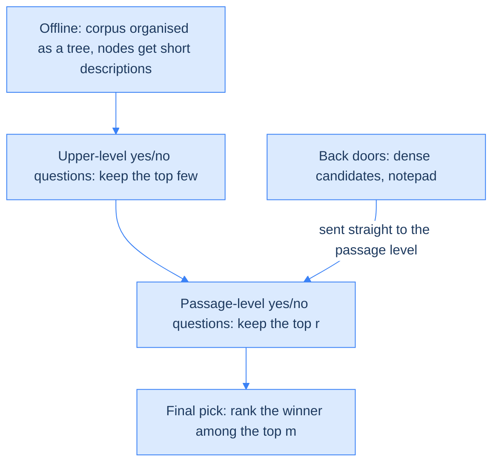

<!--more-->

## RAG's weakest link is the retriever

In RAG (retrieval-augmented generation: first find relevant passages, then have an LLM answer from them), whatever the search step misses, the LLM never sees, however strong it is. And while the LLM keeps getting stronger, that search step, the **retriever**, is still usually **BM25** (classic keyword matching) or **vector search** (turn text into vectors and find the passages closest in meaning).

**DecisionRAG** drops the retriever as the first filter. It arranges the documents like a library: sections, then books, then paragraphs. A model starts at the top and, at each level, asks which shelves are worth a closer look, until it reaches the paragraphs. It never writes out any text along the way.

The paper calls this kind of model a **decision model**: instead of writing out an answer word by word, it gives a probability for each option directly. Ask it "is this page worth opening?" and it returns the probability of yes, not a sentence. The one used here is [Jev 1.13](../../ai-concept/jev-overview/), a vendor's hosted model available only through an API, whose size is not disclosed.

The result: accuracy roughly ties the strongest baseline, vector search plus GPT-5 **reranking** (let a retriever fetch a batch of candidates, then have a stronger model reorder them), with latency an order of magnitude lower. But there are caveats. On all four datasets the best score actually comes from a hybrid that mixes in vector-search candidates, so the paper's "retriever-free" label does not quite hold.

We start with the problem and the method, then the experiments, then the limitations to know before using it, and two ideas that work beyond this paper. A few easily misread details are in the Further questions at the end.


Unmarked text is from the paper. "(Inference)" marks a guess by the note's author; "(Made up)" marks numbers invented for illustration; "(General knowledge)" marks background from outside the paper. Where the paper does not say, the post says so.


Paper: [DecisionRAG (arXiv 2610.35868v1)](https://arxiv.org/abs/2610.35868v1) (Cornell, ASAPP, 2026/10)

## What the retriever misses, the LLM can never recover

In RAG, the retriever decides what the generator sees, and the retriever is far less capable than the generator. Evidence the retriever misses cannot be recovered, no matter how strong the generator. The paper calls this **capability asymmetry**.



Take a concrete query, the example the whole post will follow: "Who is the protagonist of Christopher Nolan's 2000 film?" To answer it you first have to work out that Nolan's 2000 film is Memento, and only then do you know to look on the Memento page for the passage introducing the protagonist, Leonard Shelby. The catch: the word "Memento" is not in the query at all.

- **BM25** only matches words, so it ranks Gladiator (2000 film), whose title happens to contain "2000" and "film", above Memento.
- **Dense retrieval** (vector search) turns the query and each passage into vectors separately and then compares them, so it never gets to read the query and reason "that means Memento" either.



### Every existing fix gets stuck somewhere

Existing fixes take one of two routes. **Reranking** lets a strong model take part, but only among the candidates the first stage fetched, so anything missed stays missed. **Generative navigation** has an LLM search step by step, or write out which branches of a document hierarchy to keep; it can recover misses, but every step waits for the model to write, which is slow.

| Approach | Strong model decides? | Recovers first-stage misses? | Speed |
| --- | --- | --- | --- |
| BM25 / dense retrieval | No | N/A | Fast |
| Reranking (reranker) | Yes, but only on first-stage candidates | No | Medium |
| Generative navigation (LLM searches step by step, or writes out which branches of a document hierarchy to keep) | Yes | Yes | Slow |
| What DecisionRAG aims for | Yes | Yes | Fast |

The table boils down to three challenges:

- **No first-stage retriever**: the strong model must decide what to look at directly, not just reorder someone else's picks.
- **No word-by-word generation**: every judgment has to be fast.
- **Scale**: a corpus can run to millions of passages; the model cannot read them one by one.

In short: let a strong model choose the material directly, decide quickly, and cope with a large corpus. The next section shows how DecisionRAG does all three.

## How DecisionRAG finds passages: a tree of yes/no questions

First, the 30-second version. Offline, the corpus is organised into a tree. Online, the decision model (called the **judge** from here on) asks one **yes/no question** for every candidate at each level (is this candidate worth a closer look?) and keeps only the top few (for example a fixed top \( k \), or those above a probability threshold). At the passage level it keeps the top \( r \) passages, and finally asks one **final pick** question over the top \( m \) (which of these passages is most relevant?). Think of a library: read the section signs, then pick a book, then turn to the paragraph.

### Build a tree once, then filter level by level

- **Offline (built once)**: organise the corpus into a hierarchy such as clusters, then pages, then passages, and give each node a short description (see "Where the corpus tree comes from").
- **Online (every query)**: the judge asks questions in three places. The first two are yes/no questions (filtering upper-level nodes, filtering passages); the last is the final pick (ranking the winner).
- **Two optional back doors**: **dense candidates** (a batch of passages fetched separately by vector search) and the **notepad** (in multi-turn dialogue, remembering recently used pages), both of which send passages straight to the passage level (see "A wrong cut is final, so there are two back doors").

### Yes/no questions: read the context once, answer every candidate

Each candidate gets its own yes/no question, all questions share the same **context** (everything the model reads in one go; here, the user's question plus every candidate's description), and all of them are answered in one **forward pass** (the model computes from input to output once, with no word-by-word generation). (How the questions stay independent yet get computed in one go is unpacked under the first idea in "Two ideas that work beyond this paper".) As a formula, this is the paper's Equation 2:

$$
p_i^{\text{bin}} = P(\text{Yes} \mid s,\ Q_i)
$$

- \( s \): the shared context, the user's question plus all candidate descriptions.
- \( Q_i \): question \( i \), for example "Is the information needed to answer in page \( i \)?"
- \( p_i^{\text{bin}} \): candidate \( i \)'s score, used for ranking and **pruning** (cutting low-scoring branches so this query never looks below them).

{{< image src="figure3.png" alt="Two stacked panels. Top (a): parallel yes/no questions over documents D1, D2 and D3 give yes-probabilities 0.96, 0.81 and 0.07, summing to 1.84, not 1. Bottom (b): one multiple-choice question over the top passages gives 0.91 and 0.09, summing to 1. Both judgments run on the same shared context, read once." caption="Figure 3 — The two judgment modes of a decision model, both on one shared context read once: (a) parallel yes/no questions, (b) multiple-choice reranking (Source: original paper, Figure 3.)" width="75%" >}}

Each question splits its probability only between its own yes and no, so the scores need not sum to 1 across questions. The illustrative values in Figure 3(a) are Memento (film) 0.96, Christopher Nolan 0.81 and Gladiator (2000 film) 0.07, which add up to 1.84. Because each question is independent, the number of candidates is limited only by context length; when a level is too big, it is split into parallel requests and the scores are merged and ranked.

### One table for all: why the scores are comparable

The questions cannot see each other, but all candidates are written into the same context, like job applicants interviewed together around one table: every question is answered having seen all the competition. When a better candidate is present, a candidate that would otherwise look fine gets marked down.

An example (made up; the numbers below are illustrative only):

|  | Judged apart: one passage per request | Judged together: one shared context |
| --- | --- | --- |
| A: the protagonist is Leonard Shelby (true answer) | 0.85 | 0.93 |
| B: Nolan's film career (related, no answer) | 0.88 | 0.30 |
| Ranked first | B (wrong) | A (right) |

Judged apart, the two scores are not measured with the same ruler, so ranking them against each other goes wrong.


Each score is still its own two-way choice; marking down the competition is something the model has to learn. The paper's §6.2 calls this effect calibration, but uses the word more loosely than statistics does: it really means the scores are comparable with each other.


### The final pick: rank only the winner

At the very end there is just one question over the top \( m \) passages: "which one is most relevant?" This time the passages do not each answer yes or no; they compete for a single share of probability that sums to exactly 1 (the paper's Equation 3):

$$
p_i^{\text{mul}} = P(a_i \mid s,\ Q,\ \mathcal{A}), \qquad \sum_{i=1}^{m} p_i^{\text{mul}} = 1
$$

Here \( s \) is a freshly built context containing only the question and the top \( m \) passages; \( Q \) is that one question; \( \mathcal{A} = \{a_1, \dots, a_m\} \) are the \( m \) passage options. The illustrative values in Figure 3(b) are 0.91 for the protagonist passage and 0.09 for the passage on how the film made Nolan's name.

|  | Yes/no question | Final pick |
| --- | --- | --- |
| Used where | Filtering at every level | Only the last step |
| Goal | Recall: miss nothing | Get first place right |
| Candidate limit | Only context length | At most 255 options (a Jev limit) |
| How probability is split | Each question between its own yes/no | All candidates share a single 1 |

In practice \( m = 20 \) (5 for Natural Questions). The top \( m \) are reordered by the final-pick probabilities; the rest keep their yes/no order. MTRAG is the exception: only the final pick's winner is moved to the front, and the paper does not say why.

### Walking through the Nolan question, stage by stage

Here is the Nolan question end to end. Every stage builds a new context: "user question + numbered candidate descriptions (grouped by page, in reading order)", followed by the questions. Scores from one stage are not carried into the next stage's input (the paper's Appendix B.1).

**Stage ①: page-level yes/no questions**

- Sees: the question; page 1 Memento (film); page 2 Christopher Nolan; page 3 Gladiator (2000 film); … other candidate titles.
- Asks: one question per page, "Is the information needed to answer in page n?" (yes/no), all in the same forward pass.
- Gets: one \( P(\text{Yes}) \) per page, e.g. 0.96, 0.81, 0.07, summing to 1.84 (Figure 3(a)).
- Used for: keep the top \( k \) pages and expand all their passages.

**Stage ②: passage-level yes/no questions**

- Sees: the question; under Memento (film), passage 1 "the protagonist is Leonard Shelby…" and passage 2 "made Nolan's name…"; under Christopher Nolan, passage 3 "Nolan's marriage…".
- Asks: one question per passage, "Does passage n contain the information needed to answer?"
- Gets: one \( P(\text{Yes}) \) per passage, independent, not required to sum to 1.
- Used for: rank and keep the top \( r \) passages; the top \( m \) go on to stage ③.

**Stage ③: final pick**

- Sees: a newly built context with only the question and the top \( m \) passages.
- Asks: one question, "Which passage is most relevant?", whose options are those \( m \) passages (the paper does not give the actual wording; Figure 3(b) is only illustrative).
- Gets: one probability distribution, e.g. 0.91, 0.09, summing to 1.
- Used for: reorder the top \( m \) by this distribution; positions \( m+1 \) to \( r \) keep their stage ② order.

Page descriptions depend on the dataset: MD2D and MTRAG use the title plus section headings, CQA the title plus the top-level section heading, and NQ the title only (the four datasets are introduced under "The datasets and metrics you need to read the tables"). NQ adds a "topic cluster" level before stage ①, handled the same way; MD2D adds a "help centre" level above the page level.

### A wrong cut is final, so there are two back doors

Pruning is irreversible: once a branch is cut, this query never looks at it again. So each level's budget is deliberately generous, trading cost for recall. The quota can be a fixed top \( k \) or a [probability threshold](../adaptive-k/).


Vector search separately fetches the top 20 passages (10 for ConditionalQA), which are de-duplicated and merged into the passage level by page and section, in reading order. The catch: this needs a vector index built in advance, so the system is no longer retriever-free. A more accurate description is a hybrid: navigation first, vector search filling the gaps.


The **notepad** is used only on multi-turn dialogue datasets: it records the pages of the top-ranked passages from the last few turns. On MultiDoc2Dial, passages from the 2 most recent notepad pages skip the page level and go straight to the passage level. How they are ordered, whether they then get picked, and what happens on MTRAG are covered in "Do notepad passages go straight to the passage level?" at the end.

### Where the corpus tree comes from

Every node needs a short description for the judge: passages use their text, pages their title (some datasets add section headings), clusters a one-sentence summary.

Existing structure is reused where it exists, such as metadata fields, HTML h1/h2 headings or URL paths. The tree need not be equally deep everywhere: MTRAG adds a section level only for long pages with more than 60 passages. Without structure (Wikipedia, say), pages are clustered first and then described; the method and the reasoning are in "A tree's ceiling is set by its node descriptions".

One distinction to keep clear: queries need no vector search, but building the tree may use **embeddings** (text turned into vectors) for clustering.

In short: DecisionRAG filters level by level with yes/no questions, ranks the winner with a final pick, and relies on the "one table" setup to keep scores comparable (something the model has to learn, not a mathematical guarantee). A wrong cut is final, hence the two back doors, dense candidates and the notepad, and the first of these turns it into a hybrid. Next: how accurate and how fast it actually is.

## Accuracy: roughly tied with GPT-5 reranking, hybrid slightly ahead

The conclusion first: accuracy roughly ties the strongest baseline, vector search plus GPT-5 reranking, and the hybrid edges ahead; latency is an order of magnitude lower, but cost wins only on small corpora. This section covers accuracy; the next covers speed and cost.

### The datasets and metrics you need to read the tables

The paper tests on four datasets, covering support dialogues, government guidance, technical docs and Wikipedia:

| Dataset | Content | Size | Correct passages per question |
| --- | --- | --- | --- |
| MultiDoc2Dial (MD2D) | Multi-turn support dialogues from US government help centres | 413 pages, 4,110 passages; 4,201 turns | 1 |
| ConditionalQA (CQA) | Scenario questions on UK government guidance | 652 pages, 58K passages; 271 questions | 1–22 |
| MTRAG | Multi-turn dialogues over IBM Cloud technical docs | 8,578 pages, 72K passages; 188 turns | 1–7 |
| Natural Questions (NQ) | Real search questions answered from Wikipedia | 109K pages, 2.68M passages; 500 questions | 1–3 |

- **R@k (Recall@k)**: the share of correct passages that appear in the top \( k \), measuring whether they were found at all. MD2D has only 1 correct passage per question, so its R@1 simply means "is first place right".
- **Hit@1**: the share of questions whose first-ranked passage is one of the correct ones, measuring whether first place is right; used on datasets with more than one correct passage.

Main metric per dataset: R@1 for MD2D, Hit@1 for CQA, R@5 for MTRAG, Hit@1 for NQ.


Some of MTRAG's correct answers were labelled by GPT-5, and GPT-5 is also one of the baselines being compared (the paper's Appendix A.3).


### The main table: the real rival is GPT-5 reranking

The main table compares methods that were not trained for these tasks. Besides BM25 and vector search (Dense, using Qwen3-Embedding-8B), there is **SPLADE++** (keyword search where a model learns each keyword's weight, a smarter BM25), two purpose-trained rerankers (Qwen3-Reranker-8B and BGE), and GPT-5 reranking the top 20 vector-search results. Numbers are each dataset's main metric (%):

| Method | MD2D R@1 | CQA Hit@1 | MTRAG R@5 | NQ Hit@1 |
| --- | --- | --- | --- | --- |
| BM25 | 20.6 | 24.7 | 18.8 | 16.4 |
| SPLADE++ (learned keyword weights) | 24.4 | 28.4 | 27.8 | 36.0 |
| Dense (Qwen3-Embedding-8B) | 27.9 | 47.2 | 26.0 | 46.2 |
| Dense top 100 + Qwen3-Reranker-8B | 33.6 | 64.6 | 32.5 | 48.0 |
| Dense top 100 + BGE rerank | 22.8 | 53.1 | 14.5 | 54.8 |
| Dense top 20 + GPT-5 rerank | 47.5 | 73.4 | 31.8 | 60.8 |
| **DecisionRAG, navigation only** | 47.4 | 69.7 | 34.2 | 65.4 |
| **DecisionRAG + dense candidates** | 48.5 | 73.4 | 36.6 | 66.4 |

Three things stand out in the main table:

- **The real rival is GPT-5 reranking.** Navigation alone differs from it by −0.1, −3.7, +2.4 and +4.6, roughly a tie; the hybrid by +1.0, 0, +4.8 and +5.6.
- **Navigation alone misses things.** On NQ R@10, navigation alone scores 86.7, below Qwen3-Reranker's 89.0: the price of irreversible pruning. The hybrid recovers to 88.9.
- **The abstract picked its rival.** The abstract's "NQ Hit@1 +17.4" is measured against Qwen3-Reranker; against the strongest traditional method in the same table (BGE, 54.8) the gain is only +10.6.

The BM25 row quantifies the capability asymmetry from the opening: on NQ, BM25's Hit@1 is just 16.4 against DecisionRAG's 65.4 (the paper's Table 2 also includes SPLADE++ and plain Dense). But BM25 is not DecisionRAG's real rival, and comparing against it only inflates the gain. To judge whether the method is worth using, compare it with the strongest option, Dense + GPT-5 reranking.

### Is the gain from walking the tree, or from Jev?

Which raises the question: is the win from walking the tree, or from the Jev model itself? In §6.5 the paper has Jev rerank the top 100 vector-search passages directly, scoring exactly as DecisionRAG's last step does, so the only difference is where the candidates come from. CQA and NQ can be lined up with the main table on the same questions. The numbers are Hit@1 (%), the brackets give the gap to the column on the left, and (general knowledge) 95% CI is the 95% confidence interval: an interval that excludes 0 means the gap is unlikely to be luck:

| Hit@1 (%) | Dense top 100 + Qwen3-Reranker | Dense top 100 + Jev rerank | DecisionRAG + dense candidates |
| --- | --- | --- | --- |
| CQA (271 questions) | 64.6 | 65.7 (+1.1) | 73.4 (+7.7, 95% CI [2.6, 13.3]) |
| NQ (500 questions) | 48.0 | 59.4 (+11.4) | 66.4 (+7.0, 95% CI [3.4, 10.8]) |

On the other two datasets, navigation and Jev reranking are level, so on two of the four datasets navigation adds nothing of its own. The gaps are under 1.5 points either way: on **MD2D** (a sample of 1,000 turns) the two R@1 scores are 49.9 and 51.2, and on **MTRAG** (original official labels only) the two R@5 scores are 38.3 and 38.7, though the sources behind this post do not say which number belongs to which method. These two runs cover a different evaluation scope from the main table, so they cannot be compared with it directly.

**Observation one: Jev reranking beats Qwen3-Reranker.** What this overturns is not "rerank after retrieval" but "reranking needs a purpose-trained reranker". There are really two differences, and the paper does not separate them: the model itself ([a general decision model](../jevact/) versus a dedicated 8B reranker), and the scoring method (100 passages judged together in one context plus a final pick, versus scoring each question-passage pair on its own). The size of the effect also depends on the data: 11.4 points on NQ, only 1.1 on CQA.

**Observation two: navigation wins by ranking better, not by finding more.** Vector search's top 100 actually contains a correct passage more often (NQ 98.4% vs 94.0%; CQA 98.5% vs 91.1%). But on questions where both contain one, navigation ranks it first more often (NQ 70.1% vs 61.9%; CQA 76.7% vs 67.3%). The paper's authors guess this is because navigation hands the judge whole pages of passages in reading order, while vector search hands over scattered passages from different pages; this explanation has not been tested experimentally.

In short: DecisionRAG roughly ties GPT-5 reranking, and the hybrid edges ahead. Jev reranking vector-search results on its own already beats the purpose-trained reranker (by 11.4 points on NQ, only 1.1 on CQA; whether the model or the scoring method deserves the credit, the paper does not separate). Walking the tree adds value of its own only on CQA and NQ, and it wins on ranking, not recall.

## Speed: an order of magnitude faster, depending on the comparison

With accuracy at a tie, DecisionRAG's selling point is speed. This section takes two steps: latency and cost against rerankers and GPT-5 reranking, then the cleanest comparison in the paper.

### Latency and cost: the multiples are not a fair speedup

Latency is the median seconds per query; cost is the API fee per query in US cents. DecisionRAG's timings used only 48, 50, 24 and 100 queries on the four datasets (the paper's Table 15).

|  | MD2D | CQA | MTRAG | NQ |
| --- | --- | --- | --- | --- |
| Latency: Dense + Qwen3-Reranker | 7.5 | 3.3 | 14.3 | 5.8 |
| Latency: Dense + GPT-5 rerank | 11.8 | 14.4 | 12.2 | 15.0 |
| Latency: DecisionRAG | 0.68 | 0.82 | 1.76 | 1.73 |
| Cost: Dense + GPT-5 rerank | 1.40 | 1.20 | 1.90 | 1.40 |
| Cost: DecisionRAG | 0.22 | 0.29 | 1.73 | 2.33 |

These multiples cannot be read as a speedup under fair, controlled conditions, as the paper's Appendix F itself admits, because the two sides are deployed very differently:

|  | The Qwen3-Reranker row | The DecisionRAG row |
| --- | --- | --- |
| Model | 8B dedicated reranker | Jev 1.13, size undisclosed |
| Hardware | A single RTX A6000, run locally | Vendor's hosted service, hardware unknown |
| Parallelism | 100 passages batched onto one GPU | At most 8 concurrent requests per query |

The safer conclusion: under the paper's test conditions, "Jev API + tree navigation" is end to end an order of magnitude faster than "a local single-GPU 8B reranker" and "GPT-5 reranking". Whether decision models as a class are faster than rerankers, this paper offers no evidence.

(Inference) Structurally, writing every candidate into one context strings all the passages into one long sequence. The **attention** mechanism, which lets each token look back at the other tokens, costs compute that grows with the square of sequence length, so this is not necessarily cheaper than a **cross-encoder** (a reranker design that scores the question together with one passage at a time).


On NQ a query costs 2.33 cents, more than GPT-5 reranking's 1.40, because the page level has to judge about 17,500 titles. Also, Jev 1.13 is only available through an API, and the paper did not measure latency or cost with a self-trained model.


### On the same tree, judging beats writing by a wide margin

In §6.3 the paper keeps the tree and budget fixed and swaps only the judge for GPT-5 (low reasoning effort), which reads each level and then writes out the ids to keep: the generative navigation from earlier. Both sides go through an API, making this the cleanest latency comparison in the paper (271 CQA questions; only the first 100 NQ questions, with no confidence intervals):

|  | Hit@1 | R@10 | Latency (s) | Cost (cents) |
| --- | --- | --- | --- | --- |
| CQA: GPT-5 generative | 73.8 | 73.6 | 28.2 | 6.1 |
| CQA: DecisionRAG | 69.7 | 71.9 | 0.82 | 0.29 |
| CQA: DecisionRAG + dense | 73.4 | 76.3 | 0.85 | 0.29 |
| NQ: GPT-5 generative | 59.0 | 82.5 | 250.8 | 57.2 |
| NQ: DecisionRAG | 65.0 | 86.5 | 1.73 | 2.33 |
| NQ: DecisionRAG + dense | 64.0 | 88.5 | 1.64 | 2.33 |

Accuracy goes both ways (GPT-5 is 4.1 ahead on CQA, DecisionRAG 6.0 ahead on NQ), but latency differs by 34 to 145 times and cost by 21 to 25 times. On NQ, GPT-5 needs over 4 minutes per query: it has to read the whole level, then write out the ids one by one, and when the cluster level calls for 150 picks it often needs follow-up prompts to finish. This is the most direct evidence in the paper that decision models suit retrieval decisions.

In short: the "order of magnitude faster" against rerankers and GPT-5 reranking compares unequal deployments and is only indicative. The comparison on the same tree, swapping writing for judging, is the clean one: accuracy goes both ways, latency differs by 34 to 145 times.

## Limitations to know before you use it

The limitations mentioned along the way, gathered in one place, with pointers back to the details:

- **"Retriever-free" does not quite hold**: on all four datasets the best score comes from the hybrid that mixes in vector-search candidates, which needs a prebuilt vector index ("A wrong cut is final, so there are two back doors").
- **Navigation does not always add value**: on MD2D and MTRAG, navigation ties having Jev rerank directly ("Is the gain from walking the tree, or from Jev?").
- **The speedups are not a fair comparison**: hardware, parallelism and model size all differ; on large corpora cost is higher than GPT-5 reranking; Jev 1.13 is API-only ("Latency and cost: the multiples are not a fair speedup").
- **MTRAG labels have a conflict of interest**: some correct answers were labelled by GPT-5, and GPT-5 is also a baseline ("The datasets and metrics you need to read the tables").
- **Recall is capped by node descriptions**, and the paper does not quantify it ("A tree's ceiling is set by its node descriptions").
- **Untested or unexplained**: untested are candidate-order bias within the context and whether absolute \( P(\text{Yes}) \) values can be compared with a threshold; unexplained are the notepad's behaviour on MTRAG and the final pick's actual wording (see "Walking through the Nolan question, stage by stage", "Two ideas that work beyond this paper" and the Further questions at the end).

## Two ideas that work beyond this paper

Whether DecisionRAG itself is worth adopting depends on your corpus and budget, but two of its ideas hold up outside this paper.

### Many questions, one context: overlapping position ids plus a mask

**When it applies**: a long shared prefix followed by N independent judgments. DecisionRAG's yes/no questions are exactly this: the question plus all candidate descriptions form the prefix, and each candidate's question follows it. Other examples: N classification questions about the same text, or N responses to the same prompt scored by a reward model.

Whether Jev works this way inside, the paper does not say. What it does describe is its own self-trained open judge (Appendix G): built on Qwen3-Base, with the output head (the last layer, which normally emits the next token) replaced by a scoring head (a layer that computes the yes-probability directly; the formula is in the fold at the end of this section). Its input puts one question per candidate, each followed by two options, "no" and "yes", all after the shared context.

Keeping these questions from interfering takes two things done together: **position ids** (the slot number the model is told each token occupies in the sequence) make every question start counting from the end of the context, and an **attention mask** (a rule for which tokens each token may see) stops the questions from seeing each other (the paper's Appendix G). With (made up) lengths:

|  | Actual slots in the sequence | Position ids given to the model |
| --- | --- | --- |
| context | 0–999 | 0–999 |
| Question 1 | 1000–1019 | 1000–1019 |
| Question 2 | 1020–1044 (after question 1) | 1000–1024 (overlapping question 1) |

- **Overlapping position ids**: each question sees the same distance to the context as it would if it were the only question. (General knowledge) Qwen3 uses **RoPE** (a position encoding that builds the relative position between tokens into attention), so attention looks at relative distance.
- **Attention mask**: question 2 cannot see question 1. Without it, question 2 would read question 1's content and stop being an independent judgment.

**Why design it this way?** (Inference; the paper does not give its motive) If positions ran on in actual order, later questions would sit further from the context, and the model might favour or penalise later candidates. Starting all of them at the same position makes the questions symmetric, removing any bias from where a question sits.


Candidate 1's description sits at the start of the context and candidate 200's at the end, so they are at different distances from the questions. This bias is not removed, and the paper did not test shuffling the candidate order. The paper also does not say how the position ids of the "no" and "yes" options are arranged.


As a general recipe, **these three steps go together; position ids and the mask are both required**:

1. Concatenate the prefix and the N branches into one sequence.
2. Restart every branch's position ids from the end of the prefix.
3. Add an attention mask so each branch sees only the prefix and itself, not the other branches.

The result equals running "prefix + branch \( i \)" separately N times, but with the prefix computed once. **The benefits**: the prefix computation is shared, and every branch sits at the same relative distance from the prefix, so none is favoured or penalised for its position. **There are three limits**:

- Order bias inside the prefix remains (the candidate-order issue above).
- You need control over position ids and masks, which means open weights; API models cannot do it.
- With a very long prefix, attention cost grows with the square of its length and may cancel out the savings.

**Related techniques** (general knowledge): prefix caching in inference frameworks (such as vLLM) shares prefix computation across requests but does not change position ids; sequence packing in training concatenates samples and masks them from each other; tree attention in speculative decoding lets several candidate paths share a prefix.


The scoring head does not make the model generate the word "yes"; it compares vectors. Take the vector \( q \) of the question's last token and the vectors \( v_{\text{yes}} \) and \( v_{\text{no}} \) of the two options' last tokens, and see which one \( q \) is closer to. Concretely: compute cosine similarity (how closely two vectors point the same way), multiply by a learned temperature \( \tau \) (capped at 100, to widen the gap), then apply softmax to get a probability:

$$
P(\text{yes}) = \frac{\exp(\tau \cos(q, v_{\text{yes}}))}{\exp(\tau \cos(q, v_{\text{yes}})) + \exp(\tau \cos(q, v_{\text{no}}))}
$$

(Made up) Example: \( \cos(q, v_{\text{yes}}) = 0.30 \), \( \cos(q, v_{\text{no}}) = 0.10 \), \( \tau = 20 \), giving \( P(\text{yes}) = 1 / (1 + e^{-4}) \approx 0.982 \). Whether Jev itself works this way, the paper does not say.


### A tree's ceiling is set by its node descriptions

Back to the corpus tree. When deciding at an upper level, the judge sees only each node's short description, not what lies beneath it. If a description does not reveal that a branch holds the answer, that branch is pruned, and there is no getting it back. So description quality directly sets the recall ceiling of the whole system. The paper concedes this in its Limitations, but does not quantify it.

**Building one without existing structure** (the paper's approach on Wikipedia, Appendix A.4 and B.5):

1. Take each page's title plus first sentence and turn it into a vector (e5-base-v2).
2. Split them into 1,000 clusters with k-means (a classic algorithm that groups vectors into a set number of clusters).
3. Have an LLM (Qwen3-8B) read each cluster's page titles and write a description of under 30 words.
4. The description must name the less typical members. A summary naturally describes the majority's topic, so the minority vanishes from it, and the judge then has no reason to keep that cluster for them. This prompt design was not ablated (never compared against a version without the requirement).

**With existing structure**: section headings, URL paths and metadata can all serve as descriptions; the tree need not be equally deep, just split once more where a node is too big.


(Inference) Any routing problem that picks a branch from descriptions: an agent choosing a tool from tool descriptions, choosing a skill from skill descriptions, dispatching tasks between agents, RAPTOR's summary tree, PageIndex's table-of-contents navigation. However strong the router, it is limited by the option descriptions it sees.


## Recap: what DecisionRAG replaced and what it proved

- **DecisionRAG turns retrieval into a walk down a corpus tree**: at each level all candidates go into one context, the decision model judges in one forward pass which are worth opening, and a final pick ranks the winner. No tokens are generated, and the navigation-only version needs no first-stage retriever at query time (though on all four datasets the best score comes from the hybrid that mixes in vector-search candidates).
- **Accuracy** is far ahead of BM25 and "vector search + an 8B reranker", and roughly ties "vector search + GPT-5 reranking"; the hybrid ties or edges ahead on all four datasets.
- **Speed**: on the same tree, replacing GPT-5's word-by-word generation with the decision model's judgments keeps accuracy comparable and cuts latency by 34 to 145 times.
- **Two counter-intuitive results**: a general decision model used as a reranker can beat a purpose-trained 8B reranker; and tree navigation wins by ranking better, not by finding more.
- **Two portable ideas**: when many questions share one context, overlapping position ids plus a mask remove question-order bias; and a tree's recall ceiling is set by the quality of its node descriptions.

If you remember one line: read the section signs, then pick the book, then turn to the paragraph, and at every step have the model give a probability instead of writing text. On the same tree this made it 34 to 145 times faster than GPT-5 writing out its choices; the speedups over rerankers and GPT-5 reranking compare unequal deployments and need discounting. Three things to do next: when you see claims like "retriever-free" or "an order of magnitude faster", first ask whether the best score mixed in vector search and whether the deployments were comparable; when you have an open model and many independent judgments to make, try overlapping position ids with a mask; and when you design anything that picks branches from descriptions (tools, skills, document trees), spend your effort on the descriptions.

## Further questions

The two questions below are independent; read them in any order.

### Does packing more candidates into one context hurt?

In this design, "more questions" and "a longer context" always come together, so the real question is: does putting more candidates in one request hurt the ranking? Within the range the paper tested, no. Going from 1 to about 50 candidates actually helps, and after that it levels off.

**Same difficulty, only the request size changes** (the paper's §6.2, 289 NQ questions): each question has a fixed 200 candidates, split into requests of \( m \) each, then merged and ranked. Hit@1 rises from 47.8% at 1 per request to 54.3% at 50, and stays flat at 100 and 200 (Figure 4).

{{< image src="figure6.png" alt="Line chart with a fixed pool of 200 candidates: the x-axis is candidates per request (1 to 200, log scale), the y-axis Hit@1. The yes/no line, with a shaded band, rises as requests get larger and stops losing anything from splitting at 50 or more; a dotted multiple-choice line is shown for reference." caption="Figure 4 — Natural Questions Hit@1 when a fixed pool of 200 candidates is split into requests of m each (289 questions, band is the 95% interval) (Source: original paper, Figure 6.)" width="75%" >}}

**Very long contexts** (the paper's Appendix F, 188 MTRAG turns): when filtering 8,578 page titles, splitting at up to 150k tokens per request versus up to 10k tokens changes R@5 and **nDCG@5** (a ranking-quality metric that takes positions into account) by only −0.7 and −0.2 points, with confidence intervals that include 0.

**Figure 5 is the easy one to misread**: as the candidate pool grows from 5 to 1,000, Hit@1 keeps falling (47.6% at 1,000). But a bigger pool brings in more **hard negatives** (passages that look like the answer but are not), so the task itself gets harder; it cannot be taken as evidence that longer contexts hurt quality. What the figure does show: at every pool size, judging together beats judging apart.

{{< image src="figure5.png" alt="Line chart: the x-axis is candidate pool size N (5 to 1,000), the y-axis Hit@1. It compares yes/no questions with one passage per request, yes/no questions with all candidates in one request, and multiple-choice ranking; scores fall as the pool grows, but at every pool size the judged-together line stays above judged-apart; the region beyond the multiple-choice limit is shaded." caption="Figure 5 — Natural Questions Hit@1 as the candidate pool grows, with all candidates scored in one request (150 questions) (Source: original paper, Figure 5.)" width="75%" >}}


The absolute accuracy of each yes/no answer was not measured, only the ranking. (Inference) The absolute value of \( P(\text{Yes}) \) may drift with context length without affecting the ranking, so comparing \( P(\text{Yes}) \) against a threshold has not been validated. Also, ranking was tested only up to 200 candidates, and long contexts only on one task, filtering page titles.


### Do notepad passages go straight to the passage level?

On MultiDoc2Dial, yes. Here is how the notepad enters at each of the three levels:

| Level | How the notepad enters | Is the text clear? |
| --- | --- | --- |
| Help-centre level | The centre of a recently retrieved page is always kept | Clear (B.2) |
| Page level | The context lists the notepad pages | Unclear, see below |
| Passage level | All passages of the 2 most recent notepad pages join the yes/no questions directly, skipping page-level filtering | Clear (4.2, B.2) |

For the page level the text has only one sentence, "The page-stage context lists the notepad pages.", which can be read two ways:

- **Reading A**: as hints; those pages still compete for a slot with their own yes/no questions and can be pruned.
- **Reading B**: as extra candidates.

(Inference) Reading A is more plausible, because the help-centre level already guarantees that the page's centre is kept and that the page appears among the candidates; but the text alone cannot settle it.

Three common misunderstandings:

- The notepad tracks "recent", not "rank": after each turn, only the page of that turn's top passage moves to the front; two consecutive turns on the same page take a single slot.
- Its passages join the passage-level yes/no questions, and must then make the top \( m \) to reach the final pick. The back door guarantees being seen, not being chosen.
- MTRAG also uses the notepad, but whether it too adds passages straight to the passage level, the paper does not say.
