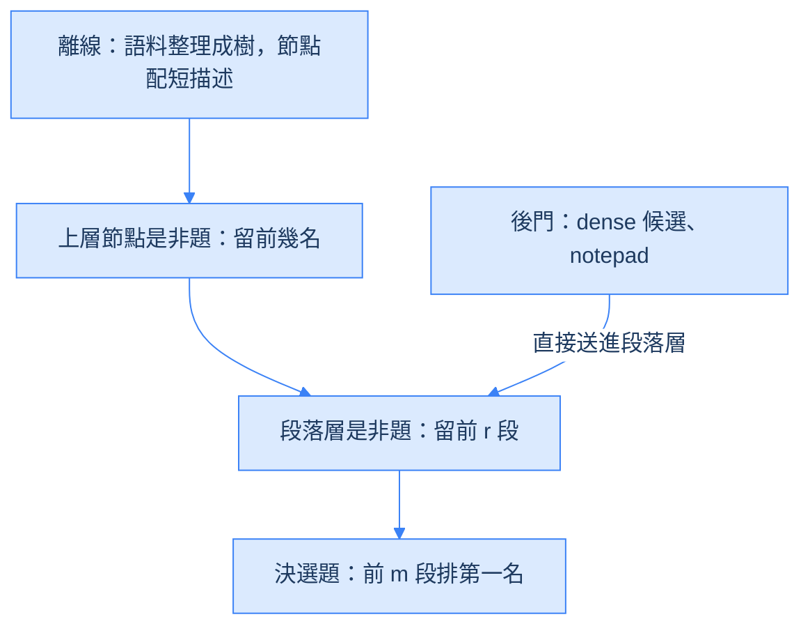

<!--more-->

## RAG 裡最跟不上的一環，是檢索器

RAG（先從語料裡找出相關段落，再讓 LLM 根據這些段落回答）裡，生成答案的 LLM 越換越強，負責決定「它能看到什麼」的**檢索器**卻還是 **BM25**（比對字面關鍵字的傳統做法）或**向量檢索**（把文字轉成向量，找意思最接近的段落）。檢索器漏掉的段落，LLM 再強也看不到。**DecisionRAG** 的做法是乾脆不讓檢索器先篩：把語料整理成一棵樹，從上往下每一層都由一個模型判斷哪些分支值得往下翻，而且全程不生成任何 token。

這個模型論文稱為**決策模型**：它不逐字寫出答案，而是直接對每個選項給出機率。問它「這頁值不值得翻？」，它回的是 yes 的機率，而不是一段文字。論文用的 [Jev 1.13](../../ai-concept/jev-overview/) 是供應商的線上服務，只能透過 API 使用，模型大小未公開。

結果是準確度和最強的「向量檢索 + GPT-5 **重排序**」大約打平（重排序：先讓檢索器撈一批候選，再交給更強的模型重新排名次），延遲快一個數量級。但這篇也有不少要打折看的地方：四個資料集的最佳成績，其實都出自「混入向量檢索候選」的混合版，論文標榜的「retriever-free」（無檢索器）名不符實。

接下來先講問題和方法，再看實驗數字，然後整理使用前要知道的限制，以及兩個脫離這篇論文也用得上的概念；幾個容易誤會的細節放在文末的延伸追問。


沒有標示的是論文內容；標「（推論）」的是筆記作者的推測；標「（自編）」的是為了說明而自己編的數字；標「（一般知識）」的是論文以外的背景。論文沒交代清楚的地方，會直接寫「論文未說明」。


論文：[DecisionRAG（arXiv 2610.35868v1）](https://arxiv.org/abs/2610.35868v1)（Cornell、ASAPP，2026/10）

## 檢索器漏掉的，生成模型再強也救不回來

在 RAG 裡，決定生成模型能看到什麼的是檢索器，而檢索器遠比生成模型笨。檢索器漏掉的證據，生成模型再強也救不回來。論文把這叫做**能力不對稱**（capability asymmetry）。



舉個具體的查詢，這也是全文會一路用到的例子：「Christopher Nolan 2000 年那部電影的主角是誰？」要答這題，得先推出「Nolan 的 2000 年作品是 Memento」，才知道該去 Memento 頁面找介紹主角 Leonard Shelby 的段落。麻煩的是，「Memento」這個詞根本不在查詢裡。

- **BM25** 只比字面，會把標題剛好含「2000」和「film」的 Gladiator (2000 film) 排在 Memento 前面。
- **Dense retrieval**（向量檢索）把查詢和段落分開轉成向量再比對，同樣沒有機會在讀過查詢之後做「先推出 Memento」這一步推理。



### 現有補救做法，各自卡在一處

現有的補救做法大致有兩條路。**重排序**讓強模型參與判斷，但它只能在第一階段撈回來的候選裡排，漏掉的找不回來。**生成式導航**則讓 LLM 自己逐步搜尋，或沿著文件階層逐字寫出要保留的分支；找得回來，但每一步都要等模型寫字，很慢。

| 做法 | 強模型參與判斷？ | 能找回第一階段漏掉的？ | 速度 |
| --- | --- | --- | --- |
| BM25／dense retrieval | 否 | 不適用 | 快 |
| 重排序（reranker） | 是，但只看第一階段的候選 | 否 | 中 |
| 生成式導航（LLM 逐步搜尋，或沿文件階層逐字寫出要保留的分支） | 是 | 是 | 慢 |
| DecisionRAG 想達成的 | 是 | 是 | 快 |

從這張表可以整理出三個挑戰：

- **不依賴第一階段檢索器**：強模型要直接決定「看什麼」，而不只是重排別人挑好的。
- **不能逐字生成**：每一步判斷都要快。
- **規模**：語料可達數百萬段，不可能讓模型逐段讀過。

小結：要讓強模型直接挑資料、判斷又要快、還要撐得住大語料。下一節看 DecisionRAG 怎麼同時做到這三件事。

## DecisionRAG 怎麼找資料：沿著語料樹一層層出題

先給 30 秒版本。離線先把語料整理成一棵樹；上線時，決策模型（下文稱「**審查員**」）在每一層對所有候選各出一題**是非題**（這個候選值不值得往下看？），只留前幾名（例如固定前 \( k \) 名，或過某個機率門檻）；到段落層留前 \( r \) 段，最後對前 \( m \) 段出一題**決選題**（這些段落裡哪一段最相關？）。比喻成在圖書館找資料，就是先看分區，再挑書，最後翻到段落。

### 先建一棵樹，再一層層往下篩

- **離線（只建一次）**：把語料整理成「分群 → 頁面 → 段落」這類階層樹，每個節點配一段短描述（做法見〈語料樹從哪來〉）。
- **上線（每個查詢都走一遍）**：審查員在三個地方出題。前兩個是是非題（上層節點篩選、段落篩選），最後一個是決選題（排第一名）。
- **兩個可選的補救後門**：**dense 候選**（另外用向量檢索撈一批段落補進來）和 **notepad**（多輪對話時記住最近用過的頁面），都把段落直接送回段落層（見〈剪錯就救不回來，所以留了兩個後門〉）。

### 是非題：讀一次 context，同時回答每個候選

每個候選各自一題 yes／no，所有題目共用同一個 **context**（模型這一次讀進去的全部輸入，在這裡是使用者問題加上所有候選的描述），並在一次 **forward pass**（模型把輸入從頭算到尾、直接得出輸出，不逐字生成）裡全部答完。（題目之間怎麼做到互不干擾、又能一次算完，後面〈兩個脫離這篇論文也用得上的概念〉的第一個概念會拆開講。）寫成式子是論文 Equation 2：

$$
p_i^{\text{bin}} = P(\text{Yes} \mid s,\ Q_i)
$$

- \( s \)：共享 context，也就是使用者問題加上所有候選的描述。
- \( Q_i \)：第 \( i \) 題，例如「回答問題所需的資訊在頁面 \( i \) 裡嗎？」
- \( p_i^{\text{bin}} \)：第 \( i \) 個候選的分數，拿來排序和**剪枝**（把分數低的分支剪掉，這個查詢不再往下看）。



每題的機率只在自己的 yes 和 no 之間分配，所以跨題加總不必是 1。圖 3(a) 的示意值是 Memento (film) 0.96、Christopher Nolan 0.81、Gladiator (2000 film) 0.07，加起來 1.84。因為每題獨立，候選數只受 context 長度限制；一層太大時就拆成多個平行請求，最後合併分數排序。

### 同一張桌子：分數為什麼能互相比較

題目之間彼此看不到，但所有候選都寫在同一個 context 裡，就像所有應徵者圍著同一張桌子一起面試，每一題都是在「看過全部對手」的條件下作答。有更好的候選在場時，原本看起來還不錯的候選分數就會被壓低。

舉個例子（自編，下表數字僅為示意）：

|  | 分開判斷：每個請求只放一段 | 一起判斷：同一個 context |
| --- | --- | --- |
| A：主角是 Leonard Shelby（真答案） | 0.85 | 0.93 |
| B：Nolan 的電影生涯（相關但沒有答案） | 0.88 | 0.30 |
| 排第一 | B（錯） | A（對） |

分開判斷時，兩個分數不是同一把尺量出來的，放在一起排序就會出錯。


分數仍然是各自的二選一，「壓低對手」的效果要靠模型自己學會。論文 6.2 節把這個效果叫 calibration（校準），但用法比統計上的原意寬鬆，實際指的是「分數彼此可比」。


### 決選題：最後一步只排第一名

到了最後，對前 \( m \) 段只出一題「哪一段最相關？」。這次不是每段各自回答 yes／no，而是所有候選搶同一份機率，加起來剛好是 1（論文 Equation 3）：

$$
p_i^{\text{mul}} = P(a_i \mid s,\ Q,\ \mathcal{A}), \qquad \sum_{i=1}^{m} p_i^{\text{mul}} = 1
$$

這裡的 \( s \) 是新組的 context，只放問題和前 \( m \) 段；\( Q \) 是那一題；\( \mathcal{A} = \{a_1, \dots, a_m\} \) 是 \( m \) 個段落選項。圖 3(b) 的示意值是主角段落 0.91、「讓 Nolan 一舉成名」那段 0.09。

|  | 是非題 | 決選題 |
| --- | --- | --- |
| 用在哪 | 每一層篩選 | 只在最後一步 |
| 目標 | 召回：不要漏 | 第一名排對 |
| 候選上限 | 只受 context 長度限制 | 最多 255 個選項（Jev 的限制） |
| 機率怎麼分 | 每題各自在 yes／no 之間分 | 所有候選搶同一份 1 |

實際設定是 \( m = 20 \)（Natural Questions 為 5）。前 \( m \) 名照決選機率重排，其餘維持是非題的排序。MTRAG 資料集比較特別，只把決選第一名提到最前面，原因論文未說明。

### 走一遍：Nolan 這題在三個階段各看到什麼

把 Nolan 那題完整走一遍。每個階段都重新組一個 context：「使用者問題 + 編號的候選描述（依所屬頁面分組、按閱讀順序）」，後面接題目。上一階段的分數不會帶進下一階段的輸入（論文 Appendix B.1）。

**階段 ①：頁面層是非題**

- 看到：問題；頁面 1 Memento (film)；頁面 2 Christopher Nolan；頁面 3 Gladiator (2000 film)；…其餘候選標題。
- 問：每頁一題「回答問題所需的資訊在頁面 n 裡嗎？」（yes／no），同一次 forward pass 答完。
- 得到：每頁一個 \( P(\text{Yes}) \)，例如 0.96、0.81、0.07，加總 1.84（圖 3(a)）。
- 用途：留前 \( k \) 頁，展開它們的全部段落。

**階段 ②：段落層是非題**

- 看到：問題；Memento (film) 底下的段落 1「主角是 Leonard Shelby…」、段落 2「讓 Nolan 一舉成名…」；Christopher Nolan 底下的段落 3「Nolan 的婚姻…」。
- 問：每段一題「第 n 段含有回答問題所需的資訊嗎？」
- 得到：每段一個 \( P(\text{Yes}) \)，彼此獨立，加總不必為 1。
- 用途：排序後留前 \( r \) 段，前 \( m \) 段進階段 ③。

**階段 ③：決選題**

- 看到：新組的 context，只放問題和前 \( m \) 段。
- 問：一題「哪一段最相關？」，選項就是這 \( m \) 段（實際問句論文未給，圖 3(b) 只是示意）。
- 得到：一個機率分布，例如 0.91、0.09，加總為 1。
- 用途：前 \( m \) 名照這個分布重排，第 \( m+1 \) 到 \( r \) 名維持階段 ② 的順序。

頁面的描述依資料集而定：MD2D 與 MTRAG 用標題加章節標題，CQA 用標題加最上層章節標題，NQ 只用標題（四個資料集在〈讀表前要知道的資料集與指標〉介紹）。NQ 在階段 ① 之前還多一層「主題分群」，做法相同；MD2D 則在頁面層之上多一層「說明中心」。

### 剪錯就救不回來，所以留了兩個後門

剪枝是不可逆的：被剪掉的分支，這個查詢就不會再看了。所以每層的預算刻意放寬，用成本換召回。名額可以是固定的前 \( k \) 個，也可以是[機率門檻](../adaptive-k/)。


另外用向量檢索撈前 20 段（ConditionalQA 為 10 段），去重後依頁面與章節、按閱讀順序併入段落層。眉角在於：用了它就需要事先建好向量索引，系統不再是「無檢索器」，比較準確的說法是「導航為主、向量檢索補漏」的混合版。


**notepad** 只用在多輪對話資料集：它記錄最近幾個對話輪中排第一的段落所在頁面。在 MultiDoc2Dial 上，最近 2 個 notepad 頁面的段落會繞過頁面層、直接進段落層。怎麼排序、進來後會不會被選上，以及 MTRAG 的情況，見文末〈notepad 的段落是直接進段落層嗎？〉。

### 語料樹從哪來

每個節點都要有一段短描述給審查員判斷：段落用內文，頁面用標題（有些資料集再加章節標題），群用一句摘要。

有現成結構就沿用，例如 metadata 欄位、HTML 的 h1／h2、網址路徑。樹不必處處一樣深，MTRAG 只替超過 60 段的長頁多插一層章節。沒有結構時（例如 Wikipedia）就先分群再寫描述，做法和背後的道理見〈樹狀導航的上限，由節點描述決定〉。

要分清楚的是：查詢時不需要向量檢索，但建樹時可能會用 **embedding**（把文字轉成的向量）來分群。

小結：DecisionRAG 用是非題一層層篩、用決選題排出第一名，靠「同一張桌子」讓分數彼此可比（這要靠模型自己學會，不是數學保證）；剪錯救不回來，所以留了 dense 候選和 notepad 兩個後門，而前者讓它變成混合版。接下來看這套做法實際準不準、快不快。

## 準確度：和 GPT-5 重排大約打平，混合版小勝

先講結論：準確度和最強的「向量檢索 + GPT-5 重排」大約打平，混合版小勝；延遲快一個數量級，但成本只在小語料上佔優。這一節看準確度，下一節看速度和成本。

### 讀表前要知道的資料集與指標

論文在四個資料集上測，涵蓋客服對話、政府指南、技術文件和 Wikipedia：

| 資料集 | 內容 | 規模 | 每題正確段落數 |
| --- | --- | --- | --- |
| MultiDoc2Dial（MD2D） | 美國政府說明中心的多輪客服對話 | 413 頁、4,110 段；4,201 輪 | 1 |
| ConditionalQA（CQA） | 英國政府指南的情境題 | 652 頁、5.8 萬段；271 題 | 1–22 |
| MTRAG | IBM Cloud 技術文件的多輪對話 | 8,578 頁、7.2 萬段；188 輪 | 1–7 |
| Natural Questions（NQ） | 真實搜尋問題，答案在 Wikipedia | 10.9 萬頁、268 萬段；500 題 | 1–3 |

- **R@k（Recall@k）**：正確段落中有幾成出現在前 \( k \) 名，衡量「有沒有找回來」。MD2D 每題只有 1 個正確段落，所以它的 R@1 就等於「第一名對不對」。
- **Hit@1**：第一名剛好是正確段落之一的題目比例，衡量「第一名排對沒有」，用在正確段落不只一個的資料集。

各資料集的主指標：MD2D 看 R@1、CQA 看 Hit@1、MTRAG 看 R@5、NQ 看 Hit@1。


MTRAG 的正確答案有一部分是 GPT-5 補標的，而 GPT-5 同時也是被比較的 baseline（論文 Appendix A.3）。


### 主表：真正的對手是 GPT-5 重排

主表比的是沒有針對任務訓練過的各種方法。除了 BM25 和向量檢索（Dense，用 Qwen3-Embedding-8B），還有 **SPLADE++**（讓模型學出每個關鍵字的權重，比 BM25 聰明一點的關鍵字檢索）、兩種專門訓練的 reranker（Qwen3-Reranker-8B 和 BGE），以及讓 GPT-5 重排向量檢索的前 20 段。數字是各資料集的主指標（%）：

| 方法 | MD2D R@1 | CQA Hit@1 | MTRAG R@5 | NQ Hit@1 |
| --- | --- | --- | --- | --- |
| BM25 | 20.6 | 24.7 | 18.8 | 16.4 |
| SPLADE++（學出來的關鍵字權重） | 24.4 | 28.4 | 27.8 | 36.0 |
| Dense（Qwen3-Embedding-8B） | 27.9 | 47.2 | 26.0 | 46.2 |
| Dense 前 100 + Qwen3-Reranker-8B | 33.6 | 64.6 | 32.5 | 48.0 |
| Dense 前 100 + BGE 重排 | 22.8 | 53.1 | 14.5 | 54.8 |
| Dense 前 20 + GPT-5 重排 | 47.5 | 73.4 | 31.8 | 60.8 |
| **DecisionRAG 純導航** | 47.4 | 69.7 | 34.2 | 65.4 |
| **DecisionRAG + dense 候選** | 48.5 | 73.4 | 36.6 | 66.4 |

從主表可以讀出三件事：

- **真正的對手是 GPT-5 重排。** 純導航版對它的差距依序是 −0.1、−3.7、+2.4、+4.6，大約打平；混合版是 +1.0、0、+4.8、+5.6。
- **純導航會漏。** NQ 的 R@10，純導航是 86.7，低於 Qwen3-Reranker 的 89.0，這就是剪枝不可逆的代價；混合版補回到 88.9。
- **論文摘要的數字挑了對手。** 摘要寫的「NQ Hit@1 +17.4」是對 Qwen3-Reranker 比；對同表最強的傳統做法（BGE 54.8）只有 +10.6。

至於 BM25 那一列，它正好量化了開頭說的能力不對稱：NQ 上 BM25 的 Hit@1 只有 16.4，DecisionRAG 是 65.4（論文 Table 2 也收了 SPLADE++ 和單純 Dense）。不過 BM25 不是 DecisionRAG 真正的對手，拿它來比只會放大提升幅度。要判斷這個方法值不值得用，該對照的是最強的「Dense + GPT-5 重排」。

### 提升來自沿樹導航，還是來自 Jev？

看到這裡會想問：贏的是「沿著樹走」這個做法，還是 Jev 這個模型本身？論文 6.5 節讓 Jev 直接重排向量檢索的前 100 段，打分方式和 DecisionRAG 最後一步完全相同，兩邊只差在「候選從哪來」。CQA 和 NQ 可以和主表用同一批題目串起來。表中數字是 Hit@1（%），括號內是相對左邊一欄的差距；（一般知識）95% CI 是 95% 信賴區間，區間不含 0，表示這個差距不太像是運氣：

| Hit@1（%） | Dense 前 100 + Qwen3-Reranker | Dense 前 100 + Jev 重排 | DecisionRAG + dense 候選 |
| --- | --- | --- | --- |
| CQA（271 題） | 64.6 | 65.7（+1.1） | 73.4（+7.7，95% CI [2.6, 13.3]） |
| NQ（500 題） | 48.0 | 59.4（+11.4） | 66.4（+7.0，95% CI [3.4, 10.8]） |

另外兩個資料集上，導航和 Jev 重排持平，也就是說，四個資料集裡有兩個，導航本身沒有額外貢獻。兩邊的差距都不到 1.5 點：**MD2D**（1,000 輪抽樣）上兩者的 R@1 分別是 49.9 和 51.2，**MTRAG**（只用官方原始標註）上兩者的 R@5 分別是 38.3 和 38.7；不過本文的資料來源沒有標明哪個數字屬於哪個方法。這兩組的評估範圍和主表不同，所以不能和主表的數字直接比。

**觀察一：Jev 重排勝過 Qwen3-Reranker。** 這打破的不是「檢索之後要重排」，而是「重排就該用專門訓練的 reranker」。兩者其實有兩個差別，論文沒有拆開：一是模型本身（[通用決策模型](../jevact/) vs 專用 8B reranker），二是打分方式（100 段放進同一個 context 一起判斷再加決選題 vs 每對問題與段落各自打分）。幅度也看資料：NQ 差 11.4 點，CQA 只差 1.1 點。

**觀察二：導航勝在排得準，不是找得全。** 向量檢索的前 100 名其實更常包含正確段落（NQ 98.4% 對 94.0%；CQA 98.5% 對 91.1%）。但只看兩邊都包含正確段落的題目，導航把它排第一的比例更高（NQ 70.1% 對 61.9%；CQA 76.7% 對 67.3%）。論文作者推測，原因是導航把整頁段落按閱讀順序交給審查員，向量檢索給的卻是來自不同頁面的零散段落；這個解釋沒有經過實驗驗證。

小結：DecisionRAG 和 GPT-5 重排大約打平，混合版小勝。光是讓 Jev 直接重排向量檢索的結果，就已經勝過專用 reranker（NQ 差 11.4 點、CQA 只差 1.1 點；這是模型本身還是打分方式的功勞，論文沒拆開）；沿樹導航的額外貢獻只在 CQA 和 NQ 上看得到，而且贏在排序，不在召回。

## 速度：快一個數量級，但要看跟誰比

準確度打平之後，DecisionRAG 主打的是速度。這一節分兩步看：先看和 reranker、GPT-5 重排的延遲與成本，再看全篇最乾淨的一個比較。

### 延遲與成本：倍數不是公平的加速比

延遲是每查詢的中位數秒數，成本是每查詢的 API 費用（美分）。DecisionRAG 的計時在四個資料集上只用了 48、50、24、100 個查詢（論文 Table 15）。

|  | MD2D | CQA | MTRAG | NQ |
| --- | --- | --- | --- | --- |
| 延遲：Dense + Qwen3-Reranker | 7.5 | 3.3 | 14.3 | 5.8 |
| 延遲：Dense + GPT-5 重排 | 11.8 | 14.4 | 12.2 | 15.0 |
| 延遲：DecisionRAG | 0.68 | 0.82 | 1.76 | 1.73 |
| 成本：Dense + GPT-5 重排 | 1.40 | 1.20 | 1.90 | 1.40 |
| 成本：DecisionRAG | 0.22 | 0.29 | 1.73 | 2.33 |

這些倍數不能當成公平控制下的加速比，論文 Appendix F 自己也承認，因為兩邊的部署條件差很多：

|  | Qwen3-Reranker 那一列 | DecisionRAG 那一列 |
| --- | --- | --- |
| 模型 | 8B 專用 reranker | Jev 1.13，大小未公開 |
| 硬體 | 單張 RTX A6000，本機執行 | 供應商線上服務，硬體不明 |
| 平行度 | 100 段分批送進同一張 GPU | 每查詢最多同時 8 個請求 |

比較保守的結論是：在論文的測試條件下，「Jev API + 沿樹導航」端到端比「本機單卡 8B reranker」和「GPT-5 重排」快一個數量級；至於決策模型這一類模型本身是不是比 reranker 快，這篇沒有證據。

（推論）從結構上看，把所有候選寫進同一個 context，等於把所有段落串成一條長序列。模型裡讓每個 token 回頭看其他 token 的 **attention** 機制，計算量隨序列長度平方成長，所以這不一定比 **cross-encoder**（把問題和一段放在一起、逐對打分的 reranker 架構）省。


NQ 每查詢 2.33 美分，高於 GPT-5 重排的 1.40，因為頁面層要判斷約 17,500 個標題。另外 Jev 1.13 只能透過 API 使用，換成自訓模型之後的延遲和成本，論文沒有測。


### 同一棵樹上，判斷比逐字生成快得多

論文 6.3 節保持樹和預算不變，只把審查員換成 GPT-5（低推理強度），讓它讀完一層之後逐字寫出要保留的編號，也就是前面說的生成式導航。兩邊都走 API，這是全篇最乾淨的延遲比較（CQA 271 題；NQ 只用前 100 題，也沒有信賴區間）：

|  | Hit@1 | R@10 | 延遲（秒） | 成本（美分） |
| --- | --- | --- | --- | --- |
| CQA：GPT-5 生成式 | 73.8 | 73.6 | 28.2 | 6.1 |
| CQA：DecisionRAG | 69.7 | 71.9 | 0.82 | 0.29 |
| CQA：DecisionRAG + dense | 73.4 | 76.3 | 0.85 | 0.29 |
| NQ：GPT-5 生成式 | 59.0 | 82.5 | 250.8 | 57.2 |
| NQ：DecisionRAG | 65.0 | 86.5 | 1.73 | 2.33 |
| NQ：DecisionRAG + dense | 64.0 | 88.5 | 1.64 | 2.33 |

準確度互有勝負（CQA 上 GPT-5 多 4.1，NQ 上 DecisionRAG 多 6.0），但延遲差 34 到 145 倍，成本差 21 到 25 倍。NQ 上 GPT-5 每查詢要超過 4 分鐘：它得先讀完整層，再一個個寫出編號，分群層要選 150 個時還常常需要追問補齊。這是全篇最直接支持「決策模型適合做檢索決策」的證據。

小結：和 reranker、GPT-5 重排比的「快一個數量級」，部署條件不對等，只能當參考；同一棵樹上把逐字生成換成判斷的那組比較才乾淨，準確度互有勝負，延遲差 34 到 145 倍。

## 拿來用之前要知道的限制

前面各節提到的限制集中在這裡，細節回到對應段落看：

- **「retriever-free」名不符實**：四個資料集的最佳成績都出自混入向量檢索候選的混合版，它需要事先建好的向量索引（〈剪錯就救不回來，所以留了兩個後門〉）。
- **導航不一定有額外貢獻**：MD2D 和 MTRAG 上，導航和直接用 Jev 重排持平（〈提升來自沿樹導航，還是來自 Jev？〉）。
- **加速比不是公平比較**：硬體、平行度、模型大小都不同；大語料時成本反而比 GPT-5 重排高；Jev 1.13 只能透過 API 用（〈延遲與成本：倍數不是公平的加速比〉）。
- **MTRAG 標註有利益衝突**：部分正確答案由 GPT-5 補標，而 GPT-5 也是 baseline（〈讀表前要知道的資料集與指標〉）。
- **召回上限受節點描述限制**，論文沒有量化（〈樹狀導航的上限，由節點描述決定〉）。
- **沒驗證或論文未交代的部分**：沒驗證的有候選在 context 內的順序偏差、\( P(\text{Yes}) \) 絕對值能不能拿來對門檻；論文未交代的有 MTRAG 的 notepad 行為、決選題的實際問句（見〈走一遍：Nolan 這題在三個階段各看到什麼〉、〈兩個脫離這篇論文也用得上的概念〉與文末〈延伸追問〉）。

## 兩個脫離這篇論文也用得上的概念

DecisionRAG 本身值不值得用，要看你的語料和預算；但它用到的兩個想法，脫離這篇論文也成立。

### 多題共用一個 context：位置編號重疊加遮罩

**適用情境**：一段很長的共同前綴，後面接 N 個彼此獨立的判斷。DecisionRAG 的是非題就是這樣：問題加所有候選描述是前綴，每個候選一題接在後面。其他例子還有同一段文字的 N 個分類題、同一個 prompt 配 N 個回覆交給 reward model 打分。

Jev 內部是不是這樣做，論文未說明；論文說明的是它自訓的開源審查員（Appendix G）：以 Qwen3-Base 為底，把輸出頭（模型最後負責吐出下一個字的那一層）換成評分頭（直接算出 yes 機率的一層，算法見本節最後的摺疊）。它的輸入排法是每個候選一題，題目後面接「no」「yes」兩個選項，全部接在共享 context 之後。

要讓這些題目互不干擾，靠的是兩件事一起做：**位置編號**（模型被告知每個 token 在序列裡排第幾格）讓每一題都從 context 結束處起算，**attention 遮罩**（規定每個 token 能看見哪些 token）讓題目之間彼此不能互看（論文 Appendix G）。用（自編）的長度舉例：

|  | 在序列中實際的格子 | 給模型的位置編號 |
| --- | --- | --- |
| context | 0–999 | 0–999 |
| 題目 1 | 1000–1019 | 1000–1019 |
| 題目 2 | 1020–1044（排在題目 1 後面） | 1000–1024（與題目 1 重疊） |

- **位置編號重疊**：每一題感受到的「自己和 context 的距離」，都和「只有這一題」時一樣。（一般知識）Qwen3 用 **RoPE**（把 token 之間的相對位置編進 attention 的位置編碼方式），attention 看的是相對距離。
- **attention 遮罩**：題目 2 看不到題目 1。少了它，題目 2 會讀到題目 1 的內容，就不再是獨立判斷。

**為什麼要這樣設計？**（推論，論文未說明動機）如果位置照實際順序往後排，越後面的題目離 context 越遠，模型可能偏好或壓低後面的候選。全部從同一個位置起算，題目在位置上就對稱了，「題目排第幾」的偏差就此消除。


候選 1 的描述在 context 開頭、候選 200 在結尾，兩者和題目的距離不同，這部分的偏差沒有被消除，論文也沒測過打亂候選順序會怎樣。另外，選項「no」「yes」的位置編號怎麼排，論文也沒交代。


把它變成一個通用做法，**下面三步要一起做，位置編號和遮罩缺一不可**：

1. 把前綴和 N 個分支串成一條序列。
2. 每個分支的位置編號，都從前綴結束處重新起算。
3. 加 attention 遮罩：每個分支只看得到前綴和自己，看不到其他分支。

算出來的結果等同於把「前綴 + 第 \( i \) 個分支」分開跑 N 次，但前綴只算一次。**好處**是前綴的計算共用，而且每個分支與前綴的相對距離相同，不會因為排第幾而被偏好或壓低。**限制**有三個：

- 前綴內部的順序偏差還在（就是上面那個候選先後的問題）。
- 需要能自己控制位置編號和遮罩，也就是要有開源權重；API 模型做不到。
- 前綴很長時，attention 計算量隨長度平方成長，省下來的部分可能被抵消。

**相關做法**（一般知識）：推論框架的 prefix caching（如 vLLM）會在請求之間共用前綴計算，但不改位置編號；訓練時的 sequence packing 把多筆樣本串接起來並互相遮罩；speculative decoding 的 tree attention 讓多條候選路徑共用前綴。


評分頭不是讓模型生成「yes」這個字，而是比較向量：取題目結尾 token 的向量 \( q \)，以及兩個選項結尾 token 的向量 \( v_{\text{yes}} \)、\( v_{\text{no}} \)，看 \( q \) 比較像哪一個。做法是算餘弦相似度（兩個向量方向有多接近），再乘上學到的溫度 \( \tau \)（上限 100，放大差距用），最後做 softmax 轉成機率：

$$
P(\text{yes}) = \frac{\exp(\tau \cos(q, v_{\text{yes}}))}{\exp(\tau \cos(q, v_{\text{yes}})) + \exp(\tau \cos(q, v_{\text{no}}))}
$$

（自編）舉例：\( \cos(q, v_{\text{yes}}) = 0.30 \)、\( \cos(q, v_{\text{no}}) = 0.10 \)、\( \tau = 20 \)，則 \( P(\text{yes}) = 1 / (1 + e^{-4}) \approx 0.982 \)。Jev 本身是不是也這樣做，論文未說明。


### 樹狀導航的上限，由節點描述決定

回到語料樹。上層做決定時，審查員只看得到節點的短描述，看不到底下的內容。描述看不出某個分支有答案，那個分支就會被剪掉，而且救不回來。所以描述的品質直接決定整個系統的召回上限。論文在 Limitations 承認了這點，但沒有量化。

**沒有現成結構時怎麼建**（論文在 Wikipedia 上的做法，Appendix A.4、B.5）：

1. 每頁取「標題 + 第一句」，轉成向量（e5-base-v2）。
2. 用 k-means（把向量自動分成指定數量群組的經典演算法）分成 1,000 群。
3. 請 LLM（Qwen3-8B）讀每群的頁面標題，寫一句 30 字內的描述。
4. 描述必須點名比較不典型的成員。摘要天生會描述多數成員的主題，少數成員就從描述裡消失了，審查員也就不會為它們保留這一群。這個 prompt 設計沒有做消融驗證（沒有拿掉這條要求來比較）。

**有現成結構時**：章節標題、網址路徑、metadata 都可以當描述；樹不必處處一樣深，只在節點太大的地方多切一層。


（推論）任何「看描述選分支」的路由問題都適用，例如 agent 依工具描述選工具、依 skill 描述選 skill、多 agent 之間分派任務、RAPTOR 的摘要樹、PageIndex 的目錄導航。路由器再強，也受限於它看到的選項描述。


## 重點回顧：DecisionRAG 換掉了什麼、證明了什麼

- **DecisionRAG 把檢索改成沿語料樹往下走**：每一層把所有候選寫進同一個 context，由決策模型一次 forward pass 判斷哪些值得往下翻，最後出一題決選題排第一名；全程不生成 token，純導航版查詢時也不需要第一階段檢索器（但四個資料集的最佳成績，都出自混入向量檢索候選的混合版）。
- **準確度**遠勝 BM25 與「向量檢索 + 8B reranker」，和「向量檢索 + GPT-5 重排」大約打平；混合版在四個資料集上持平或小勝。
- **速度**：同一棵樹上把 GPT-5 的逐字生成換成決策模型的判斷，準確度相當，延遲快 34 到 145 倍。
- **兩個反直覺的結果**：通用決策模型當重排器能勝過專門訓練的 8B reranker；沿樹導航勝在「排得準」，不是「找得全」。
- **兩個通用概念**：多題共用一個 context 時，用「位置編號重疊 + 遮罩」消除題目順序偏差；樹狀導航的召回上限，由節點描述的品質決定。

如果只記一句：先看分區、再挑書、最後翻到段落，每一步都讓模型直接給機率而不是寫字。在同一棵樹上，這讓它比逐字生成的 GPT-5 快 34 到 145 倍；和 reranker、GPT-5 重排比的加速，部署條件不對等，要打折看。接下來可以做三件事：看到「無檢索器」「快一個數量級」這類宣稱時，先問最佳成績是不是混了向量檢索、比較的部署條件是否對等；手上有開源模型要做大量獨立判斷時，試試位置編號重疊加遮罩；設計任何靠描述選分支的系統（工具、skill、文件樹）時，把力氣花在描述上。

## 延伸追問

以下兩個問題各自獨立，不需要按順序讀。

### 同一個 context 放越多候選，判斷會變差嗎？

在這個設計裡，「題目變多」和「context 變長」永遠一起發生，所以真正要問的是：一個請求放越多候選，排序會不會變差？在論文測過的範圍內不會，從 1 個加到大約 50 個反而變好，之後持平。

**固定難度，只改請求大小**（論文 6.2 節，NQ 289 題）：每題固定 200 個候選，拆成每個請求 \( m \) 個，再合併排序。Hit@1 從每請求 1 個的 47.8% 升到 50 個的 54.3%，到 100、200 個都持平（圖 4）。



**非常長的 context**（論文 Appendix F，MTRAG 188 輪）：篩 8,578 個頁面標題時，比較「每請求最多 150k tokens」和「最多 10k tokens」兩種拆法，R@5 與 **nDCG@5**（會考慮名次的排序品質指標）只差 −0.7 和 −0.2 點，信賴區間都包含 0。

**容易誤讀的是圖 5**：候選池從 5 長到 1,000 時，Hit@1 一路下降（1,000 個時 47.6%）。但池子變大時會混進更多 **hard negative**（看起來很像答案、其實不是的段落），題目本身變難了，不能拿來當「context 變長會傷品質」的證據。這張圖該看的是：同樣的池子大小下，一起判斷一直勝過分開判斷。




每題 yes／no 的絕對正確率論文沒測，只測了排序。（推論）\( P(\text{Yes}) \) 的絕對值可能會隨 context 長度漂移，卻不影響排序，所以如果要拿 \( P(\text{Yes}) \) 去對門檻值，這件事沒有被驗證過。另外，排序只測到 200 個候選，長 context 也只測了「篩頁面標題」這一種任務。


### notepad 的段落是直接進段落層嗎？

在 MultiDoc2Dial 上，是。notepad 在三個層級各自是這樣進來的：

| 層級 | notepad 怎麼進來 | 原文講清楚了嗎 |
| --- | --- | --- |
| 說明中心層 | 最近取過的頁面所屬的中心一定保留 | 清楚（B.2） |
| 頁面層 | context 列出 notepad 頁面 | 不清楚，見下 |
| 段落層 | 最近 2 個 notepad 頁面的所有段落直接加入是非題，不經頁面層篩選 | 清楚（4.2、B.2） |

原文對頁面層只有一句「The page-stage context lists the notepad pages.」，可以有兩種讀法：

- **讀法 A**：當作提示資訊，那些頁面仍要靠自己的是非題爭名額，可能被剪掉。
- **讀法 B**：當作額外的候選。

（推論）讀法 A 比較合理，因為說明中心層已經保證那一頁所屬的中心會被保留、那一頁會出現在候選裡；但光看原文沒辦法區分。

三個常見誤解：

- notepad 記的是「最近」不是「名次」：每個對話輪結束後，只有那一輪排第一的段落所屬頁面會移到最前面；連續兩個對話輪落在同一頁，只佔一個位置。
- 段落加入的是段落層的是非題，之後還得擠進前 \( m \) 名才進得了決選題。後門保證「能被看到」，不保證「會被選上」。
- MTRAG 也用 notepad，但它是否也把段落直接加進段落層，論文沒說。
