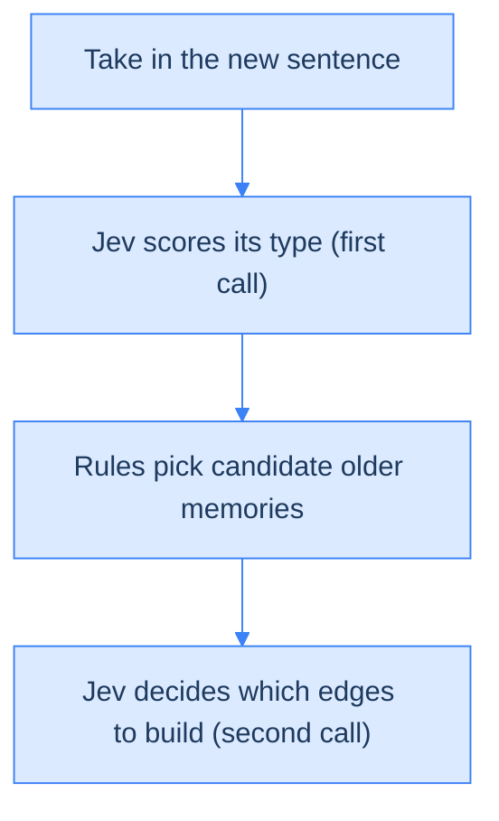

<!--more-->

## An agent's memory hides a string of small judgments

An agent with [long-term memory](../memgpt/) makes a string of small judgments every time it stores a sentence or answers a question. Which older memories does this sentence relate to? Where should I look? Is what I found enough? Asking a big LLM to write out each answer is slow and expensive; hard-coded rules are too rigid. **Jev-Mem**, from Jiang, Li and Li at UT Dallas, makes a simple bet: hand every one of these judgments to **Jev**, a small model that only outputs a score from 0 to 1, and let the big LLM do nothing but write the final answer.

The comparison point is **MAGMA**, an earlier memory system by the same authors and the strongest competitor in the experiments. On **LoCoMo** (a test set of very long, multi-session conversations), Jev-Mem builds its memory about 8.9× faster, answers each question with 37% less latency, and lifts the overall score from 0.700 to 0.777. Most of that gain, though, comes from one kind of question, the **adversarial** ones: they ask about something never said in the conversation, and the right answer is "I don't know".

We'll start with the problem and the big picture, then look at what the memory is made of, how it is written, and how it is read (plan the search, expand outward, decide when to stop), followed by the experiments and the limitations. Last comes a trick that is useful far beyond this paper: **RRF** (Reciprocal Rank Fusion: when merging several search result lists, look only at ranks, not scores). Implementation details mentioned along the way are collected in "Further details" at the end.

Paper: [Jev-Mem: System-One-Controlled Agentic Memory for Efficient AI Agents](https://arxiv.org/abs/2609.23986) (UT Dallas, 2026/09). The authors released code: [libingzheren/Jev-Mem](https://github.com/libingzheren/Jev-Mem).


Unmarked statements come from the paper. "(from the code)" marks implementation details and settings from the official repo and its config file `config/jev_mem.json` that the paper does not state. "(inference)" marks the note author's own judgment, which neither the paper nor the code states directly. "(made-up)" marks examples or numbers constructed for explanation. "(general knowledge)" marks background that is not from the paper.


## The answer is always just yes/no or a score

Spelled out in full, those judgments also include "what kind of memory is this?" and "which of the results is most useful?". They have one thing in common: the answer is a yes/no or a score, not a piece of text.

Existing systems handle these judgments in roughly two ways:

| Approach | Strength | Weakness |
| --- | --- | --- |
| Hard-coded rules | Fast | Rigid |
| Let a big LLM generate text, then parse it | Understands meaning | Slow, expensive |

Worse, these judgments sit right on the path the user is waiting on: every extra big-LLM call is another wait. So the paper sets out to answer three questions:

1. How can a small model run through both writing and reading?
2. Does letting a weak model control memory hurt final accuracy?
3. What memory structure and retrieval process suit this kind of lightweight control?

Recap: there are many judgments, they sit on the user's waiting path, and each answer is just a score. That is exactly the kind of work a score-only small model can take over.

## System One judges, System Two answers

**Jev-Mem has three layers: Jev makes every judgment, and is called System One; in the middle sits the shared memory; the big LLM only writes the final answer, and is called System Two.** The names come from dual-process theory in cognitive psychology; here they only borrow the metaphor of fast intuitive judgment versus slow deliberate thought.

Below is the paper's architecture overview. The top band is writing: a new sentence comes in, Jev judges it, and it is stored. The middle band is the memory itself. The bottom band is reading: starting from the question, Jev keeps deciding where to look, what to keep and whether it has enough, and only then hands over to System Two to answer.

{{< image src="figure2.png" alt="Jev-Mem architecture diagram in three bands. Top band, writing: a new observation goes through Jev typing, a search for related older memories and Jev judging relations, and is then stored. Middle band, the shared memory layer: sentences linked by four kinds of edges (semantic, temporal, causal, entity) over a shared set of search indexes, with a periodic consolidation loop beside it. Bottom band, reading: the question goes through Jev deciding which edges to follow, finds starting points, then repeatedly checks the evidence, expands outward and has Jev score what it finds, and once it stops hands over to System Two to produce the answer." caption="Figure 1 — Jev-Mem at a glance: writing on top, shared memory in the middle, reading at the bottom (Source: original paper, Figure 2.)" >}}

The whole flow can be read as two columns joined by the memory:

|  | Left column: writing | Right column: reading |
| --- | --- | --- |
| What it does | Take in a sentence, pick out related older memories, connect relations | Plan the search, find starting points (anchors), expand outward round by round |
| Jev calls | At most 2 per sentence written | At most 2 per round (stop check, scoring) |
| Shape | A straight line | After scoring, loop back to "is the evidence enough?"; only when it is does System Two get the evidence |

How anchors are chosen comes in "Reading, part two"; the details are in the writing section and the three reading sections.

### Jev doesn't write; it answers a batch of yes/no questions

Jev does not generate text. Each call gives it a "state" (for example, the question and the evidence so far) and a batch of questions. Each yes/no question, which the paper calls a **Noul**, consists of an instruction, a true condition and a false condition, and Jev returns a score in \( [0, 1] \). When exactly one option must be picked, a multiple-choice question (**Choice**) is used instead, returning the chosen option and the distribution. All questions about the same state are asked at once, and since no text is generated, there is nothing to parse. What an actual input looks like is in "What Jev's input looks like" at the end.

Think of it this way: a big LLM is like being asked to write an essay and then digging the answer out of it; Jev is an answer sheet of yes/no questions where each one is filled in directly with a score.


The paper's main text calls these scores "probabilities", but Appendix B.1 says plainly that they are not guaranteed to be calibrated. So thresholds you'll see later, such as 0.60 and 0.95, are engineering settings; do not read them as "60% sure".


Recap: Jev only answers batches of yes/no questions and the big LLM only writes the answer; the scores are engineering numbers compared against thresholds, not confidence levels.

## What the memory looks like: one node per sentence, plus four kinds of edges

**The memory is a graph: one sentence per node, stored once; nodes are linked by four kinds of edges, and one pair of nodes can have several kinds at once.** "Graph" here means the data structure: **nodes** are points (here, sentences) and edges are lines connecting two points. Edges are for this: once one memory is found, follow its edges to bring related memories along with it.

### What edges are for: bringing causes and consequences along

Appendix B of the paper uses an example that this post keeps returning to. The question is "When did Mira buy a new bicycle, and why?", and memory holds two sentences:

- m1: "Mira: My old bicycle broke."
- m2 (said on 5/16): "Mira: I bought a new bicycle yesterday because my old one broke."

The question looks a lot like m2, so similarity alone finds it. m1 comes along by following the causal edge and entity edge built when the memories were written.

(inference) Causal edges are only built when cause and effect are visible in the text (see "Edge-building conditions and edge scores" at the end), and sentences that state a cause usually mention the same thing, so they are easy to find by similarity anyway. So the value of edges is mainly "bring the causes and consequences along", not "find sentences that similarity cannot find at all".

### One observation and the whole memory, in symbols

First, what a sentence looks like when it is stored. The paper writes one observation as three things: content, timestamp and source (the paper's Eq. 4):

$$
o_t = (x_t,\ \tau_t,\ \mu_t)
$$

\( x_t \) is the content. \( \tau_t \) is the timestamp, which records when the sentence was said, not necessarily when the event happened: m2 above was said on 5/16, but it says "yesterday", so the purchase actually happened on 5/15. \( \mu_t \) is the source; the paper does not spell out its fields. Each node also stores an **embedding** (a list of numbers representing a sentence, so that sentences with similar meaning get similar vectors), a list of entities (the people, places and so on the sentence mentions) and four type scores.

The whole memory is four things: all the nodes, one list per kind of edge, plus two "indexes", the entry points used to find memories when reading (the paper's Eqs. 5 and 6):

$$
\mathcal{M}_t = \big(V_t,\ \{E^g_t\}_{g\in\mathcal{G}},\ I^{\text{vec}}_t,\ I^{\text{lex}}_t\big),\quad \mathcal{G}=\{\text{semantic},\ \text{temporal},\ \text{causal},\ \text{entity}\}
$$

\( V_t \) is the list of nodes; \( E^g_t \) is the list of edges of kind \( g \), one list for each of the four kinds; \( I^{\text{vec}}_t \) is the **vector index** (finds sentences with similar meaning via embeddings), and \( I^{\text{lex}}_t \) is the **keyword index** (finds sentences that use the same words). In data-structure terms: a set of nodes, four adjacency lists (one per relation, recording which nodes each node links to), and two indexes.

### How each kind of edge is built

What the four kinds of edges mean and how they are built:

| Edge | Meaning | How it's built |
| --- | --- | --- |
| Semantic | The two sentences are about the same specific topic or fact | Jev judges |
| Causal | One sentence causes or explains the other; directional | Jev judges, one question per direction |
| Entity | They mention the same thing or person | Same name: a rule; different spelling: ask Jev |
| Temporal | Adjacent in time; does not imply a relation | A rule (from the code) |

Entity and semantic edges are easy to confuse; see "Entity edges vs. semantic edges" at the end. How entities are extracted and how temporal edges are linked is in "Entity extraction and temporal edges".

Recap: memory is a graph whose nodes hold the original sentences and whose four kinds of edges bring related memories along. Semantic and causal edges rely on Jev; temporal edges and same-name entity edges rely on rules.

## Writing: a fixed Jev cost per sentence

**For each new sentence: keep it → score its type → let rules pick at most 10 candidates → judge and build edges. At most 2 Jev calls per sentence, a number that does not grow as memory grows.** This is the top band of the architecture figure. **Candidates** are the older memories most likely to relate to the new sentence, the ones worth comparing carefully.



### Keep everything, choose later

The appendix settings switch off the "should this be stored?" filter: every non-empty sentence becomes a node. The reasoning: some remarks look unimportant now, and only a later question reveals that they matter. "Selection" moves to edge-building and reading, so if Jev judges wrongly, the worst case is a missing edge; the sentence itself is still there.

### Give each sentence type scores

This is Jev's first call (the paper's Eq. 7): four yes/no questions asked at once, asking whether the sentence looks like "an event that happened", "a general fact", "steps for doing something" or "a personal preference":

$$
t(v) = \big(t_{\text{episodic}},\ t_{\text{semantic}},\ t_{\text{procedural}},\ t_{\text{preference}}\big)
$$

The names come from [the psychology of memory](../mirix/), but here they are just four yes/no labels, and all four can be high at once. "semantic" here means "general fact" and has nothing to do with semantic edges. These scores are computed and then never used; see "Are the type scores used at all?" at the end.

### Cheap rules pick the candidates first

Next: which older memories should the new sentence be compared with? Comparing with all of them is too expensive, so cheap signals first give every older memory a rough score, and only the top \( K_w = 10 \) become **candidates** (the paper's Eq. 8):

$$
C(v) = \operatorname{TopK}_{u\in V_t}\ s_{\text{cand}}(v,u)
$$

This is a two-stage "rough **pre-filter**, then careful ranking" design: rules roughly pick 10, then Jev looks at those 10 closely. The benefit is a fixed Jev cost per sentence; the price is that an older memory the pre-filter misses can never get an edge.

(from the code) The pre-filter score \( s_{\text{cand}} \) adds up four signals:

| Signal | Points |
| --- | --- |
| Vector similarity | 2 × similarity (only for the top 10 of the vector search) |
| Shared entity | 2 points |
| Keyword overlap ratio | at most 1 |
| Closeness in time | 0.25 ÷ (1 + days apart) |

A side effect: any two sentences from the same speaker get the same +2 for a shared entity (each sentence is stored as "[Mira]: …", so the speaker's name is always extracted as an entity; see "Entity extraction and temporal edges" at the end).

### Jev decides whether to build edges

This is Jev's second call (the paper's Eq. 9). The semantic and two-way causal questions between the new memory and its 10 candidates (plus entity aliases when needed) go out as one batch, and an edge is built only when the score reaches the threshold:

$$
P(g \mid v, u) \ge \theta_{\text{rel}} = 0.60
$$

In words: Jev's score for "new sentence \( v \) and candidate \( u \) have relation of kind \( g \)" must be at least 0.60 to build that edge. Same-name entity edges and adjacent-in-time edges are built directly by rules. The full conditions are in "Edge-building conditions and edge scores" at the end.

### Consolidating every so often

Every 20 writes, a consolidation pass runs on the 20th sentence and its candidates only, and the original sentences are always kept. Jev answers two sets of questions:

- Are they duplicates, contradictory, outdated, or worth an extra link?
- What to do: pick one of "keep separate / merge / generalize / unsure".

Only when the merge or generalize score is ≥ 0.85, the contradiction score is < 0.85, and the system has a **summarizer** (a separately attached LLM that writes several sentences up as one summary) is it asked to write a new entry. Why only the 20th sentence is checked is in "Consolidation only checks every twentieth sentence" at the end.


Suppose that on the 20th write, Mira's sentence "my old bike broke down" has among its candidates her earlier "my old bicycle broke". If Jev judges them duplicates, picks "merge", the score clears the threshold, and a summarizer is attached, the summarizer writes a new merged entry; the two original sentences stay in memory.


Recap: writing is a straight line with at most two Jev calls per sentence; the price of that fixed cost is that older memories the pre-filter misses can never get an edge.

## Reading, part 1: plan the search before setting out

**Before searching outward, Jev looks only at the question and decides three things at once: which kinds of edges to open (routing), how many neighbours each kind may visit (budget), and how many hops to go at most (depth).** They are produced in that order: routing picks the edges, the budget is split by **need scores** (how strongly Jev judges that this question needs that kind of edge), and depth comes last. A "neighbour" here is another node joined to a given node by an edge.

### Routing: which edges to open

Jev gives each kind of edge a need score for "does this question need this kind of edge?", and the edge kind is opened if the score reaches the threshold (the paper's Eq. 12):

$$
p_g(q) \ge \theta_{\text{act}} = 0.10
$$

Each kind is judged on its own, so a question like "when did she buy it, and why?" can open both temporal and causal edges (multi-label). MAGMA, by contrast, could only pick one intent label (WHY or WHEN). On the other hand, for a question like "what does she like to eat?", the temporal and causal need scores might be only 0.05, so those edges are not followed.

During routing, Jev also gives a "does this question care about recency?" score \( r(q) \), which is only used later in "Nudging newer memories up".

### Budget: how many neighbours each edge kind may visit

Think of the budget as "tickets for visiting neighbours": each time you follow an edge to look at a neighbour, you tear off one ticket of that edge kind. There are \( B = 80 \) tickets in total. Each opened edge kind is guaranteed 1, and the rest are shared out in proportion to the need scores (the paper's Eqs. 13 and 14):

$$
b_g = m + \operatorname{LRound}_g\Big[(B - m\,|A|)\cdot \frac{p_g^{\gamma}}{\sum_{j\in A} p_j^{\gamma}}\Big]
$$

- \( B = 80 \) is the total number of tickets.
- \( A \) is the set of opened edge kinds, and \( |A| \) is how many there are.
- \( m = 1 \) is the guaranteed minimum.
- \( \gamma = 1 \) means plain proportional sharing; above 1 concentrates tickets on high-scoring edges.
- \( \operatorname{LRound} \) is largest-remainder rounding: drop the fractions first, then hand the missing tickets to the edges with the largest fractional parts, so the total is exactly \( B \).

Why split into four piles? Temporal and entity edges are built by rules and are dense; in a single pile they would drown out causal edges, which are sparse but crucial.

(made-up) With all four edge kinds open and scores summing to 2.85, 80 − 4 = 76 tickets remain after the minimums:

| Edge | Score | 76 × score ÷ 2.85 | Fraction dropped | Top-up | Plus minimum |
| --- | --- | --- | --- | --- | --- |
| Semantic | 0.50 | 13.33 | 13 | 0 | 14 |
| Temporal | 0.90 | 24.00 | 24 | 0 | 25 |
| Causal | 0.85 | 22.67 | 22 | +1 | 24 |
| Entity | 0.60 | 16.00 | 16 | 0 | 17 |

After dropping fractions the total is 75, 1 short, so the extra ticket goes to the causal edge, which has the largest fraction (0.67). What the 80 stands for and how tickets are spent: see "How tickets are spent" at the end.

### Depth: how many hops at most

Depth is 8 × the multi-hop need score \( h(q) \) (how many hand-offs it takes to reach the answer), rounded up and clamped between 1 and 8 (the paper's Eq. 15):

$$
D(q) = \min\Big\{D_{\max},\ \max\big(1,\ \lceil D_{\max}\, h(q)\rceil\big)\Big\},\quad D_{\max} = 8
$$

For example, \( h(q) \) of 0.05 gives 1 hop, 0.40 gives 4, and 1.00 gives 8. This is only a ceiling: the stop check or running out of tickets ends the search earlier.


(inference, from the config numbers) Anchors are capped at 30, evidence at 60, and each round adds at most 10, so when the anchors are full there is room for only about 3 rounds; under this config, Eq. 15's ceiling of 8 hops is never actually reached.


Recap: before setting out, and looking only at the question, Jev decides which edges to open, how many tickets each gets and how deep to go.

## Reading, part 2: start from the anchors and expand round by round

**Start from the anchors and repeat each round: "follow edges to neighbours → Jev scores them → keep only the top 10", until it is time to stop.** This is the loop in the bottom band of the architecture figure.

### Anchors: where the search starts

**Anchors** are where the search starts. The vector index and the keyword index each produce a ranking, the two are merged with RRF (ranks only, \( k = 60 \); how it works is in "A trick worth keeping: RRF looks at ranks, not scores" below), and the top results become the anchors, the starting evidence (the paper's Eq. 16). (from the code) At most 30 anchors are taken.

### What happens in one round

1. Run the stop check first (see "Reading, part three"); stop if there is enough.
2. From the **frontier** (the nodes added in the previous round), follow the opened edges to neighbours not yet found; every link followed costs one ticket of that edge kind. A neighbour reached by several links is kept only once.
3. One Jev call gives every neighbour 4 scores (the input is shown in "What Jev's input looks like" at the end).
4. Combine them into a total, sort, and add the top 10 to the evidence (how many survive each round is called the **beam width**); they become the new frontier.

Once it stops, the top \( K \) pieces of evidence by total score go to System Two; (from the code) \( K \) is 40.

### How a neighbour's total score is computed

A neighbour's total score is a weighted average of five terms (the paper's Eq. 23). In order: how similar it is to the question; whether it contains a fact the answer needs; whether the edge it came through is useful, multiplied by that edge kind's need score; whether it brings new information; and the average of the edge score stored at write time and "does it support the current evidence". The table below explains each symbol:

$$
s(v \mid q, E_d) = \frac{1}{\sum_{i=1}^{5}\lambda_i}\Big[\lambda_1 z_v + \lambda_2 a_v + \lambda_3\, p_g(q)\,\ell_v + \lambda_4 n_v + \lambda_5 \tfrac{\pi_e + c_v}{2}\Big]
$$

| Symbol | Meaning | Computed by |
| --- | --- | --- |
| \( z \) | Term one: vector similarity between question and neighbour | Rule |
| \( a \) | Term two: does the neighbour contain a fact the answer needs? | Jev |
| \( p \) | Term three (times \( \ell \)): need score of the edge kind it came through (computed during routing) | Jev (routing) |
| \( \ell \) | Term three (times \( p \)): is the link it came through useful? | Jev |
| \( n \) | Term four: does it bring information not yet in the evidence? | Jev |
| \( \pi \) | Term five (averaged with \( c \)): the score stored on this edge at write time (see "Edge-building conditions and edge scores" at the end) | Stored at write time |
| \( c \) | Term five (averaged with \( \pi \)): does it support the current evidence? | Jev |
| \( \lambda_1 \) to \( \lambda_5 \) | (from the code) weights of the five terms: 0.25, 0.35, 0.15, 0.15, 0.10, summing to 1 | Config |

(made-up) Back to "when did she buy it, and why?": B arrives along a causal edge; C arrives along a temporal edge and is just nearby small talk.

| Term (weight) | B score | B weighted | C score | C weighted |
| --- | --- | --- | --- | --- |
| \( z \) (0.25) | 0.60 | 0.150 | 0.55 | 0.138 |
| \( a \) (0.35) | 0.90 | 0.315 | 0.20 | 0.070 |
| \( p \times \ell \) (0.15) | 0.85 × 0.80 | 0.102 | 0.90 × 0.30 | 0.041 |
| \( n \) (0.15) | 0.70 | 0.105 | 0.60 | 0.090 |
| \( (\pi + c) \div 2 \) (0.10) | (0.90 + 0.80) ÷ 2 | 0.085 | (0.50 + 0.30) ÷ 2 | 0.040 |
| Total |  | 0.757 |  | 0.378 |

Most of the gap comes from \( a \) (does it contain a fact the answer needs), the most heavily weighted term; this is also where the need score \( p \) from routing gets multiplied into the total.

### Nudging newer memories up

If the question cares about recency (a high \( r(q) \) from routing), newer neighbours get a small nudge (the paper's Eqs. 24 and 25):

$$
s_e(v) = \frac{s(v) + 0.1\,r(q)\,\rho_v}{1 + 0.1\,r(q)}
$$

Freshness \( \rho_v \) = 1 ÷ (1 + days older than the reference). The reference time \( \tau^* \) (from the code) is "the newest time among the current evidence". Freshness is weighted by \( 0.1\,r(q) \), at most about 9% of the score: truly just a nudge.

Recap: each round follows edges to neighbours, has Jev score them and keeps only the top 10; the heaviest weight in the total goes to "does it contain a fact the answer needs".

## Reading, part 3: stop when the evidence is enough, or when searching more won't help

**Before each round, Jev looks at the question and the evidence in hand and gives four scores; it stops if "the evidence is enough" or "searching more won't help", and otherwise keeps expanding.** The first check happens before any expansion, so if the anchors alone are enough, no edge is followed at all.

The four scores for round \( d \) (the paper's Eqs. 17 to 20):

| Score | Asks |
| --- | --- |
| \( s_d \) | Is the evidence sufficient (every needed fact is backed by a memory)? |
| \( u_d \) | Could another round fill a gap or resolve a contradiction? |
| \( m_d \) | Is necessary evidence still missing? |
| \( c_d \) | Is there an unresolved contradiction? |

Two stopping rules (the paper's Eqs. 21 and 22), with \( \theta_{\text{suff}} = 0.95 \) and \( \theta_{\text{cont}} = 0.15 \) (shared by \( m \), \( c \) and \( u \)). Rule one: the evidence is clearly sufficient, nothing is missing and nothing contradicts, so stop. Rule two: searching more can't fill anything, so stop too.

$$
s_d \ge \theta_{\text{suff}}\ \wedge\ m_d < \theta_{\text{cont}}\ \wedge\ c_d < \theta_{\text{cont}} \ \Rightarrow\ \text{stop: enough}
$$

$$
u_d < \theta_{\text{cont}} \ \Rightarrow\ \text{stop: no use}
$$

The two rules complement each other: the first guards against "finding too little", the second against "never stopping", so the search doesn't pile up more and more distractions. How \( u \) can be judged without seeing the next round is in "How Jev decides whether to keep searching" at the end.

Besides these two, there is a third way to stop: hitting a hard cap (Appendix B.5). Depth, nodes, edges checked, Jev calls, time and tickets all have caps. Only if none of the three triggers does the search go back to another round of "Reading, part two".


- Depth: 8 hops
- Nodes: 60
- Edges checked: 2400
- Jev calls: 16
- 15 seconds
- All four ticket piles used up


(made-up) How the stop check plays out for one question:

| When | \( s \) | \( m \) | \( c \) | \( u \) | Result |
| --- | --- | --- | --- | --- | --- |
| Round zero (only "the old bike broke") | 0.60 | 0.70 | 0.00 | 0.80 | Not enough, worth searching → expand |
| Round one (adds "bought a new bike") | 0.97 | 0.05 | 0.02 | 0.10 | Stop: enough |
| Alternative round one (nothing relevant found) | 0.70 | 0.40 | 0.00 | 0.10 | Stop: no use |

Also, for time questions, the evidence sent to Jev marks each timestamp as "when it was said" and attaches the time words in the sentence, so the conversation date isn't mistaken for the event date (like m2's "yesterday").

Recap: one rule guards against finding too little, one against never stopping, and hard caps catch everything else.

## Experiments: much faster than MAGMA, with the accuracy gain mostly on adversarial questions

**Compared with MAGMA, which has the same architecture, Jev-Mem builds memory about 8.9× faster, cuts query latency by 37% and gains +0.077 overall; most of the accuracy gain comes from adversarial questions.** Know the scope of the evaluation up front: the paper has only two tables, no **ablation study** (removing one component at a time to see how much the score drops), a single test set (LoCoMo), and gpt-4o-mini as the answer-writing model.

### Understanding the metrics first

- **[LoCoMo](../mem0/)**: a test set of very long, multi-session conversations, with five question types (multi-hop, temporal, open-domain, single-hop, adversarial). Adversarial questions ask about things never said in the conversation, and the right answer is "I don't know". (general knowledge; the paper does not explain the question types)
- **LLM-as-a-Judge**: another LLM judges whether an answer matches the reference answer. It measures the **final answer**, not retrieval on its own.
- **Build time**: total seconds to turn a whole conversation into memory.
- **Query latency**: average seconds per question, from retrieval to answer.

The two original tables are below: Table 1 is accuracy, Table 2 is speed. Don't worry if they're hard to read; the next section pulls out the MAGMA and Jev-Mem rows.





### The cleanest comparison: MAGMA vs. Jev-Mem

MAGMA is the same authors' earlier system and the strongest competitor. (from the code) Jev-Mem is built on top of MAGMA, with the control layer swapped for Jev. So this gap is the closest thing to the method's own contribution. The table below is compiled from Table 1 and Table 2:

| Item | MAGMA | Jev-Mem | Difference |
| --- | --- | --- | --- |
| Overall | 0.700 | 0.777 | +0.077 |
| Adversarial | 0.742 | 0.962 | +0.220 |
| Open-domain | 0.517 | 0.618 | +0.101 |
| Multi-hop | 0.528 | 0.623 | +0.095 |
| Single-hop | 0.776 | 0.802 | +0.026 |
| Temporal | 0.650 | 0.637 | −0.013 |
| Build time (s) | 1404 | 158 | about 8.9× faster |
| Query latency (s) | 1.47 | 0.93 | −36.7% |

Speed is the headline: storing a whole conversation drops from 1404 seconds to 158. On accuracy, adversarial questions alone gain 0.220, more than any of the other four types; temporal questions actually lose slightly.

Three things to keep in mind when reading this table:

- The "6.6×" in the paper's abstract is measured against the fastest-building other system, Nemori (1044 seconds), not against MAGMA, which shares the architecture.
- The main text says "tied for best on temporal questions at 0.650", but in Table 1 Jev-Mem scores 0.637, below MAGMA's 0.650. Going by the table, it loses on temporal questions.
- (inference) The big jump on adversarial questions may come from the stopping rule requiring evidence to be "sufficient, complete and consistent" before stopping, which makes it less likely to force an answer out of irrelevant memories. Then again, when memory holds no answer at all, the "worth searching more" score may stay high, so the search may only stop at a hard cap (see "How Jev decides whether to keep searching" at the end).

Recap: about 8.9× faster to build and 37% lower latency, with the overall score up 0.077, mostly from adversarial questions; temporal questions actually lose slightly.

## Limitations to know before you use it

These limitations are scattered through the sections; here they are in one place, to help you decide whether to use the method. First, the ones that affect how to read the results:

- **Thin evaluation.** One test set (LoCoMo), two tables, no ablation study, so there is no way to tell how much each component contributes.
- **Uncalibrated scores.** Jev's scores are not guaranteed to be calibrated, and every threshold is an engineering setting (see "Jev doesn't write; it answers a batch of yes/no questions").
- **Text and table disagree.** The "tied for best" claim on temporal questions does not match Table 1 (see "The cleanest comparison: MAGMA vs. Jev-Mem").
- **Unexplained hyperparameters.** How the budget of 80 was chosen, and which config file in the repo produced Table 1 and Table 2 (from the code: the repo has two), the paper does not say (see "How tickets are spent" at the end).
- **Unknown value of consolidation.** There is no run with consolidation switched off (see "Consolidation only checks every twentieth sentence" at the end).
- **When memory holds no answer, "worth searching more" may stay high.** (inference) The search can then only stop at a hard cap; the paper also doesn't report how often each stopping rule fires (see "How Jev decides whether to keep searching" at the end).

Then the implementation details worth knowing before you change the code:

- **What the pre-filter misses is lost for good.** Older memories outside the top 10 candidates can never get semantic, causal or entity edges (see "Cheap rules pick the candidates first").
- **Type scores go unused.** (from the code) Picking candidates, judging relations and scoring during reading never use them; (inference) of the two Jev calls per sentence, one produces output that affects nothing downstream (what goes to System Two and consolidation were not checked; see "Are the type scores used at all?" at the end).
- **Rule-built edges are broad.** (from the code) Entity edges roughly mean "same speaker" and temporal edges mean "adjacent in time" (see "Entity extraction and temporal edges" at the end).
- **8 hops are never reached.** (inference, from the config numbers) At most about 3 rounds (see "Depth: how many hops at most").
- **Causal edges only catch stated causes.** (inference) They never infer a hidden reason between two sentences (see "Edge-building conditions and edge scores" at the end).
- **Temporal tickets run out first.** (inference) Temporal edges are dense, and two adjacent sentences often share several temporal links (see "How tickets are spent" at the end).
- **"How deep to go" is really decided by rules.** Why depth is passed to Jev, the paper doesn't explain; (inference) what actually controls depth is the hop and node caps (see "What Jev's input looks like" at the end).

## A trick worth keeping: RRF looks at ranks, not scores

**When merging several retrieval result lists, ignore each list's scores and look only at ranks: each list gives a few points by rank, add them up, and re-sort.** Jev-Mem uses it to merge the vector-index and keyword-index results when choosing anchors (the paper's Eq. 16), but the trick is useful well beyond this paper.

### What problem it solves

Different retrievers score on different scales. Vector search gives a similarity from 0 to 1; keyword search (for example **BM25**, a classic algorithm that scores by how often query words appear) can range from 0 to several dozen. Add them directly and the larger-scale list drowns out the other; ranks are always 1, 2, 3…, so they are comparable by nature. RRF works like this: in each list, an item at a given rank gets 1 ÷ (\( k \) + rank) points, and an item's points from all the lists are added up:

$$
\text{RRF}(d) = \sum_{r \in R,\ d \in r} \frac{1}{k + \text{rank}_r(d)},\qquad k = 60
$$

\( d \) is one candidate; \( R \) is the set of result lists, and only the lists that contain \( d \) are summed; \( \text{rank}_r(d) \) starts at 1; a list that does not contain it contributes 0.

### Why it works

- It uses only ranks, so score scales and distributions don't matter: no normalization, no training.
- Taking the reciprocal makes higher ranks count more, and low ranks fade towards zero.
- \( k \) narrows the gaps between the top few ranks.

Here is the last point computed straight from \( 1/(k + \text{rank}) \) (the numbers are from the formula, scaled so that first place is 1):

| Rank | \( k = 0 \) | \( k = 60 \) |
| --- | --- | --- |
| 1 | 1.000 | 1.000 |
| 2 | 0.500 | 0.984 |
| 3 | 0.333 | 0.968 |
| 5 | 0.200 | 0.938 |
| 10 | 0.100 | 0.871 |

With \( k = 0 \), second place is worth only half of first place, so first place dominates; with \( k = 60 \), the top 10 are nearly equal. So the effect of \( k = 60 \) is: **ranking near the top in several lists is worth more than ranking first in one.**

(made-up) X is ranked first in the vector list only; Y is ranked second in both lists:

| \( k \) | X | Y | Winner |
| --- | --- | --- | --- |
| 0 | 1/1 = 1.000 | 1/2 + 1/2 = 1.000 | Tie |
| 60 | 1/61 = 0.0164 | 1/62 + 1/62 = 0.0323 | Y, about twice X |

### How to use it

Where it fits: [hybrid search combining vectors and keywords](../cerebras-rag/), merging results after rewriting one question into several versions, and merging results from several embedding models. Take the top N from each list before fusing, with ranks counted from 1.

```python
def rrf(result_lists, k=60):
    scores = {}
    for results in result_lists:            # each retrieval result list
        for rank, doc_id in enumerate(results, start=1):
            scores[doc_id] = scores.get(doc_id, 0) + 1 / (k + rank)
    return sorted(scores, key=scores.get, reverse=True)
```

The price is losing the size of the scores: whether a list's top result is "extremely relevant" or "barely relevant" looks the same under RRF.

(general knowledge) RRF was proposed by Cormack, Clarke and Büttcher at SIGIR 2009, and \( k = 60 \) is the value the original paper recommends.

Recap: when merging retrieval results, ranks can be added and scores can't; \( k \) makes "near the top everywhere" beat "first in one place".

## Wrapping up: three things to remember

The whole post boils down to three things:

- **Small model judges, big model answers.** When writing, rules first pick at most 10 candidates and Jev only judges whether those pairs get semantic or causal edges, while entity and temporal edges are built by rules; when reading, Jev first plans the search (which edges, how many neighbours each, how many hops), then expands from the anchors round by round, scoring and keeping only the top 10 each round and checking whether the evidence is enough. Jev only outputs scores from 0 to 1; the big LLM only writes the final answer.
- **Much faster, with the accuracy gain concentrated in adversarial questions.** Against MAGMA: about 8.9× faster to build, 37% lower latency, overall score 0.700 → 0.777, mostly from adversarial questions; but the evaluation uses one test set and no ablation, and temporal questions actually lose slightly.
- **RRF is worth taking with you.** When merging several retrieval result lists, look at ranks, not scores.

And back to the three questions raised in "The answer is always just yes/no or a score": the small model runs both writing and reading through "a state plus a batch of yes/no questions"; on LoCoMo, letting a weak model control memory did not drag down the overall score, with only temporal questions slightly worse; and the structure that suits this kind of control is a memory graph of nodes and four edge kinds, paired with a read process of "plan, expand round by round, decide when to stop".

What you can do with this: if you're building agent memory or RAG, check how many steps in your pipeline only need a yes/no or a score; those steps are candidates for a small scoring model. And when merging vector and keyword search results, you can use the few lines of RRF above as they are. As for Jev-Mem itself, until more test sets and ablation studies appear, treat it as a direction worth trying rather than a settled result.

## Further details

The eight topics below are the implementation details the main text points to; read whichever interest you.

### Entity edges vs. semantic edges

**An entity edge asks "do the two sentences mention the same thing or person?"; a semantic edge asks "are the two sentences about the same specific matter?".** The two are independent, and all four combinations can occur.

|  | Entity edge | Semantic edge |
| --- | --- | --- |
| How it's built | Exactly the same entity name → built by a rule; different spelling → ask Jev "is this the same thing?" | Ask Jev for every pair |
| False condition | No shared thing or person | Only shares generic conversational wording, no specific shared topic |

(made-up) The easiest to confuse are the two combinations with only one kind:

| Combination | Example |
| --- | --- |
| Entity edge, no semantic edge | "[Mira]: My old bicycle broke." and "[Mira]: I love pizza.": the same speaker, talking about two different things |
| Semantic edge, no entity edge | Two different speakers both discussing the office and school closures for the same typhoon, with no shared capitalized name in their sentences |

What counts as an "entity" is not defined in the paper; the appendix example lists both Mira and bicycle as entities, but (from the code) only capitalized words are actually picked up (see "Entity extraction and temporal edges").

### Are the type scores used at all?

**The type scores are computed and stored, but never used when finding candidates, judging relations or scoring during reading; they would suit a bonus, not a filter.**

(from the code) Where they are and aren't used:

| Step | Uses type scores? | Basis |
| --- | --- | --- |
| Writing: picking candidates | No | The pre-filter only uses vectors, shared entities, keywords and time |
| Writing: judging relations / Reading: routing, scoring, stopping | No | Nodes sent to Jev carry only id, content, time and entities |
| Reading: total score (Eq. 23) | No | None of the five terms involves type |
| What goes to System Two; consolidation | Not checked | The note author did not review these two parts of the code |

The paper only says the scores are "annotated on the node". (inference) It is a placeholder field; the cost is that of the two Jev calls per write, one produces output that affects nothing downstream.

So could they be used to filter candidates, comparing only with older memories of the same type? Not as a hard filter, for three reasons:

- **It would miss cross-type relations.** (made-up) "I hate traffic jams" (a preference) and "I've started cycling to work" (an event) have a valuable causal edge between them, and a same-type filter would never compare this pair.
- **Types are scores, not labels.** A sentence can be both an event and a preference, so "same type" would need yet another threshold.
- **The pre-filter's job is not to miss things.** Whatever it misses can never get an edge; adding a hard filter only misses more.

| Approach | Effect | Risk |
| --- | --- | --- |
| The paper: ignore type | Never misses anything because of type | Type scores go unused |
| Same type only | More focused candidates | Misses every cross-type causal or preference relation |
| Small bonus for same type | Same type first, other types still have a chance | The bonus size needs tuning |

### Entity extraction and temporal edges

**Entities and temporal edges both come from cheap fixed rules, and both link broadly: an entity edge roughly means "same speaker", a temporal edge means "adjacent in time".** The paper is vague on both; what follows is from the code.

**Entity extraction** is not Jev and not an LLM but a regular-expression rule (matching fixed text patterns): it takes words that start with a capital letter, are longer than 2 characters and are not on a list of common words, plus the pattern "I'm X", up to 5 of them. If the caller supplies its own entity list, that list is used instead, but the LoCoMo runs don't supply one. This has two side effects:

- Each sentence is stored as "[Mira]: …", so the speaker's name is always picked up, and sentences by the same speaker almost always share an entity edge (still only within the 10 candidates).
- Lowercase "bicycle" is missed, and capitalized sentence-initial words are wrongly picked up. (made-up) "[Mira]: Yesterday I went to Paris." yields Mira, Yesterday and Paris.

**Temporal edges** link to unrelated sentences: the rule ignores content and is not limited to the 10 candidates. The two rules:

| Rule | Condition | Direction |
| --- | --- | --- |
| Sequence | The immediately preceding sentence in the same conversation | One edge each way |
| Proximity | Up to 9 sentences back, with a time gap ≤ 24 hours | Old → new |

On LoCoMo this is even more pronounced: every sentence in a session carries the same session date as its timestamp, so the time gap is 0 and a new sentence almost always links to the previous 9. So a temporal edge means "close in time", useful for ordering a timeline and finding context; whether to follow it is decided by routing, and sentences reached that way still have to pass Jev's scoring to stay. The main text's line that "timestamp order directly builds temporal relations" is too loose: two sentences two days apart that are not adjacent get no temporal edge.

### Edge-building conditions and edge scores

**Semantic, causal and entity-alias edges are judged by Jev, only between the new memory and its 10 candidates, with a threshold of 0.60; same-name entities and adjacency in time are handled by rules. Every edge stores a score \( \pi \) when it is built, which is used again when scoring during reading.** Based on Appendix B.2 and the code.

The precondition is candidate status, which only affects semantic, causal and entity edges: a new memory is compared only with the top 10 of the pre-filter (the pre-filter formula is in "Cheap rules pick the candidates first").

| Edge | Must be a candidate? | Judged by | Condition | Direction | Stored \( \pi \) |
| --- | --- | --- | --- | --- | --- |
| Semantic | Yes | Jev | "The two sentences are about the same specific topic" ≥ 0.60 | New → candidate | Jev's score at the time (0.60 to 1) |
| Causal: candidate causes new | Yes | Jev | ≥ 0.60, and the text itself must support causality; mere sequence or same speaker doesn't count | Candidate → new | Same as above |
| Causal: new causes candidate | Yes | Jev | Same as above, asked as a separate question | New → candidate | Same as above |
| Entity: same name | Yes | Rule | Any entity in the two lists is exactly the same | New → candidate | Fixed 1.0 |
| Entity: alias | Yes | Jev | Only when no entity matches, ask "is this the same thing?", ≥ 0.60 | New → candidate | Jev's score at the time |
| Temporal: sequence | No | Rule | The immediately preceding sentence in the same conversation | One edge each way | 0.5 filled in at read time |
| Temporal: proximity | No | Rule | Up to 9 sentences back, with a time gap ≤ 24 hours | Old → new | 0.5 filled in at read time |

(inference) Causal edges only catch causality that is "visible in the text"; they never infer a hidden reason between two sentences. For what that implies, see "What edges are for: bringing causes and consequences along".

A small implementation gap: temporal proximity edges actually store a weight that grows the closer the sentences are, but the reading code looks for a different field name, finds nothing, and fills in 0.5 every time. As a result, in the fifth term of the scoring formula, \( (\pi + c)/2 \), an entity edge (\( \pi = 1.0 \)) always beats a temporal edge (\( \pi = 0.5 \)) by 0.25, which after the weight of 0.10 is a fixed 0.025 added to the total.

How \( \pi \) travels to the reading side (the paper's example, made-up scores): when m2 is written, Jev scores "m1 causes m2" at 0.90 ≥ 0.60, so a causal edge is built and 0.90 is stored on it. When reading later walks from m1 along this edge to m2, the \( \pi \) in the scoring formula's fifth term is 0.90.

### Consolidation only checks every twentieth sentence

**Why twenty, and why only one sentence is checked, the paper never explains; the code checks only that one sentence and its candidates on writes 20, 40, 60….**

The appendix only says "every 20 successful writes, evaluate candidate pairs once", which can be read two ways, and the wording can't settle it:

| Reading | What gets checked | Average extra cost per sentence |
| --- | --- | --- |
| A (what the code does) | Only the 20th sentence and its candidates | About 0.05 Jev calls |
| B | All 20 sentences | About 1 Jev call |

- (inference) The low frequency is about cost. Doing it for every sentence would raise the Jev calls per write from at most 2 to 3, and write speed is exactly this paper's selling point.
- Under reading A, only about 1/20 of sentences are ever consolidated, and which ones depends on the order they were written, not on which need it most.
- The paper has no run with consolidation switched off, and doesn't say whether a summarizer was attached during the experiments, so this mechanism's contribution to accuracy is unknown.

### How tickets are spent

**80 is a fixed, hand-set hyperparameter; the paper doesn't say how it was chosen and runs no sensitivity test. Tickets are spent only when going from an already-found node to a not-yet-found one, and they are spent per link.**

80 counts "at most 80 candidate neighbours proposed", shared across all rounds; it is not 80 edges and not a number of Jev calls. There is also a separate cap of "at most 2400 edges checked". (from the code) The appendix's numbers match the config file `jev_mem.json`, but the code's built-in defaults differ:

| Parameter | Appendix / jev_mem.json | Code's built-in default |
| --- | --- | --- |
| Total budget \( B \) | 80 | 20 |
| Concentration \( \gamma \) | 1.0 | 1.5 |
| Activation threshold | 0.10 | 0.15 |
| Max hops | 8 | 5 |

The repo also has a `jev_mem_accuracy.json` (same budget of 80, different thresholds); the paper doesn't say which one produced Table 1 and Table 2. (inference) 80 doesn't scale with memory size, so it is the first number to retune when moving to a larger memory.

**Ticket rules** (from the code): list every link of a frontier node (outgoing and incoming), and check them one by one:

1. The other end has already been found → skip, no ticket.
2. This edge kind is out of tickets → skip.
3. Otherwise spend 1 ticket of that edge kind and put the other end on the to-be-scored list (being on the list doesn't count as "found").

(made-up) Frontier node A has four links all pointing to B. Each of the four costs a ticket, but B appears only once on the to-be-scored list (keeping the highest-scoring link). In other words, tickets are spent per link, not per neighbour. By contrast, if B was an anchor from the start, all four links are skipped and no ticket is spent.

(inference) This explains why temporal tickets always run out first: temporal edges are dense to begin with, and two adjacent sentences often have 2 to 3 temporal links between them, so each temporal neighbour visited can eat several tickets.

### What Jev's input looks like

**Each call = one shared "state" plus a batch of questions; each question's instruction names the state field to look at, and each question gets one number back.** Think of a reading test: one passage with several questions, each saying "see paragraph so-and-so". Appendix B.1 explains that question ids are only internal identifiers the model never sees, so the location has to be written into the instruction.

Take one candidate-scoring call as an example (the paper's Appendix B.4 example: the evidence already holds m1, and the search follows a causal edge to m2; structure from the code, values made up):

```json
{
  "query": "When did Mira buy a new bicycle, and why?",
  "evidence": [
    {"id": "m1", "content": "Mira: My old bicycle broke.",
     "timestamp": "2024-05-14 10:00", "entities": ["Mira"]}
  ],
  "candidates": [
    {"id": "m2",
     "content": "Mira: I bought a new bicycle yesterday because my old one broke.",
     "timestamp": "2024-05-16 10:00", "entities": ["Mira"],
     "graph": "causal", "source_id": "m1", "target_id": "m2",
     "relation": {"sub_type": "caused_by", "probability": 0.9}}
  ]
}
```

| Question | Instruction | Fields used | Jev's answer (made-up) |
| --- | --- | --- | --- |
| `candidate_0_relevance` (\( a \)) | Does `candidates[0].content` contain a fact the query needs? | Question + neighbour content | 0.93 |
| `candidate_0_relation_usefulness` (\( \ell \)) | Does this edge (kind and direction) connect the evidence to information useful for the query? | Question + link info + evidence | 0.88 |
| `candidate_0_new_information` (\( n \)) | Does it add answer-relevant detail not already in the evidence? | Question + neighbour content + evidence | 0.81 |
| `candidate_0_supports_current_evidence` (\( c \)) | Can it independently corroborate query-relevant claims in the evidence? | Question + neighbour content + evidence | 0.74 |

With several neighbours, the `candidates` list grows and the questions become `candidate_1_…`, `candidate_2_…`, still sent once and returned once. Of the four questions, only \( a \) compares the question with the neighbour; the other three compare the neighbour with the current evidence, so the same neighbour gets different scores when the evidence differs.

What each of the three reading calls sees:

| Call | Input |
| --- | --- |
| Routing | The question only |
| Candidate scoring | Question + top 40 pieces of evidence + all neighbours this round |
| Stop check | Question + top 40 pieces of evidence + current depth |

**Why depth is also passed in, the paper doesn't explain.** It is indeed part of the stop-check state, but all four stop questions name only the query and the evidence, and none asks to look at depth. There are two readings that can't be told apart: either it is background for Jev, nudging it to stop once deep, or it is only recorded and has no effect. The one place in the code where depth clearly affects a decision is the default answer when a Jev call fails: "not enough" at depth zero, "enough" after that. (inference) "How deep to go" is really controlled by rules (the hop and node caps), not by Jev.

### How Jev decides whether to keep searching

**Jev can't see the next round's neighbours; it judges only from "question + evidence in hand". So this question really asks "can you name what's still missing?", not "can the memory store find it?".** Appendix B.5's criteria: true means you can point to a specific missing fact or contradiction and more memories might fill it; false means there is no gap you can point to any more, or more memories are unlikely to help.

An analogy: a detective going through their notes. They don't know what's in the next room, but they can see they "know who did it, but not why", so they decide another search is worthwhile; if the notes are complete, or they can't even say what's missing, they stop searching.

(made-up) Same question, "when did she buy it, and why?":

| Evidence in hand | Visible gap | \( u \) |
| --- | --- | --- |
| Only "bought a new bicycle yesterday" | Has "when", missing "why" | High, e.g. 0.80 |
| "Bought a new bike" plus "because the old one broke" | No gap | Low, e.g. 0.05 |

- (inference) When the memory has no answer at all (a question about something never discussed), Jev can still see "what's missing", so \( u \) stays high and only the caps can stop the search.
- (inference) \( u \) heavily overlaps with \( m \) (missing evidence); the only difference is that \( u \) adds "could searching more fill it?", which Jev has no way of knowing. The paper doesn't report how often each stopping rule fires, so it's impossible to tell what \( u \) actually adds.
