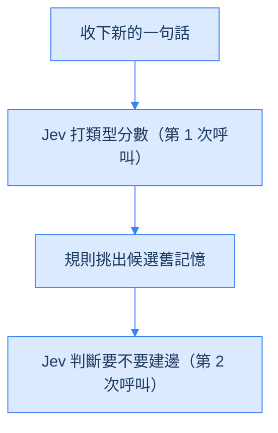

<!--more-->

## agent 的記憶裡，藏著一大串小判斷

一個有[長期記憶](../memgpt/)的 agent，每存一句話、每回答一題，背後都要做一連串小判斷：這句跟哪些舊記憶有關？該往哪裡找？找到的夠不夠？讓大 LLM 一題一題寫字回答，又慢又貴；寫死規則，又太笨。UT Dallas 的 Jiang、Li、Li 提出的 **Jev-Mem**，主張很單純：這些判斷全部交給一個只輸出 0 到 1 分數的小模型 **Jev**，大 LLM 只在最後負責寫答案。

比較的對象是同一組作者先前做的記憶系統 **MAGMA**，也是實驗裡最強的對手。在 **LoCoMo**（一份超長、多場次的對話記憶測驗集）上，Jev-Mem 建構記憶快約 8.9 倍、回答一題的延遲少 37%，總分從 0.700 升到 0.777。不過提升大半來自其中一類「**對抗題**」：問對話裡從沒說過的事，正確做法是回答不知道。

接下來先看問題出在哪、方法的全貌，再看記憶長什麼樣、怎麼寫入、怎麼讀取（訂計畫、往外找、決定何時停），然後是實驗和限制。最後介紹一個脫離這篇論文也很好用的技巧：**RRF**（倒數名次融合：合併好幾份搜尋結果時，只看名次、不看分數）。正文提到的實作細節收在文末的〈延伸細節〉，想深究再看。

論文：[Jev-Mem: System-One-Controlled Agentic Memory for Efficient AI Agents](https://arxiv.org/abs/2609.23986)（UT Dallas，2026/09）。作者有公開程式碼：[libingzheren/Jev-Mem](https://github.com/libingzheren/Jev-Mem)。


沒有標示的是論文內容；標「（依程式碼）」的是論文沒寫、出自官方 repo 的實作與設定檔 `config/jev_mem.json`；標「（推論）」的是筆記作者的判斷，論文與程式碼都沒直接寫；標「（自編）」的是為了說明而自己構造的例子或數字；標「（一般知識）」的是背景知識，不是論文內容。


## 這些判斷的答案，都只是「是／否」或一個分數

前面那串判斷，完整一點還包括「這句是哪種記憶」和「找到的哪個最有用」。它們有個共同點：答案都是「是／否」或一個分數，不是一段文字。

現有系統處理這些判斷，大致走兩條路：

| 做法 | 優點 | 缺點 |
| --- | --- | --- |
| 寫死的規則 | 快 | 死板 |
| 讓大 LLM 逐字生成再解析 | 懂語意 | 慢、貴 |

更麻煩的是，這些判斷就卡在使用者要等的那條路上：每多一次大 LLM 呼叫，使用者就多等一次。論文因此要回答三個問題：

1. 小模型怎麼貫穿寫入與讀取？
2. 讓弱模型控制記憶，會不會拖累最終準確度？
3. 什麼樣的記憶結構與檢索流程，適合這種輕量控制？

小結：判斷很多、又卡在使用者要等的路上，而答案都只是一個分數。這正好是一個只會打分數的小模型能接手的工作。

## System One 判斷、System Two 作答

**Jev-Mem 分三層：Jev 做所有判斷，稱為 System One；中間是共用的記憶；大 LLM 只寫最後的答案，稱為 System Two。** 這兩個名稱借自認知心理學的雙歷程理論，這裡只取「快的直覺判斷 vs. 慢的深思」這層比喻。

下圖是論文的架構總覽。上方是寫入：收下一句話，經過 Jev 判斷後存進記憶；中間是記憶本身；下方是讀取：從問題出發，Jev 一路判斷要往哪裡找、找到的留不留、夠不夠，最後才交給 System Two 回答。



整條流程可以看成左右兩欄，中間由記憶相連：

|  | 左欄：寫入 | 右欄：讀取 |
| --- | --- | --- |
| 做什麼 | 收下一句話、挑出相關的舊記憶、連上關係 | 訂搜尋計畫、找到起點（錨點）、逐輪往外展開 |
| Jev 呼叫次數 | 每寫入一句最多 2 次 | 每一輪最多 2 次（停止判斷、打分） |
| 流程形狀 | 一條直線 | 打分完繞回「證據夠了嗎？」形成迴圈，夠了才交給 System Two |

錨點怎麼選，留到〈讀取之二〉再談；細節分別在〈寫入〉與三個「讀取」章節。

### Jev 不寫字，只回答一批是非題

Jev 不生成文字。每次呼叫，給它一份「狀態」（例如問題和手上的證據）和一批題目。每道是非題，論文稱為 **Noul**，由一句指令、true 條件、false 條件組成，Jev 回傳一個 \( [0, 1] \) 的分數。只能選一個的情況改用選擇題（**Choice**），回傳選中的選項和分布。同一份狀態的多道題一次問完；因為不生成文字，也就不需要解析輸出。實際的輸入長什麼樣，見文末〈Jev 的輸入長什麼樣子〉。

打個比方：大 LLM 像是要你寫一篇作文再從中找答案，Jev 則是一張只有是非題的答案卡，每題直接塗一個分數。


論文正文把這些分數叫「機率」，但附錄 B.1 明說它們不保證經過校準。所以後文出現的 0.60、0.95 這些門檻都是工程設定，不能讀成「有 60% 把握」。


小結：Jev 只回答一批是非題，大 LLM 只寫答案；這些分數是拿來比門檻的工程數字，不是把握程度。

## 記憶長什麼樣：一句話一個節點，加上四種邊

**記憶是一張圖：一句話一個節點，只存一份；節點之間有四種邊，同一對節點可以同時有好幾種。** 這裡的「圖」是資料結構裡的圖：**節點**是一個個點（這裡就是一句句話），**邊**是連接兩個點的線。邊的用途是：找到一條記憶之後，沿著邊把相關的記憶一起帶出來。

### 邊的用途：把前因後果一起帶出來

論文附錄 B 用了一個例子，後文會一路沿用。問題是「When did Mira buy a new bicycle, and why?」（Mira 什麼時候買了新腳踏車，為什麼？），記憶裡有兩句：

- m1：「Mira: My old bicycle broke.」（我的舊腳踏車壞了。）
- m2（5/16 說的）：「Mira: I bought a new bicycle yesterday because my old one broke.」（我昨天買了新腳踏車，因為舊的壞了。）

問題和 m2 很像，直接用相似度就能找到；m1 則是沿著寫入時建好的因果邊、實體邊被一起帶出來的。

（推論）因果邊只在「文字裡看得出因果」時才會建立（見文末〈建邊條件總整理與邊分數〉），而明講因果的句子通常會提到同一件事，本來就容易被相似度找到。所以邊的價值主要是「把前因後果一起帶出」，而不是「找到相似度完全找不到的句子」。

### 用符號寫下一筆觀察與整份記憶

先看一句話存進來時長什麼樣。論文把一筆觀察寫成三個東西：內容、時間戳、來源（論文式 4）：

$$
o_t = (x_t,\ \tau_t,\ \mu_t)
$$

\( x_t \) 是內容。\( \tau_t \) 是時間戳，記的是「這句話被說出的時間」，不一定是事件時間：上面的 m2 是 5/16 說的，但它說「yesterday」，購買其實發生在 5/15。\( \mu_t \) 是來源，具體欄位原文未交代。節點另外還存 **embedding**（把一句話轉成一串數字的向量，意思相近的句子，向量也相近）、實體清單（句子提到的人名、地名等）和四個類型分數。

整份記憶則是四樣東西：所有節點、四種邊各自的清單，再加兩個「索引」，也就是讀取時找記憶的入口（論文式 5、6）：

$$
\mathcal{M}_t = \big(V_t,\ \{E^g_t\}_{g\in\mathcal{G}},\ I^{\text{vec}}_t,\ I^{\text{lex}}_t\big),\quad \mathcal{G}=\{\text{semantic},\ \text{temporal},\ \text{causal},\ \text{entity}\}
$$

\( V_t \) 是節點清單；\( E^g_t \) 是第 \( g \) 種邊的清單，四種各一份；\( I^{\text{vec}}_t \) 是**向量索引**（用 embedding 找意思相近的句子），\( I^{\text{lex}}_t \) 是**關鍵字索引**（找用字相同的句子）。用資料結構的話說：一組節點，搭配四份鄰接串列（每種關係一份，記錄每個節點連到誰），再加兩個索引。

### 四種邊各自怎麼建

四種邊各自的意思和建法：

| 邊 | 意思 | 怎麼建 |
| --- | --- | --- |
| 語意 | 兩句在講同一個具體主題或事實 | Jev 判斷 |
| 因果 | 一句導致或解釋另一句，有方向 | Jev 判斷，正反兩個方向各問一題 |
| 實體 | 提到同一個對象 | 名稱相同用規則；寫法不同才問 Jev |
| 時間 | 時間上相鄰，不代表有關係 | 規則（依程式碼） |

實體邊和語意邊很容易搞混，差別見文末〈實體邊與語意邊怎麼分〉；實體怎麼抽、時間邊怎麼連，見〈實體抽取與時間邊〉。

小結：記憶是一張圖，節點存原句，四種邊負責把相關的記憶一起帶出來；語意、因果靠 Jev 判斷，時間和同名實體靠規則。

## 寫入：每句話的 Jev 成本固定

**每來一句話：全部收下 → 打類型分數 → 規則挑最多 10 個候選 → 判斷並建邊。每句最多 2 次 Jev 呼叫，不會隨記憶庫變大而增加。** 這是架構圖的上方那一段。**候選**指的是最可能和新句子有關、值得仔細比對的舊記憶。



### 全部收下，挑選留到之後

附錄的設定關閉了「要不要存」的過濾，所有非空的句子都會成為節點。理由是：有些話當下不重要，要等之後的問題出現才知道它有用。「挑選」被移到建邊與讀取兩處，所以 Jev 判斷錯，頂多少一條邊，原句還在。

### 替每句話打類型分數

這是第 1 次 Jev 呼叫（論文式 7）：四道是非題一次問完，分別問這句話像不像「發生過的事件」「一般性事實」「做事的步驟」「個人喜好」：

$$
t(v) = \big(t_{\text{episodic}},\ t_{\text{semantic}},\ t_{\text{procedural}},\ t_{\text{preference}}\big)
$$

名稱借自[認知心理學的記憶分類](../mirix/)，但在這裡只是四個是非題標籤，可以同時都高。這裡的 semantic 指「一般性事實」，和語意邊無關。這組分數算了，後續卻沒有用到，見文末〈類型分數到底有沒有用〉。

### 便宜的規則先挑候選

接著要決定新句子該跟哪些舊記憶比。全部比太貴，所以先用便宜的訊號替所有舊記憶打一個粗分，只取前 \( K_w = 10 \) 名當**候選**（論文式 8）：

$$
C(v) = \operatorname{TopK}_{u\in V_t}\ s_{\text{cand}}(v,u)
$$

這是「先**粗篩**、再精排」的兩段式：規則先大略篩出 10 個，Jev 再仔細判斷這 10 個。好處是每句的 Jev 成本固定；代價是：粗篩沒選上的舊記憶，永遠建不了邊。

（依程式碼）粗篩分數 \( s_{\text{cand}} \) 是四個訊號相加：

| 訊號 | 分數 |
| --- | --- |
| 向量相似度 | 2 × 相似度（只加給向量搜尋前 10 名） |
| 共同實體 | 2 分 |
| 關鍵字重疊比例 | 最多 1 |
| 時間接近 | 0.25 ÷（1 + 相差天數） |

副作用是：只要是同一個說話者，就會因為共同實體拿到同樣的 +2（每句存成「[Mira]: …」，說話者名字一定被抽成實體，見文末〈實體抽取與時間邊〉）。

### Jev 判斷要不要建邊

這是第 2 次 Jev 呼叫（論文式 9）。新記憶和 10 個候選之間的語意、雙向因果（必要時加實體別名）合成一批題目一次問完，分數到門檻才建邊：

$$
P(g \mid v, u) \ge \theta_{\text{rel}} = 0.60
$$

式子的意思是：Jev 判斷「新句 \( v \) 和候選 \( u \) 之間有第 \( g \) 種關係」的分數，至少要 0.60 才建這條邊。實體名稱相同、時間相鄰這兩種則由規則直接建。完整條件見文末〈建邊條件總整理與邊分數〉。

### 每隔一段時間做一次整理

每 20 次寫入做一次整理，只針對第 20 句和它的候選，原句一律保留。Jev 要判斷這兩組問題：

- 它們之間是否重複、矛盾、過時，或值得補一條連結？
- 該怎麼處理：在「分開／合併／歸納／不確定」中選一個。

只有在合併或歸納的分數 ≥ 0.85、矛盾 < 0.85，而且系統有提供**摘要器**（另外接上、負責把幾句話寫成一條摘要的 LLM）時，才會請它寫出新條目。為什麼只看第 20 句，見文末〈定期整理只檢查第二十句〉。


假設輪到第 20 次寫入時，Mira 這句「我那台舊車壞掉了」的候選裡，有她之前說過的「我的舊腳踏車壞了」。如果 Jev 判斷兩句重複、選了「合併」，分數也過了門檻，而且系統有接上摘要器，摘要器就會寫出一條新的合併條目；原本的兩句仍然留在記憶裡。


小結：寫入是一條直線，每句最多問 Jev 兩次；成本固定的代價，是粗篩沒挑中的舊記憶永遠建不了邊。

## 讀取之一：出發前先訂搜尋計畫

**往外找之前，Jev 只看問題，一次決定三件事：開哪幾種邊（路由）、每種邊能看幾個鄰居（預算）、最多走幾層（深度）。** 三者依序產生：先路由決定開哪些邊，再按需求分數（Jev 判斷「這題需要走這種邊」的程度）分預算，最後算深度。這裡的「鄰居」是指和某個節點有邊相連的另一個節點。

### 路由：開哪幾種邊

Jev 替每種邊各打一個「這題需要走這種邊嗎」的需求分數，到門檻就開啟（論文式 12）：

$$
p_g(q) \ge \theta_{\text{act}} = 0.10
$$

每種邊各自判斷，所以像「何時買、為何買」這種題目，可以同時開時間邊和因果邊（多標籤）。MAGMA 則是只能選一類的單標籤意圖（WHY 或 WHEN）。反過來，「喜歡吃什麼」這類題，時間與因果的需求分數可能只有 0.05，就不走這兩種邊。

路由時 Jev 還會順便打一個「這題在不在意新舊」的分數 \( r(q) \)，留到後面〈替比較新的記憶輕推一下〉才用到。

### 預算：每種邊能看幾個鄰居

可以把預算想成「看鄰居的票」：每沿一條邊看一個鄰居，就撕一張那種邊的票。總共 \( B = 80 \) 張，每種開啟的邊先保底 1 張，剩下的按需求分數的比例分（論文式 13、14）：

$$
b_g = m + \operatorname{LRound}_g\Big[(B - m\,|A|)\cdot \frac{p_g^{\gamma}}{\sum_{j\in A} p_j^{\gamma}}\Big]
$$

- \( B = 80 \) 是總票數。
- \( A \) 是開啟的邊，\( |A| \) 是種數。
- \( m = 1 \) 是保底。
- \( \gamma = 1 \) 表示單純照比例；大於 1 會更集中給高分的邊。
- \( \operatorname{LRound} \) 是最大餘數取整：先捨去小數，差幾張就補給小數部分最大的邊，總數剛好等於 \( B \)。

為什麼要分開成四疊？時間邊、實體邊由規則建立，連得很密；不分疊的話，會淹沒稀疏但關鍵的因果邊。

（自編）四種邊都開啟，分數總和 2.85，保底後剩 80 − 4 = 76 張：

| 邊 | 分數 | 76 × 分數 ÷ 2.85 | 捨去小數 | 補差額 | 加保底 |
| --- | --- | --- | --- | --- | --- |
| 語意 | 0.50 | 13.33 | 13 | 0 | 14 |
| 時間 | 0.90 | 24.00 | 24 | 0 | 25 |
| 因果 | 0.85 | 22.67 | 22 | +1 | 24 |
| 實體 | 0.60 | 16.00 | 16 | 0 | 17 |

捨去小數後合計 75 張，差 1 張，補給小數部分最大（0.67）的因果邊。80 代表什麼、票怎麼扣，見文末〈預算怎麼扣票〉。

### 深度：最多走幾層

層數的算法是：8 × 多跳需求分數 \( h(q) \)（這題需要轉幾手才找得到答案），無條件進位後夾在 1 到 8 之間（論文式 15）：

$$
D(q) = \min\Big\{D_{\max},\ \max\big(1,\ \lceil D_{\max}\, h(q)\rceil\big)\Big\},\quad D_{\max} = 8
$$

例如 \( h(q) \) 為 0.05 時是 1 層、0.40 時 4 層、1.00 時 8 層。這只是上限，停止判斷或票用完都會提早結束。


（推論，依設定檔數字）錨點最多 30、證據上限 60、每輪最多加 10，所以錨點填滿時最多只能展開約 3 輪；式 15 的 8 層上限在這份設定下實際上走不到。


小結：出發前只看問題，就決定好開哪幾種邊、每種邊有幾張票、最多走幾層。

## 讀取之二：從錨點出發，一輪一輪往外找

**從錨點出發，每一輪「沿邊找鄰居 → Jev 打分 → 只留前 10 名」，重複到該停為止。** 這是架構圖下方那個迴圈。

### 錨點：搜尋的起點

**錨點**是搜尋的起點。向量索引與關鍵字索引各給一份排名，用 RRF 合併（只看名次，\( k = 60 \)，原理見後面〈值得帶走的技巧：RRF 只看名次、不看分數〉），排最前面的成為錨點，也就是起始證據（論文式 16）。（依程式碼）錨點最多取 30 個。

### 一輪做哪些事

1. 先做停止判斷（見〈讀取之三〉）；夠了就停。
2. 從「**前線**」（上一輪新加入的節點）沿著已開啟的邊，找還沒找到的鄰居；每走一條連結，撕一張該種邊的票。同一個鄰居被多條連結碰到時只保留一筆。
3. 一次 Jev 呼叫，替所有鄰居各打 4 個分數（輸入見文末〈Jev 的輸入長什麼樣子〉）。
4. 合成總分，排序後取前 10 名加入證據（這個「每輪只留幾名」的寬度稱為**束寬**，beam），成為新的前線。

停下之後，證據依總分取前 \( K \) 條交給 System Two；（依程式碼）\( K \) 是 40。

### 怎麼替鄰居打總分

鄰居的總分是五項的加權平均（論文式 23）。五項依序是：它和問題像不像；含不含回答需要的事實；走過來的那條邊有沒有用，再乘上這種邊的需求分數；帶不帶來新資訊；寫入時存下的邊分數和「能不能佐證現有證據」兩者的平均。各符號的意思見下表：

$$
s(v \mid q, E_d) = \frac{1}{\sum_{i=1}^{5}\lambda_i}\Big[\lambda_1 z_v + \lambda_2 a_v + \lambda_3\, p_g(q)\,\ell_v + \lambda_4 n_v + \lambda_5 \tfrac{\pi_e + c_v}{2}\Big]
$$

| 符號 | 意思 | 誰算的 |
| --- | --- | --- |
| \( z \) | 第 1 項：問題與鄰居的向量相似度 | 規則 |
| \( a \) | 第 2 項：鄰居含有回答需要的事實嗎 | Jev |
| \( p \) | 第 3 項（與 \( \ell \) 相乘）：走過來那種邊的需求分數（路由時算好） | Jev（路由） |
| \( \ell \) | 第 3 項（與 \( p \) 相乘）：走過來的這條連結有用嗎 | Jev |
| \( n \) | 第 4 項：帶來證據裡沒有的新資訊嗎 | Jev |
| \( \pi \) | 第 5 項（與 \( c \) 平均）：寫入時存在這條邊上的分數（見文末〈建邊條件總整理與邊分數〉） | 寫入時存下 |
| \( c \) | 第 5 項（與 \( \pi \) 平均）：能支持現有證據嗎 | Jev |
| \( \lambda_1 \) 到 \( \lambda_5 \) | （依程式碼）五項的權重 0.25、0.35、0.15、0.15、0.10，合計 1 | 設定 |

（自編）延續「何時買、為何買」的問題：B 沿因果邊走來；C 沿時間邊走來，只是相鄰的閒聊。

| 項目（權重） | B 小分數 | B 加權 | C 小分數 | C 加權 |
| --- | --- | --- | --- | --- |
| \( z \)（0.25） | 0.60 | 0.150 | 0.55 | 0.138 |
| \( a \)（0.35） | 0.90 | 0.315 | 0.20 | 0.070 |
| \( p \times \ell \)（0.15） | 0.85 × 0.80 | 0.102 | 0.90 × 0.30 | 0.041 |
| \( n \)（0.15） | 0.70 | 0.105 | 0.60 | 0.090 |
| \( (\pi + c) \div 2 \)（0.10） | (0.90 + 0.80) ÷ 2 | 0.085 | (0.50 + 0.30) ÷ 2 | 0.040 |
| 總分 |  | 0.757 |  | 0.378 |

差距主要來自權重最高的 \( a \)（含不含回答需要的事實）；路由算出的需求分數 \( p \) 也是在這裡乘進總分的。

### 替比較新的記憶輕推一下

如果問題在意新舊（路由時打的 \( r(q) \) 高），就替較新的鄰居輕推一下（論文式 24、25）：

$$
s_e(v) = \frac{s(v) + 0.1\,r(q)\,\rho_v}{1 + 0.1\,r(q)}
$$

新鮮度 \( \rho_v \) = 1 ÷（1 + 比基準早幾天）。基準時間 \( \tau^* \)（依程式碼）是「目前證據中最新的時間」。新鮮度的權重是 \( 0.1\,r(q) \)，最多約占 9%，真的只是輕推。

小結：每輪沿邊找鄰居、Jev 打分、只留前 10 名；總分裡權重最高的，是「含不含回答需要的事實」。

## 讀取之三：證據夠了，或再找也沒用，就停

**每輪開始前，Jev 看問題與手上的證據打四個分數；「證據夠了」或「再找也沒用」就停，否則繼續展開。** 第一次檢查發生在任何展開之前，所以錨點本身夠用時，完全不會走邊。

第 \( d \) 輪的四個分數（論文式 17 到 20）：

| 分數 | 問的是 |
| --- | --- |
| \( s_d \) | 證據足夠嗎（每個需要的事實都有記憶支持） |
| \( u_d \) | 再找一輪，可能補到缺口或解決矛盾嗎 |
| \( m_d \) | 仍缺必要證據嗎 |
| \( c_d \) | 有未解決的矛盾嗎 |

兩條停止規則（論文式 21、22），其中 \( \theta_{\text{suff}} = 0.95 \)，\( \theta_{\text{cont}} = 0.15 \)（\( m \)、\( c \)、\( u \) 三處共用）。第一條：證據很足夠、又不缺、又沒矛盾，就停；第二條：再找也補不到東西，也停。

$$
s_d \ge \theta_{\text{suff}}\ \wedge\ m_d < \theta_{\text{cont}}\ \wedge\ c_d < \theta_{\text{cont}} \ \Rightarrow\ \text{停：夠了}
$$

$$
u_d < \theta_{\text{cont}} \ \Rightarrow\ \text{停：沒用}
$$

兩條規則互補：第一條防「找太少」，第二條防「找不停」，避免越找越多干擾。\( u \) 在看不到下一輪的情況下怎麼判斷，見文末〈Jev 怎麼判斷值得繼續找〉。

除了這兩條，還有第三種停法：撞到硬上限（附錄 B.5），深度、節點數、檢查過的邊數、Jev 呼叫次數、時間和票數都有上限。三種停法都沒觸發，才回到〈讀取之二〉的一輪展開。


- 深度 8 層
- 節點 60 個
- 檢查過的邊 2400 條
- Jev 呼叫 16 次
- 15 秒
- 四疊票全部用完


（自編）一個問題的停止判斷過程：

| 時點 | \( s \) | \( m \) | \( c \) | \( u \) | 結果 |
| --- | --- | --- | --- | --- | --- |
| 第 0 輪（只有「舊車壞了」） | 0.60 | 0.70 | 0.00 | 0.80 | 不夠、值得找 → 展開 |
| 第 1 輪（加入「買了新車」） | 0.97 | 0.05 | 0.02 | 0.10 | 停：夠了 |
| 另一種第 1 輪（找來的都不相關） | 0.70 | 0.40 | 0.00 | 0.10 | 停：沒用 |

另外，時間類問題送給 Jev 的證據，會標明時間戳是「被說出的時間」，並附上句中的時間詞，避免把對話日期當成事件日期（像 m2 的「yesterday」）。

小結：一條規則防找太少、一條防找不停，再加上硬上限兜底。

## 實驗：比 MAGMA 快很多，準確度提升主要在對抗題

**和架構相同的 MAGMA 相比，Jev-Mem 建構快約 8.9 倍、查詢延遲少 37%，總分 +0.077；準確度的提升大半來自對抗題。** 也要先知道評估的範圍：論文只有兩張表，沒有**消融實驗**（一次拿掉一個元件，看分數掉多少），只報告 LoCoMo 一個測驗集，負責寫答案的模型是 gpt-4o-mini。

### 先看懂指標

- **[LoCoMo](../mem0/)**：超長、多場次的對話記憶測驗集，題目分五類（多跳、時間、開放領域、單跳、對抗）。其中對抗題問的是對話裡沒說過的事，正確做法是回答不知道。（一般知識，題型說明論文沒有解釋）
- **LLM-as-a-Judge**：讓另一個 LLM 判斷答案是否與標準答案一致。它測的是**最終答案**，不單獨評檢索。
- **建構時間**：把整段對話存成記憶的總秒數。
- **查詢延遲**：每題從檢索到回答的平均秒數。

兩張原始表格如下。表 1 是準確度，表 2 是速度；看不清楚也沒關係，下一節會把 MAGMA 和 Jev-Mem 這兩列單獨整理出來。





### 最乾淨的對照：MAGMA 與 Jev-Mem

MAGMA 是同一組作者先前的系統，也是最強的對手。（依程式碼）Jev-Mem 建在 MAGMA 之上，把控制層換成 Jev。所以這組差距最接近方法本身的貢獻。下表整理自表 1、表 2：

| 項目 | MAGMA | Jev-Mem | 差距 |
| --- | --- | --- | --- |
| 總分 | 0.700 | 0.777 | +0.077 |
| 對抗題 | 0.742 | 0.962 | +0.220 |
| 開放領域 | 0.517 | 0.618 | +0.101 |
| 多跳 | 0.528 | 0.623 | +0.095 |
| 單跳 | 0.776 | 0.802 | +0.026 |
| 時間 | 0.650 | 0.637 | −0.013 |
| 建構時間（秒） | 1404 | 158 | 約快 8.9 倍 |
| 查詢延遲（秒） | 1.47 | 0.93 | −36.7% |

最醒目的是速度：存一整段對話從 1404 秒降到 158 秒。準確度上，對抗題一項就升了 0.220，比其他四類都多；時間題反而小輸。

讀這張表要注意三件事：

- 論文摘要寫的「6.6 倍」，是跟建構最快的其他系統 Nemori（1044 秒）比，不是跟架構相同的 MAGMA 比。
- 正文說「時間題與最佳並列 0.650」，但表 1 裡 Jev-Mem 是 0.637，低於 MAGMA 的 0.650。以表格為準，時間題是輸的。
- （推論）對抗題大幅提升，可能來自停止規則要求證據「足夠、不缺、不矛盾」才停，比較不會拿不相關的記憶硬答。不過記憶裡根本沒有答案時，「值得再找」的分數可能一直偏高，只能靠硬上限停下（見文末〈Jev 怎麼判斷值得繼續找〉）。

小結：建構快約 8.9 倍、延遲少 37%，總分升 0.077，提升大半來自對抗題；時間題其實略輸。

## 拿來用之前要知道的限制

這些限制散在各章，集中列一次，方便評估要不要拿來用。先看會影響「怎麼讀實驗結果」的：

- **評估很薄。** 只有 LoCoMo 一個測驗集、兩張表，沒有消融實驗，看不出哪個元件貢獻了多少。
- **分數沒校準。** Jev 的分數不保證校準，所有門檻都是工程設定（見〈Jev 不寫字，只回答一批是非題〉）。
- **正文和表格對不上。** 時間題的「並列最佳」與表 1 不符（見〈最乾淨的對照：MAGMA 與 Jev-Mem〉）。
- **超參數沒交代。** 預算 80 怎麼選、跑表 1、表 2 用 repo 裡哪份設定檔（依程式碼，repo 有兩份），論文都沒說（見文末〈預算怎麼扣票〉）。
- **定期整理的貢獻未知。** 沒有關掉整理的對照（見文末〈定期整理只檢查第二十句〉）。
- **記憶裡沒有答案時，「值得再找」可能一直偏高。** （推論）這時只能靠硬上限停下；論文也沒報告兩條停止規則各被觸發幾次（見文末〈Jev 怎麼判斷值得繼續找〉）。

再來是實作上的細節，拿程式碼來改之前值得知道：

- **粗篩漏掉就永遠漏掉。** 沒進前 10 名候選的舊記憶建不了語意、因果、實體邊（見〈便宜的規則先挑候選〉）。
- **類型分數空轉。** （依程式碼）挑候選、判斷關係、讀取打分都沒用到它；（推論）每句兩次 Jev 呼叫中，有一次的產出沒影響後續（交給 System Two 的內容與定期整理未確認，見文末〈類型分數到底有沒有用〉）。
- **規則建的邊很寬。** （依程式碼）實體邊大致等於「同一個說話者」，時間邊等於「時間相鄰」（見文末〈實體抽取與時間邊〉）。
- **8 層深度實際走不到。** （推論，依設定檔數字）最多約 3 輪（見〈深度：最多走幾層〉）。
- **因果邊只抓明講的因果。** （推論）不會替兩句話推理出隱藏的原因（見文末〈建邊條件總整理與邊分數〉）。
- **時間票最快用完。** （推論）時間邊很密，相鄰兩句常有好幾條時間連結（見文末〈預算怎麼扣票〉）。
- **「走多深」其實由規則決定。** 層數為何被輸入給 Jev，論文沒說明；（推論）實際控制深度的是層數與節點上限（見文末〈Jev 的輸入長什麼樣子〉）。

## 值得帶走的技巧：RRF 只看名次、不看分數

**要把好幾份檢索結果合成一份時，不看各自的分數，只看名次：每份清單按名次給一點分，加總後重排。** Jev-Mem 用它合併向量與關鍵字索引的結果來選錨點（論文式 16），但這招本身脫離這篇論文也很實用。

### 它解決什麼問題

不同檢索器的分數尺度不同。向量檢索給 0 到 1 的相似度，關鍵字檢索（例如 **BM25**，一種依關鍵字出現次數打分的經典演算法）可以是 0 到幾十。直接相加，尺度大的那一路會壓倒另一路；名次則永遠是 1、2、3⋯，天生可比。RRF 的算法是：每份清單裡，第幾名就給 1 ÷（\( k \) + 名次）分，再把一筆候選在各清單拿到的分數加起來：

$$
\text{RRF}(d) = \sum_{r \in R,\ d \in r} \frac{1}{k + \text{rank}_r(d)},\qquad k = 60
$$

\( d \) 是一筆候選；\( R \) 是所有結果清單，只加總 \( d \) 有出現的那幾份；\( \text{rank}_r(d) \) 從 1 開始；沒出現在某份清單，那份就貢獻 0。

### 為什麼有效

- 只用名次，所以不受分數尺度與分布影響，不需正規化、不需訓練。
- 取倒數，越前面貢獻越多，排很後面的趨近於零。
- \( k \) 讓前幾名之間的差距變小。

最後一點直接用公式 \( 1/(k + \text{名次}) \) 算給你看（數字是公式算出來的，以第 1 名為 1 做比較）：

| 名次 | \( k = 0 \) | \( k = 60 \) |
| --- | --- | --- |
| 1 | 1.000 | 1.000 |
| 2 | 0.500 | 0.984 |
| 3 | 0.333 | 0.968 |
| 5 | 0.200 | 0.938 |
| 10 | 0.100 | 0.871 |

\( k = 0 \) 時，第 2 名只剩第 1 名的一半，第 1 名獨大；\( k = 60 \) 時，前 10 名幾乎一樣。所以 \( k = 60 \) 的效果是：**在幾份清單裡都排前面，比在一份清單裡拿第 1 更值錢。**

（自編）X 只在向量清單排第 1；Y 在兩份清單都排第 2：

| \( k \) | X | Y | 誰贏 |
| --- | --- | --- | --- |
| 0 | 1/1 = 1.000 | 1/2 + 1/2 = 1.000 | 平手 |
| 60 | 1/61 = 0.0164 | 1/62 + 1/62 = 0.0323 | Y，約為 X 的兩倍 |

### 怎麼用

適用場景：[向量加關鍵字的混合檢索](../cerebras-rag/)、同一個問題改寫成多個版本分別檢索後合併、多個 embedding 模型的結果合併。每一路先取前 N 名再融合，名次從 1 算起。

```python
def rrf(result_lists, k=60):
    scores = {}
    for results in result_lists:            # 每一份檢索結果
        for rank, doc_id in enumerate(results, start=1):
            scores[doc_id] = scores.get(doc_id, 0) + 1 / (k + rank)
    return sorted(scores, key=scores.get, reverse=True)
```

代價是丟掉分數大小的資訊：某一路的第 1 名是「極度相關」還是「勉強相關」，在 RRF 裡看起來一樣。

（一般知識）RRF 由 Cormack、Clarke、Büttcher 在 2009 年的 SIGIR 提出，\( k = 60 \) 是原論文的建議值。

小結：合併檢索結果時，名次可以相加，分數不行；\( k \) 讓「到處都排前面」勝過「一處拿第一」。

## 總結：三件值得記住的事

整篇可以濃縮成三件事：

- **判斷交給小模型，答案交給大模型。** 寫入時規則先挑最多 10 個候選，Jev 只判斷這幾對要不要建語意邊、因果邊，實體邊和時間邊由規則直接建；讀取時 Jev 先訂搜尋計畫（走哪幾種邊、每種看幾個鄰居、最多幾層），再從錨點逐輪往外找，每輪打分、只留前 10 名，並判斷證據夠了沒。Jev 只輸出 0 到 1 的分數，大 LLM 只在最後寫答案。
- **快很多，準確度的提升集中在對抗題。** 和 MAGMA 比，建構快約 8.9 倍、延遲少 37%，總分 0.700 → 0.777，提升主要來自對抗題；但評估只有一個測驗集、沒有消融，時間題其實略輸。
- **RRF 值得直接帶走。** 合併多份檢索結果時，只看名次、不看分數。

也回頭對一下〈這些判斷的答案，都只是「是／否」或一個分數〉提出的三個問題：小模型靠「狀態加一批是非題」同時管寫入與讀取；在 LoCoMo 上，弱模型控制記憶沒有拖累總分，只有時間題略輸；適合這種控制的，是一張節點加四種邊的記憶圖，搭配「訂計畫、逐輪展開、判斷停止」的讀取流程。

可以怎麼用：如果你在做 agent 記憶或 RAG，先檢查流程裡有多少步其實只需要一個「是／否」或分數，那些步驟就是換成小模型打分的候選；而合併向量與關鍵字檢索結果時，可以直接用上面那幾行 RRF。至於 Jev-Mem 本身，在更多測驗集與消融實驗出來之前，把它當成一個值得嘗試的方向，而不是定論。

## 延伸細節

以下八個主題，是正文各處指過來的實作細節，可以挑有興趣的看。

### 實體邊與語意邊怎麼分

**實體邊問「兩句有沒有提到同一個對象」，語意邊問「兩句是不是在講同一件具體的事」。** 兩者互相獨立，四種組合都可能出現。

|  | 實體邊 | 語意邊 |
| --- | --- | --- |
| 怎麼建 | 實體名稱完全相同 → 規則直接建；寫法不同才問 Jev「是否同一個對象」 | 每一對都問 Jev |
| false 條件 | 沒有共同對象 | 只共用一般對話用語，沒有具體共同主題 |

（自編）最容易混淆的是「只有其中一種」的兩個組合：

| 組合 | 例子 |
| --- | --- |
| 有實體邊、沒有語意邊 | 「[Mira]: My old bicycle broke.」和「[Mira]: I love pizza.」：同一個說話者，但講的是兩件事 |
| 有語意邊、沒有實體邊 | 兩個不同說話者都在討論同一場颱風的停班停課，但句子裡沒有相同的大寫名稱 |

哪些字算「實體」，原文未定義；附錄例子把 Mira 和 bicycle 都列為實體，但（依程式碼）實際只抓得到大寫開頭的字（見〈實體抽取與時間邊〉）。

### 類型分數到底有沒有用

**類型分數有算、有存，但在找候選、判斷關係、讀取打分三處都沒被使用；它適合當加分，不適合當篩選門檻。**

（依程式碼）各環節的使用情況：

| 環節 | 用到類型分數嗎 | 依據 |
| --- | --- | --- |
| 寫入：挑候選 | 否 | 粗篩只算向量、共同實體、關鍵字、時間 |
| 寫入：判斷關係／讀取：路由、打分、停止 | 否 | 送給 Jev 的節點只有 id、內容、時間、實體 |
| 讀取：總分公式（式 23） | 否 | 五個分量都沒有類型 |
| 交給 System Two 的內容、定期整理 | 未確認 | 筆記作者沒檢視這兩段程式碼 |

論文只說分數「標注在節點上」。（推論）它是預留欄位；代價是每次寫入的兩次 Jev 呼叫中，有一次的產出沒有影響後續結果。

那能不能拿它來篩候選，只跟同類型的舊記憶比？不建議當硬門檻，原因有三：

- **會漏掉跨類型的關係。** （自編）「我討厭塞車」（喜好）和「我改騎腳踏車上班了」（事件）之間有一條有價值的因果邊，同類型篩選會讓這一對永遠不被比較。
- **類型是分數不是標籤。** 一句話可以同時是事件與喜好，「同類型」還得另訂門檻。
- **粗篩的目標是不漏。** 粗篩沒選上的永遠建不了邊，再加硬過濾只會漏更多。

| 做法 | 效果 | 風險 |
| --- | --- | --- |
| 論文：不看類型 | 不會因類型漏掉 | 類型分數空轉 |
| 同類型才比 | 候選更集中 | 跨類型的因果、喜好關係全漏 |
| 同類型加一點分 | 同類型優先，跨類型仍有機會 | 加分幅度需要調 |

### 實體抽取與時間邊

**實體與時間邊都是便宜的固定規則，而且連得很寬：實體邊大致等於「同一個說話者」，時間邊等於「時間相鄰」。** 論文兩者都沒寫清楚，以下依程式碼。

**實體抽取**不是 Jev，也不是 LLM，而是正則規則（用固定的文字樣式比對）：抓大寫開頭、長度大於 2、不在常見字清單裡的字，加上「I'm X」句型，最多 5 個。呼叫方自備實體清單時改用那份，但 LoCoMo 的跑法沒有自備。這帶來兩個副作用：

- 每句存成「[Mira]: …」的形式，說話者名字一定被抓到，所以同一個說話者的句子之間幾乎都有實體邊（仍限於 10 個候選之內）。
- 小寫的 bicycle 抓不到；句首大寫的字會被誤抓。（自編）「[Mira]: Yesterday I went to Paris.」會抽出 Mira、Yesterday、Paris。

**時間邊**會連到無關的句子：規則不看內容，也不受 10 個候選的限制。兩條規則如下：

| 規則 | 條件 | 方向 |
| --- | --- | --- |
| 序列 | 同一份對話裡緊鄰的前一句 | 雙向各一條 |
| 鄰近 | 往前最多 9 句，且時間差 ≤ 24 小時 | 舊 → 新 |

在 LoCoMo 上這更明顯：同一場對話的每句話，時間戳都是同一個場次日期，時間差為 0，新句子幾乎一定連到前 9 句。所以時間邊的意思是「時間上靠近」，用來排時間線、找上下文；要不要走由路由決定，走到的句子還要經過 Jev 打分才會留下。論文正文那句「時間戳先後直接建時間關係」太籠統：相差兩天、又不是緊鄰的兩句，不會有時間邊。

### 建邊條件總整理與邊分數

**語意、因果、實體別名問 Jev，只在新記憶與 10 個候選之間，門檻 0.60；實體名稱相同與時間相鄰用規則。每條邊建立時都存下一個分數 \( \pi \)，讀取打分時再用。** 依附錄 B.2 與程式碼。

先決條件是候選資格，只影響語意、因果、實體邊：新記憶只跟粗篩前 10 名比（粗篩公式見〈便宜的規則先挑候選〉）。

| 邊 | 要是候選嗎 | 誰判斷 | 建立條件 | 方向 | 存下的 \( \pi \) |
| --- | --- | --- | --- | --- | --- |
| 語意 | 要 | Jev | 「兩句在講同一個具體主題」≥ 0.60 | 新 → 候選 | Jev 當時的分數（0.60 到 1） |
| 因果：候選導致新 | 要 | Jev | ≥ 0.60，且文字本身要支持因果；只是先後、同一人說的不算 | 候選 → 新 | 同上 |
| 因果：新導致候選 | 要 | Jev | 同上，另問一題 | 新 → 候選 | 同上 |
| 實體：名稱相同 | 要 | 規則 | 實體清單有任一個完全相同 | 新 → 候選 | 固定 1.0 |
| 實體：別名 | 要 | Jev | 沒有任何相同實體時才問「是否同一對象」，≥ 0.60 | 新 → 候選 | Jev 當時的分數 |
| 時間：序列 | 不用 | 規則 | 同一份對話裡緊鄰的前一句 | 雙向各一條 | 讀取時補 0.5 |
| 時間：鄰近 | 不用 | 規則 | 往前最多 9 句，且時間差 ≤ 24 小時 | 舊 → 新 | 讀取時補 0.5 |

（推論）因果邊只抓得到「文字裡看得出來」的因果，不會替兩句話推理出隱藏的原因；這帶來的影響見〈邊的用途：把前因後果一起帶出來〉。

一個實作上的小落差：時間的鄰近邊其實存了「越近越大」的權重，但讀取程式讀的是另一個欄位名稱，讀不到就一律補 0.5。結果在打分公式第五項 \( (\pi + c)/2 \) 裡，實體邊（\( \pi = 1.0 \)）永遠比時間邊（\( \pi = 0.5 \)）多 0.25，乘上權重 0.10 後，總分固定多 0.025。

\( \pi \) 怎麼一路走到讀取端（論文的例子，分數自編）：寫入 m2 時，Jev 給「m1 導致 m2」0.90 ≥ 0.60，於是建一條因果邊並存下 0.90。讀取時從 m1 沿這條邊走到 m2，打分公式第五項裡的 \( \pi \) 就是 0.90。

### 定期整理只檢查第二十句

**為什麼是 20、為什麼只檢查一句，論文都沒給理由；程式碼的做法是每第 20、40、60⋯ 次寫入，只檢查那一句和它的候選。**

附錄原文只說「每成功寫入 20 次，評估一次候選配對」，有兩種讀法，文字無法判定：

| 讀法 | 檢查範圍 | 每句平均額外成本 |
| --- | --- | --- |
| A（程式碼的做法） | 只檢查第 20 句與它的候選 | 約 0.05 次 Jev 呼叫 |
| B | 這 20 句都檢查 | 約 1 次 Jev 呼叫 |

- （推論）降頻是為了成本。每句都做的話，寫入的 Jev 呼叫會從最多 2 次變 3 次，而寫入速度正是這篇主打的賣點。
- 照讀法 A，實際被整理到的只有約 1/20 的句子，而且是哪些句子取決於寫入順序，不是挑最需要整理的。
- 論文沒有「關掉整理」的對照實驗，也沒說實驗時有沒有提供摘要器，所以這個機制對準確度的貢獻未知。

### 預算怎麼扣票

**80 是人為設定的固定超參數，論文沒說怎麼選，也沒做敏感度實驗；票只在「從已找到的節點走向還沒找到的節點」時扣，而且按連結數扣。**

80 數的是「最多提出 80 個候選鄰居」，跨所有回合共用；不是 80 條邊，也不是 Jev 呼叫次數。另外還有「最多檢查 2400 條邊」的獨立上限。（依程式碼）附錄的數字和設定檔 `jev_mem.json` 一致，但程式內建的預設值不同：

| 參數 | 附錄／jev_mem.json | 程式碼內建預設 |
| --- | --- | --- |
| 總預算 \( B \) | 80 | 20 |
| 集中程度 \( \gamma \) | 1.0 | 1.5 |
| 啟動門檻 | 0.10 | 0.15 |
| 最大層數 | 8 | 5 |

repo 裡另有一份 `jev_mem_accuracy.json`（預算同為 80，其他門檻不同）；表 1、表 2 是用哪一份跑的，論文沒說。（推論）80 不隨記憶庫大小調整，搬到更大的記憶庫時，這是第一個要重調的數字。

**扣票規則**（依程式碼）：從前線節點列出它的所有連結（出去與進來的都列），一條一條檢查：

1. 對方已經找到 → 跳過，不扣。
2. 這種邊的票用完 → 跳過。
3. 否則扣該種邊 1 張，把對方放進待打分清單（放進清單不算「找到」）。

（自編）前線節點 A 有四條連結都指向 B。四條各扣一張票，但待打分清單裡 B 只留一筆（保留分數最高的那條連結）。換句話說，票是照連結數扣的，不是照鄰居數。對照：如果 B 一開始就是錨點，四條連結全部跳過，一張票都不扣。

（推論）這解釋了時間票為什麼總是最快用完：時間邊本來就密，相鄰兩句之間又常有 2 到 3 條時間連結，每看一個時間鄰居就可能吃掉好幾張票。

### Jev 的輸入長什麼樣子

**每次呼叫 = 一份共用的「狀態」加上一批題目，每題的指令裡直接寫出要看狀態的哪個欄位，回傳每題一個數字。** 類比閱讀測驗：一篇文章配好幾題，每題註明「請看第幾段」。附錄 B.1 說明題目編號只是程式內部識別用，模型看不到，所以位置必須寫在指令裡。

以候選打分的一次呼叫為例（論文附錄 B.4 的例子：證據裡已有 m1，沿因果邊走到 m2；結構依程式碼，數值自編）：

```json
{
  "query": "When did Mira buy a new bicycle, and why?",
  "evidence": [
    {"id": "m1", "content": "Mira: My old bicycle broke.",
     "timestamp": "2024-05-14 10:00", "entities": ["Mira"]}
  ],
  "candidates": [
    {"id": "m2",
     "content": "Mira: I bought a new bicycle yesterday because my old one broke.",
     "timestamp": "2024-05-16 10:00", "entities": ["Mira"],
     "graph": "causal", "source_id": "m1", "target_id": "m2",
     "relation": {"sub_type": "caused_by", "probability": 0.9}}
  ]
}
```

| 題目 | 指令（中譯） | 用到的欄位 | Jev 回答（自編） |
| --- | --- | --- | --- |
| `candidate_0_relevance`（\( a \)） | `candidates[0].content` 有沒有回答 query 需要的事實？ | 問題 + 鄰居內容 | 0.93 |
| `candidate_0_relation_usefulness`（\( \ell \)） | 這條邊（種類與方向）有沒有把 evidence 連到對 query 有用的資訊？ | 問題 + 連結資訊 + 證據 | 0.88 |
| `candidate_0_new_information`（\( n \)） | 有沒有 evidence 裡沒有、跟回答有關的細節？ | 問題 + 鄰居內容 + 證據 | 0.81 |
| `candidate_0_supports_current_evidence`（\( c \)） | 能不能獨立佐證 evidence 裡跟 query 有關的說法？ | 問題 + 鄰居內容 + 證據 | 0.74 |

鄰居有多個時，`candidates` 清單變長，題目變成 `candidate_1_…`、`candidate_2_…`，仍是一次送出、一次拿回。四題裡只有 \( a \) 是「問題 vs. 鄰居」，其餘三題都拿鄰居對照現有證據，所以同一個鄰居在證據不同時會拿到不同分數。

讀取時三種呼叫各看什麼：

| 呼叫 | 輸入 |
| --- | --- |
| 路由 | 只有問題 |
| 候選打分 | 問題 + 前 40 條證據 + 這一輪所有鄰居 |
| 停止判斷 | 問題 + 前 40 條證據 + 目前層數 |

**層數為什麼也被輸入，論文沒說明。** 它確實在停止判斷的狀態裡，但四道停止題的指令都只指名 query 與 evidence，沒有一題要求看層數。兩種讀法無法判定：一是給 Jev 當背景，讓它走深後傾向停止；二是只做記錄，實際沒作用。程式碼裡層數唯一明確影響判斷的地方，是 Jev 呼叫失敗時的預設答案：第 0 層預設「不夠」，之後預設「夠了」。（推論）「走多深」實際上是由規則控制（層數上限與節點上限），不是 Jev。

### Jev 怎麼判斷值得繼續找

**Jev 看不到下一輪的鄰居，只能根據「問題 + 手上的證據」判斷；所以這題實際在問「說得出還缺什麼嗎」，而不是「記憶庫裡找得到嗎」。** 附錄 B.5 的標準：true 是指得出具體缺少的事實或矛盾，而且更多記憶可能補上；false 是已經沒有指得出的缺口，或更多記憶不太可能有幫助。

打個比方：偵探翻筆記。他不知道下一個房間有什麼，但看得出自己「知道兇手是誰，卻不知道動機」，於是判斷值得再搜；筆記已經完整，或根本說不出缺什麼，就不再搜。

（自編）問題同樣是「何時買、為何買」：

| 手上的證據 | 看得出的缺口 | \( u \) |
| --- | --- | --- |
| 只有「昨天買了新腳踏車」 | 有「何時」，缺「為什麼」 | 高，例如 0.80 |
| 「買了新車」加「因為舊的壞了」 | 沒有缺口 | 低，例如 0.05 |

- （推論）記憶庫根本沒有答案時（問一件從沒聊過的事），Jev 仍看得出「缺什麼」，\( u \) 會一直偏高，只能靠上限停下。
- （推論）\( u \) 和 \( m \)（缺證據）高度重疊，差別只在 \( u \) 多了一層「再找能不能補到」，而這一層 Jev 無從得知。論文沒報告兩條停止規則各被觸發幾次，看不出 \( u \) 實際多貢獻了什麼。
