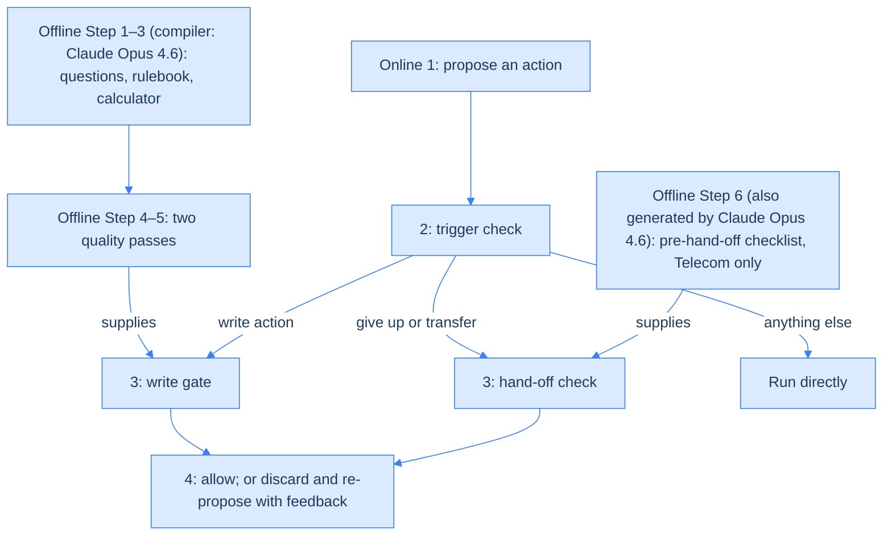
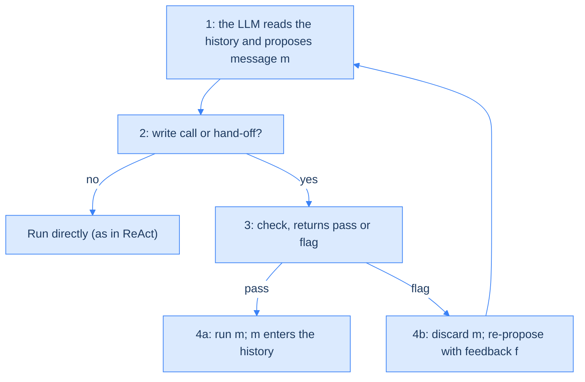
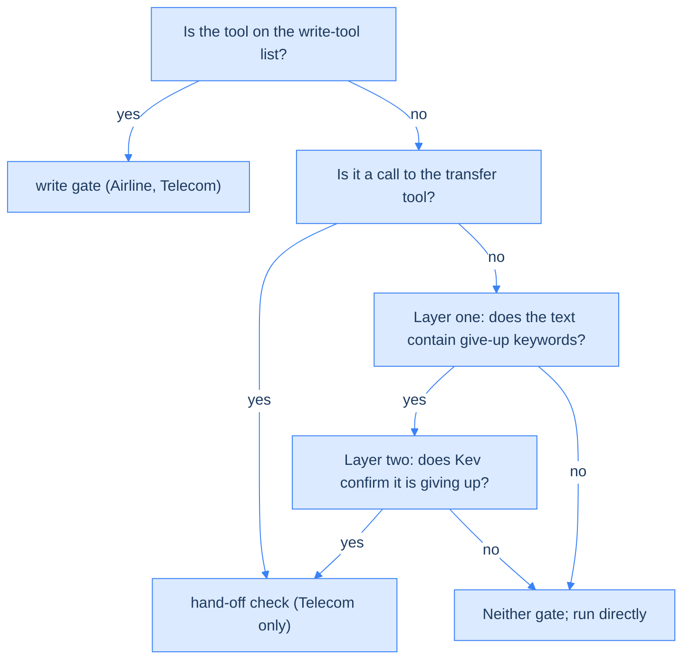
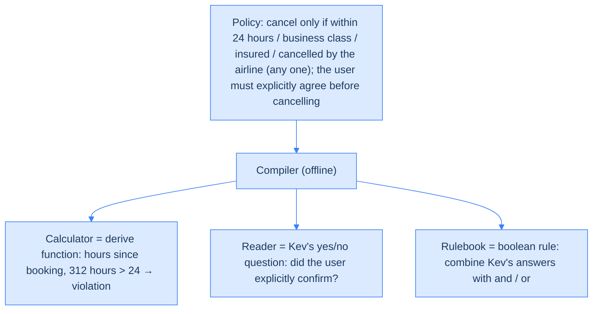
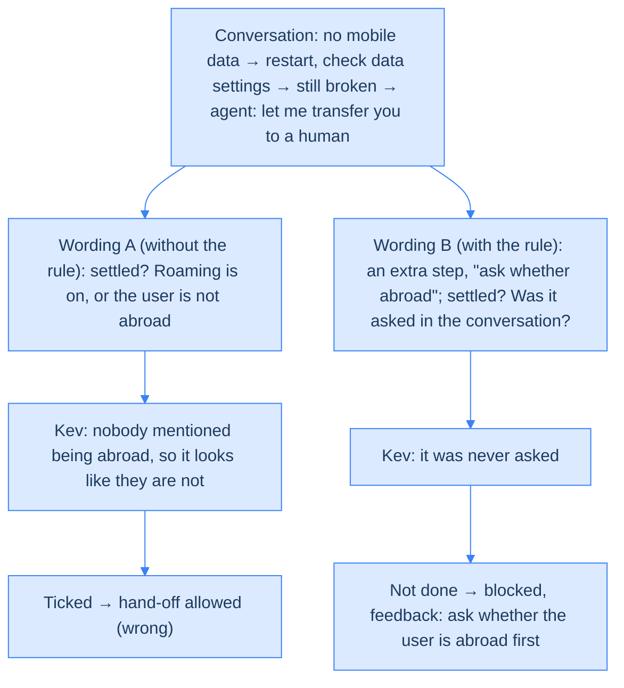
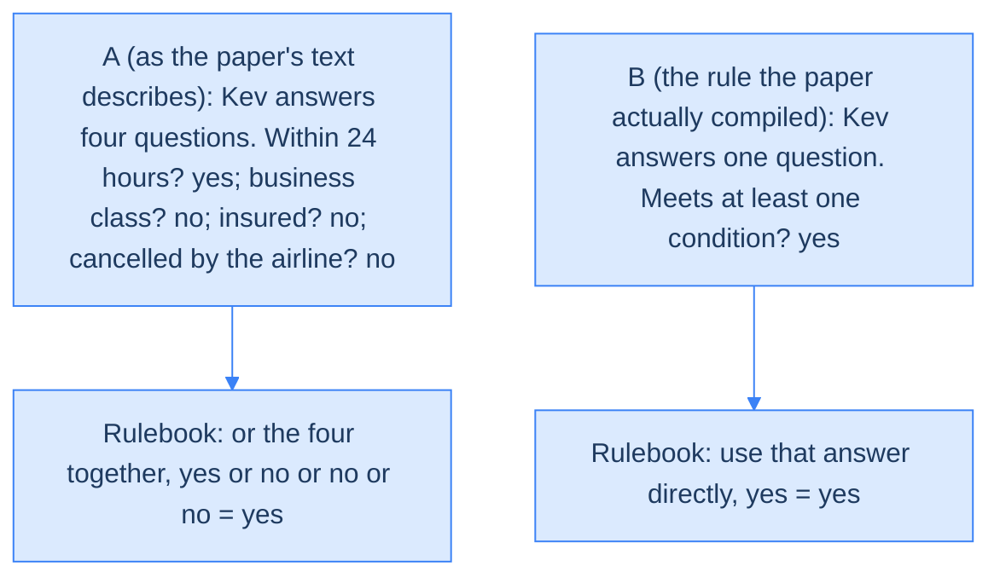

<!--more-->

## An agent's costliest mistakes are actions: JevAct checks them before they run

When an LLM agent says something wrong, it can correct itself on the next turn. When it *does* something wrong, that is harder to undo: it books the wrong ticket, cancels a reservation it should have kept, or tells the user "there's nothing more I can do" too early. JevAct, from Iftach Shoham, Yuval David and colleagues at IBM SIL, puts a gate between the moment an agent proposes an action and the moment it runs. The gate stops only two kinds of hard-to-undo actions: **write calls**, tool calls that change a database, and **hand-offs**, where the agent gives up or transfers the user to a human.

The referee is not another large LLM. It is Kev, a separate, cheap, open-source **decision model** that the JevAct authors did not build. Kev works in a single **forward pass**: it reads the input once (only the input-reading step, called prefill, runs) and writes no text, returning a probability for each of a fixed set of answers, such as yes or no. Ahead of time, each service's written policy (for example, the airline's rules on cancellations) is compiled into checks: code that computes hard facts from the records, and yes/no questions for Kev. At run time, Kev blocks an action only when it is very sure, and attaches feedback so the agent can fix the action within a limited number of tries.

The experiments use three benchmarks: Airline (airline customer service) and Telecom (telecom customer service) from \( \tau^2 \)-bench, plus BFCL (Berkeley Function Calling Leaderboard), a tool-calling benchmark. The results are not uniformly good news. Telecom improves the most, Airline is mixed, and on BFCL the agents solve the same tasks more reliably across runs but no new ones. Ablations (remove one part at a time and see how much the score drops) show that most of the gain comes from the code checks, while Kev's extra contribution depends on the agent. And the yes/no questions compiled from the policy can catch at most about 58% of wrong calls.

Here is the route. First, why to check before acting. Then how JevAct splits one policy across three kinds of check, how Kev makes its call, and how the must-do list before a human hand-off works. Finally, the experiments: who actually deserves the credit, and the blind spot the questions cannot see by design.

The map in the next section is the skeleton of the whole post; come back to it if you get lost in the details. Labels used in the text: (my inference) marks my own judgment; (made-up) marks an illustrative example; (general knowledge) marks an analogy or background fact that is not from the paper; "the paper does not say" marks something the paper leaves unexplained. Everything else is from the paper.

Paper: [Think Before You Act: Decision Gate for LLM Agents](https://arxiv.org/abs/2610.38620) (IBM SIL, 2026-10)

## A wrong word can be fixed, a wrong action is hard to undo: why check before acting

Most agent loops execute an action as soon as the LLM proposes it. Nothing sits between generating an action and checking whether it should happen. A wrong sentence can be fixed next turn, but two kinds of action are hard to take back:

- **Write call**: changes database state, such as booking, cancelling or changing a setting.
- **Hand-off**: transferring to a human, or telling the user "there's nothing more I can do", which ends the attempt. The most common failure on Telecom tasks is an agent giving up too early.

The two existing families of fixes each miss something. Reflection methods have the model look back and critique its own output; a [generative LLM-as-judge](../llm-as-a-verifier/) asks another LLM to act as reviewer and write an assessment:

| Approach | What it misses |
| --- | --- |
| Reflection methods such as Self-Refine and Reflexion | They improve *later* proposals; they do not check a specific action against the policy, rule by rule, before it runs |
| Generative LLM-as-judge | It outputs free text, so the gate must interpret it again; calling a frontier model at every step is also too expensive |

That gives three challenges (this grouping is mine, drawn from the paper's introduction and method section; the paper does not number them):

1. The check must happen before execution, against the domain policy.
2. The judge's output must be able to open or close the gate directly, and cheaply. A decision model returns only probabilities over fixed options, so a threshold is enough.
3. A decision model's probabilities are not guaranteed to be calibrated (general knowledge: when it claims to be nine-tenths sure, it is right nine times in ten) or correct, and it cannot do arithmetic, so other parts have to cover for it.

Recap: the targets are write and give-up actions. The judge has to be cheap and able to flip the gate directly, and its blind spot for arithmetic has to be covered by something else.

## The architecture: prepare offline, check every step online

### One map: two layers, two gates

JevAct has two layers. Offline, an LLM compiles the domain policy into check material, then runs two quality passes over development-stage logs. Online, it intercepts risky actions at every agent step: code computes the hard facts, and one Kev forward pass gives probabilities for every question; it blocks only when confident and attaches one-time feedback so the agent can fix the action within a limited number of tries. The agent's own LLM, base prompt and tools are not changed.

There are four kinds of check material, and their names come up throughout. The checkpoint for writes is the **write gate**; the checkpoint for giving up is the **hand-off check**. The write gate uses three kinds of material: the **calculator** (the derive function the compiler writes, which computes facts from tool logs), the **reader** (single-fact yes/no questions for Kev), and the **rulebook** (a boolean rule that combines Kev's answers). The hand-off check uses a separate piece: the **pre-hand-off checklist**, the steps that must be done before giving up. Where the name Kev comes from, and how it differs from Jev and JevLoop, is in the further reading at the end.

Figure 1 maps the whole system: the top half is offline compilation, the bottom half is the four stages of every online step. Arrows labelled "supplies" show which check uses which offline material.



### The decision loop: a blocked proposal tries again with feedback

Every step has four stages: propose, trigger, check, then allow or re-propose. Only write calls and hand-offs are checked; every other message runs exactly as in ReAct. **ReAct** is the standard agent loop that executes a proposed action immediately, with no gate in between, and it is the baseline in this post's experiments. Figure 2 shows the four stages; a blocked proposal goes back to stage one with feedback.



In symbols, a proposal and a re-proposal differ by one thing: the first proposal sees only the history; after a block, the feedback is appended to the history for that one call, and the agent proposes again.

$$
m \sim \pi(\cdot \mid h_t), \qquad m' \sim \pi(\cdot \mid h_t,\ f)
$$

- \( \pi \): the agent's LLM.
- \( h_t \): the conversation history before step \( t \).
- \( m \): the proposed message: text, a tool call, or both.
- \( f \): the feedback given when a check fails.
- \( m' \): the message re-proposed after seeing the feedback.

Three rules the figure does not show:

- A blocked proposal is not executed and is not written into the history.
- Feedback applies to that one call only and is not written into \( h_t \), so past criticism does not pile up in the context.
- Each check has a correction budget \( R \): \( R = 2 \) for the write gate and \( R = 1 \) for the hand-off check. Once the budget is spent, the next proposal runs without a check.

### Routing: only writes and give-ups get checked

Not every output passes through both gates. Messages are routed by type into at most one; ordinary replies and read-only lookups go through neither. Writes and transfers can be recognised from the tool name. Giving up in plain text has no tool name, so it first passes a cheap keyword filter, then Kev confirms it (Figure 3).



The paper does not say three things: how the write-tool list is decided (my inference: it reuses the benchmark's own tool classification), the actual give-up keyword list, and what happens when one message contains both a write and a give-up.

Recap: offline, the policy becomes check material. Online, only writes and give-ups are stopped and checked; a blocked action comes back with one-time feedback, a limited number of times.

## The compiler: one policy split across a calculator, a reader and a rulebook

The compiler is Claude Opus 4.6. It runs offline, once per domain. It reads the policy and the tool schemas (the description of each tool's parameters), and for every write tool it produces three things, each handed to whoever does that job best. An analogy (general knowledge): in a refund review, the accountant runs the numbers on a calculator, the reviewer reads the correspondence to judge intent, and the final call follows a checklist. Figure 4 shows how one cancellation policy is split.



Why split it this way: Kev can read but cannot calculate, so date and amount comparisons go to code; code cannot tell whether the user really agreed, so that goes to Kev; and "any one condition is enough" is combination logic, which the rule expresses.

### What each write tool gets

1. **Question list**: 12–20 questions per tool; 86 across Airline's 6 write tools and 75 for Telecom, all answered by Kev. The calculator asks no questions.
2. **Rulebook**: one Python boolean expression that combines only Kev's answers.
3. **derive function (calculator)**: reads this call's arguments and every earlier tool result, computes facts and lists violations itself, without going through the rulebook.

The verdict: if the rulebook fails or the calculator reports a violation, either one, the action is blocked. The two can overlap; "is it within 24 hours?" is both one of Kev's questions and something the calculator checks (how the actual cancellation rule handles this question is at the end, in "The rulebook: description and example disagree"). Kev does not have to compute time itself, because before the input reaches it, the system annotates every date with how long ago it was.

### Four kinds of question

The questions below are real ones from the paper for `cancel_reservation`:

| Aspect | What it asks | Example question |
| --- | --- | --- |
| Policy condition | Does the action comply with the policy? | According to the tool results, has no segment of this reservation been flown yet? |
| Argument source | Did the argument come from the record, or did the agent make it up? | Do the tool results confirm that this reservation ID belongs to this user? |
| User intent | Does the user really want this? | Did the user actually ask to cancel, not just ask about it? |
| Prerequisite steps | Was everything that needs confirming confirmed? | After the agent listed the cancellation details, did the user explicitly say "yes"? |

Each question carries a `bad_if` field that records which answer means a violation; for all four above, "no" is the violation. Arguments in a question are placeholders such as `{reservation_id}`, filled with this call's actual values before the question goes to Kev.

### The calculator would rather miss than raise a false alarm

The calculator reports only when the records show a violation for *certain*. Missing records, or rules that depend on what the user said, are never reported and are left to Kev; an exception thrown by the code also counts as no violation. The code may use only the standard library and runs under an allowlist. (My inference) A calculator report blocks the action outright, so a false alarm is expensive, and missing a violation is the lesser evil.

One thing to note: the rulebook as actually written does not match the paper's own description of it. The details are at the end, in "The rulebook: description and example disagree".

Recap: code does the arithmetic, Kev reads the conversation, the rule combines the answers. If the calculator or the rulebook says violation, the action is blocked.

## Kev says no only when it is 95% sure

Kev's input includes the policy, the whole conversation, every tool result, and the call about to run. Two preprocessing steps come first: each date is annotated with how long ago it was, and list-like results are pre-sorted (for example, price from low to high). All questions for the same tool share one forward pass, so adding questions does not add cost. The paper uses Kev-27B (the 27B-parameter version), fine-tuned from Qwen3.8-27B; the authors did not train it further.

Kev has the same interface as Jev, [the original decision model from TypeSafe AI](../../ai-concept/jev-overview/) (how the four names relate is at the end); several questions on one prompt share one pass. Kev comes in three sizes, 0.8B, 9B and 27B, and the paper mainly uses Kev-27B. Validated context lengths: 8,192 tokens for 0.8B and 9B, 65,536 tokens for 27B. This matters later, in the long-input experiment.

For each question Kev gives the probability that the answer is "yes". But the write gate counts a question as "no", and blocks, only when Kev is very sure the answer is no; everything else counts as "yes". In other words, Kev must be at least 95% sure the answer is not yes before it counts as "no":

$$
\text{answer} = \begin{cases} \text{no (block)} & P(\text{yes}) \le 0.05 \\ \text{yes (allow)} & \text{otherwise} \end{cases}
$$

- \( P(\text{yes}) \): the probability Kev gives to "yes" for this question.
- \( 0.05 \): the threshold, tuned only on Kev-27B.

Back to cancelling a reservation. Three made-up examples, all for the question "did the user explicitly confirm the cancellation?":

| Kev's \( P(\text{yes}) \) | What Kev means | Verdict at the 0.05 threshold | With a 0.5 threshold instead |
| --- | --- | --- | --- |
| 0.97 | Very sure the user confirmed | Allow | Allow |
| 0.03 | Very sure the user did not confirm | Block | Block |
| 0.20 | 80% likely the user did not confirm | Allow | Block |

The paper only says the probabilities let the check "act only when confident"; it does not explain why the threshold is set so far to one side. (My inference) Blocking a correct action is treated as the costlier mistake; the price is that cases like 0.20, "probably not confirmed", get through. For the threshold to mean anything, Kev's probabilities must be well calibrated; whether the same threshold still holds for a smaller Kev is covered in "Other experiments and open questions".

Recap: block only when \( P(\text{yes}) \le 0.05 \). Better to let a "probably not confirmed" through than to block a correct action.

## A write gate walkthrough: cancelling a reservation nobody confirmed

Putting the parts together, the write gate runs three steps in order: the calculator computes facts and lists certain violations → Kev answers the tool's questions under the 0.05 threshold → the rulebook decides. If the calculator reports a violation or the rulebook fails, the action is blocked.

The feedback lists the confirmed violations and the failed questions first, then offers the agent three paths: fix the call, ask the user for more information, or explain why it cannot be done. If the agent believes the original call was right, it may resend it unchanged. On a second block, the feedback instead tells the agent to "reply to the user and do not call this tool again".

One step-by-step run (made-up: the user asks to cancel straight away, and the agent calls the tool without confirming first):

1. User: please cancel reservation ABC (booked 2 hours ago).
2. The agent proposes `cancel_reservation(ABC)`. It is a write action, so it enters the write gate.
3. Calculator: booked only 2 hours ago, eligible for cancellation, no violation.
4. Kev: "did the user explicitly confirm?" \( P(\text{yes}) = 0.02 \), which counts as "no"; every other question is above 0.05.
5. Verdict: the rulebook requires "confirmed", which fails, so the action is blocked with feedback.
6. The agent re-proposes: no tool call, just the question "Cancel ABC for a full refund, are you sure?". That is an ordinary message, so it is sent.
7. The user replies "yes"; the agent proposes `cancel_reservation(ABC)` again, Kev gives \( P(\text{yes}) = 0.96 \), all three steps pass, and the cancellation runs.

Recap: a block is not a failure. The agent goes and asks the user, and once the user confirms, the very same call goes through.

## Two quality passes that fix code and drop bad questions without ground truth

Material compiled in one pass will contain mistakes, so two quality passes run over development-stage agent logs. Neither **needs ground-truth labels**.

**Quality pass one: fix the calculator (Step 4).** The code is repaired by the same model that wrote it (Claude Opus 4.6), with a separate prompt: write it yourself, fix it yourself.

1. Run the calculator on the write calls in the training-set logs and pick the cases where it reports a violation: at most 16, one per violation type per tool.
2. The model's input: the policy text, the full calculator code, and for each case the call, the reported violation, and the 8 most recent tool calls and results before it (each truncated to 700 characters).
3. The model checks each case against the policy and the records and decides whether the violation is real: if it is, the check stays; if not, it finds and fixes the bug, then returns the complete fixed code. One round of fixing only, and no ground truth is given.

The paper gives two fixed bugs: one read the error message "Error: User not found" as if it were user data; the other used an old reservation that a later lookup had replaced. The effect is clear: on Airline's held-out test tasks, the calculator's false-alarm rate on write calls that were actually correct fell from 11.3% to 1.4%.

**Quality pass two: drop bad questions (Step 5).** Kev-27B answers every question for every write call in the development logs. If a question "confidently flags a violation" on more than 10% of that tool's calls, the whole question is dropped. Dropped questions never report online and count as "yes" in the rulebook.

The assumption behind it: real violations are rare, so a question that flags too often most likely means Kev cannot read that fact from the conversation, or the policy never required it. An analogy (general knowledge): a smoke alarm that goes off more than one time in ten is more likely broken than living in a house that is often on fire.

The result: Airline dropped 17 of its 86 questions; Telecom dropped 5 of its 75 (based on 175 development write calls). The violation threshold \( P(\text{yes}) \le 0.05 \) and the 10% cut-off were both set once on Airline and reused as-is on Telecom.

Recap: the calculator's false alarms fell from 11.3% to 1.4%, and questions that cry wolf too often are dropped like broken alarms. Neither pass needs to know the right answer first.

## The pre-hand-off checklist: were the required steps done before handing off?

The pre-hand-off checklist comes out of offline Step 6 and, online, is used only by the hand-off check. It is enabled only on Telecom: in offline tests on Airline, it blocked 26% of the hand-offs in runs that had succeeded, far too many false blocks, so it was switched off. An analogy (general knowledge): a support manager rules that before a ticket can be closed as "cannot be resolved", steps such as restarting the device and checking settings must be confirmed as tried.

### How the checklist is made

The checklist is produced in two steps, 6a and 6b, which only call Claude Opus 4.6 and need no labels. Every step on the list carries a `settled` question for Kev: "has this step been dealt with?" It counts as settled if it was tried, confirmed fine, or confirmed not to apply.

1. **6a, extract prerequisites** (Telecom only): find rules of the form "fix problem A before troubleshooting problem B", so that A's steps are also marked as required for B.
2. **6b, generate the checklist**: read the policy, the prerequisites and the agent's tool names, and output JSON in a fixed format.


```json
{
  "problems": { "no_data": "Phone cannot get mobile data", "no_sms": "Cannot send text messages" },
  "steps": [
    {
      "id": "ask_traveling",
      "step": "Ask whether the user is currently abroad",
      "problems": ["no_data"],
      "settled": "Has the conversation established whether the user is abroad?",
      "agent_tools": []
    }
  ]
}
```

The content above is made up; the fields are the ones the paper specifies. Telecom actually has 8 problem types. What each field does:

- `problems`: decides whether this step is relevant to the user's problem.
- `settled`: the "dealt with?" question Kev answers.
- `agent_tools`: how it is used online, the paper does not say.

The 6b prompt has four main rules:

1. List every step, in the order the policy gives them.
2. Leave out identity verification and plain information requests.
3. When a later step depends on a fact, make "ask the user" a step of its own.
4. `settled` questions must follow "not discussed is not ruled out".


### The key rule: not discussed is not ruled out

Start with an analogy (general knowledge). Suppose the checklist before prescribing penicillin asks "Is the patient not allergic, or has the patient not mentioned an allergy?" If the doctor never asks, the box ticks itself. The right wording is "Did the doctor ask the patient about allergies?"

Back to Telecom. The policy says "if the user is abroad, turn on roaming", a step with a precondition. The obvious check is "done, or the precondition does not hold", but the precondition may never have been established at all. Figure 5 applies both wordings to the same conversation (made-up: the user is in fact abroad, and nobody ever mentions it):



The rule is that an escape clause like "or the precondition does not hold" may only be written as "the conversation has established that the precondition does not hold". The paper itself only says wording A "looks settled, but nobody actually asked"; Kev's reading in the figure is an illustration built from that sentence.

### Dropping steps that block too eagerly, using successful runs

Once written, the checklist is filtered. A hand-off in a conversation that still ended up solved is treated as correct, and a correct hand-off should pass the checklist; so if the checklist marks a step "not done" on such a hand-off, that counts as one false block. Any step with a false-block rate above 5% is removed entirely.


| Hand-off in a successful run | Restart | Turn on roaming | Airplane mode | Check unpaid bill |
| --- | --- | --- | --- | --- |
| #1 | Settled | Settled | Settled | Settled |
| #2 | Settled | Settled | **Not done** | Settled |
| #3 | Settled | Settled | Settled | **Not done** |
| #4 | Settled | Settled | **Not done** | Settled |
| #5 | Settled | Settled | **Not done** | Settled |
| #6 | Settled | Settled | Settled | Settled |
| #7 | Settled | Settled | **Not done** | Settled |
| #8 | Settled | Settled | Settled | Settled |
| False-block rate | 0/8 | 0/8 | 4/8 | 1/8 |
| Result | Keep | Keep | Remove | Remove |


The paper's real numbers: 6 development runs with GPT-4.1 and Opus 4.6 on 74 training tasks, taking only the first hand-off of each run, 217 hand-offs in total; 36 of them came from successful runs, and those 36 are the denominator. \( 36 \times 5\% = 1.8 \), so a step with 2 or more false blocks is removed. In the end 7 steps were removed: airplane mode, APN settings, SIM status, line suspension, unpaid bill, contract end date, and restoring the line after payment.

This filter differs from quality pass two in one key way: it **needs outcome labels**, because it has to know which runs succeeded.

### How the hand-off check decides

With the checklist ready, how is it used online? The hand-off check triggers on a call to the transfer tool, or on a plain-text give-up that passed the keyword filter and Kev's confirmation. In one request, Kev answers three things:

1. Which kind of problem the user has (including "other").
2. Whether the user said the problem is solved.
3. Whether each step on the checklist has been dealt with.

If the problem is not solved and any relevant step is not done, the hand-off is blocked and the feedback lists the missing steps. A step counts as "not done" when two things hold at once: it is relevant to the user's problem, and it has probably not been done. As a formula, step \( k \) is "not done" when:

$$
\sum_{p \,\in\, \text{problems needing } k} P(p) \ \ge\ 0.5 \quad \text{and} \quad P(\text{step } k \text{ settled}) \ \le\ 0.5
$$

- \( P(p) \): Kev's probability that the user has problem \( p \).
- Left side: the summed probability of every problem that needs step \( k \), i.e. how relevant the step is to the user's problem.
- Right side: the probability that the step has been dealt with.

A made-up example: Kev gives the problem probabilities as "no mobile data" 0.7, "cannot send texts" 0.2 and "other" 0.1; \( P(\text{solved}) = 0.05 \), so the problem counts as unsolved.

| Step | Problems that need it | Relevance (sum) | \( P(\text{settled}) \) | Result |
| --- | --- | --- | --- | --- |
| Restart | Data, texts | 0.7 + 0.2 = 0.9 | 0.95 | Settled |
| Ask whether abroad | Data | 0.7 | 0.10 | **Not done** |
| Check SMS settings | Texts | 0.2 (below 0.5) | 0.10 | Not relevant, skipped |

Verdict: the problem is unsolved and one step is not done, so the hand-off is blocked with the feedback "you have not asked whether the user is abroad". Three more points:

- Both thresholds here are 0.5, unlike the write gate's 0.05; the paper does not say what threshold decides "solved".
- Correction budget \( R = 1 \): after one correction, the next give-up runs without a check.
- The hand-off check is enabled only on Telecom, because of the Airline false blocks mentioned at the start of this section.

Recap: the checklist runs only on Telecom; "not discussed is not ruled out" closes the easiest hole to miss, and steps that block too eagerly are weeded out using successful runs.

## BFCL: general checks when there is no policy

**BFCL** (Berkeley Function Calling Leaderboard) measures how well a model calls tools. The paper uses its multi-turn version: there is no policy document, and what the user says each turn is scripted in advance. So BFCL gets no compiler; instead it uses two general checks with fixed questions, simplified versions of the write gate and the hand-off check.

|  | Unrequested-action gate | End-of-turn check |
| --- | --- | --- |
| Counterpart | Simplified write gate | Simplified hand-off check |
| Trigger | Before every state-changing call | When the agent ends its turn while a tool error containing "needs to" or "must" is still unhandled |
| Kev answers | Was this action requested by the user, or required by a tool error? (yes/no) | Which tool on the list can satisfy what the error asks for? (one of the task's tool names, or "none") |
| Threshold | Block only if \( P(\text{yes}) \le 0.05 \) | Block if any tool has \( P \ge 0.6 \) |
| Feedback | Do only what the user asked or what is necessary | Call that tool; do not ask the user |

- **Unrequested action** (made-up): the user only says "read this file", and the agent also deletes a temp file on the side. Kev gives \( P(\text{yes}) = 0.02 \); blocked.
- **End of turn** (made-up): the agent wants to post, the tool replies "you must log in first", and the agent ends its turn to ask the user. Kev picks `login` from the tool list (\( P = 0.8 \)); blocked, with an instruction to call `login`.

The options for the end-of-turn check are each task's own tool list. So a decision model's options can be filled in at run time, as long as they are fixed at the moment the question is asked.

The paper does not give the exact wording of these two questions, who wrote them, or the correction budget \( R \). (My inference) Since they are "fixed questions, not compiled", the authors most likely wrote templates by hand and filled in the current conversation, tool list and error message at run time.

Recap: with no policy, the gate asks only two things. Who asked for this action? And was the tool that should have been called actually called?

## Experiments: the gain comes mostly from code, not Kev

The verdict first: most of the gain comes from the code checks; Kev's extra contribution depends on the agent; and the big Telecom improvement should be taken with a discount.

### Three metrics: can it, and does it reliably

Each task runs 3 times, and three metrics summarise the results:

- **pass@3**: the share of tasks solved in at least 1 of the 3 runs. It measures whether the agent *can* do it.
- **\( \text{pass}^3 \)**: the share of tasks solved in all 3 runs. It measures whether it does so *reliably*.
- **\( \text{pass}^1 \)**: the average success rate of a single run.

Every comparison runs the same agent LLM under ReAct and under JevAct; the only difference is the layer of code wrapped around the model that runs the loop (the **harness**). In \( \tau^2 \)-bench the user is played by another LLM, called the **user simulator**.

### Main results: a big Telecom jump, with a discount

Table 1 is the paper's main results table; each comparison uses the same LLM and differs only in the harness:



Condensed into three rows:

| Benchmark | Result | The catch |
| --- | --- | --- |
| Telecom (114 tasks) | All 8 agents improve on both metrics; on average pass@3 +16.0 and \( \text{pass}^3 \) +16.9 percentage points | See the two points below |
| Airline (50 tasks) | \( \text{pass}^3 \) improves for 4 agents and drops for 2 | 1 task is worth 2 percentage points, so no real difference can be seen |
| BFCL (800 tasks) | \( \text{pass}^3 \) improves for all nine agents (+0.1 to +9.6) | pass@3 drops for 5: more consistent, but no new tasks solved |

Two things discount the Telecom numbers:

- With gpt-oss-120b as the user simulator, the \( \text{pass}^3 \) change is −1.8 (95% confidence interval −7.9 to +4.4, a range that crosses 0), and the gain disappears. The paper does not say which agent this run used.
- The end of Appendix A.1 also mentions that the pre-hand-off checklist was revised after one review of results, without saying which tasks were reviewed. (My inference) If the test set was among them, the Telecom numbers would be inflated.

### Credit split: most of it goes to the calculator

So where does the gain come from? On Airline, with GPT-4.1 as the agent, the paper runs a single-run ablation of the write gate (source: the paper's Table 3). The "placebo" arm is a control: it blocks every write once, regardless of whether it is right, to test how much a second chance alone is worth.

| Setting | \( \text{pass}^1 \) |
| --- | --- |
| ReAct (no gate) | 50.0 |
| Calculator only | 68.0 |
| Kev questions only | 57.1 |
| Full JevAct | 72.0 |
| Placebo: block every write once, regardless | 50.0 |

Of the 22-point gain, the calculator alone accounts for 18 points; Kev adds 4 more on top, which is 2 of the 50 tasks and within the noise.

The main text also reports a 3-run follow-up with the user simulator fixed to gpt-oss-120b, comparing two agents; all numbers are \( \text{pass}^3 \). It shows that whether Kev helps depends on the agent:

| Agent | Start (no gate) | Placebo | Random blocks at the gate's rate | Full gate | Reading |
| --- | --- | --- | --- | --- | --- |
| GPT-4.1 | 26 | 28 (barely any effect) | — | 40 | Kev's judgment contributes |
| gpt-oss-120b | 32 | 42 | 42 | 42 | All the credit comes from "one more try" |

In plain words: for GPT-4.1, blocking every write once (the placebo) barely helps, so Kev's judgment really does contribute. For gpt-oss-120b, placebo, random blocking and Kev's judgment all give the same result; the gain comes only from getting one more try.

### The blind spot: questions see the policy, not what the user wants

Apart from how the credit splits, the questions have a ceiling of their own: questions compiled from the policy can catch at most about 58% of wrong calls, because 42 of 101 wrong calls violate no question at all. The problem is not that Kev answers wrongly; no question asks about the thing that went wrong.

The data come from 260 hand-labelled write calls from Airline's development stage: 159 correct and 101 wrong (Appendix A.4, the same data as Table 5 later; the number 42 comes from the paper's conclusion). Broken down:

| 260 labelled write calls | Count |
| --- | --- |
| Correct | 159 |
| Wrong, and violating at least one question | 59 |
| Wrong, but violating no question (blind spot) | 42 |

The paper's explanation: the questions encode the policy, not the user's request. They are compiled offline from the policy and shared by every task; what a user wants in the moment (cheapest, earliest, window seat) differs every time and cannot be known offline, so no question checks it.


The user says "change my return to the cheapest flight on 5/20". The agent picks the second-cheapest, the user replies "OK", and the agent calls `update_reservation_flights`. The membership tier allows the change, the cabin is unchanged, the payment is valid, the reservation ID is right: every policy question passes, yet the call is wrong. The policy never says "you must pick the cheapest", so no such question exists.


The ceiling: even if Kev answered every question correctly, this question set could catch at most \( 59/101 \approx 58\% \) of the wrong calls. The paper does not say whether the calculator can catch these 42. (My inference) The calculator also checks only policy-related facts, so it probably cannot either.

## Other experiments and open questions

A few more experiments sit outside the main line; the table below gives the conclusions first. **[AUROC](../jev-as-a-judge/)** (general knowledge) scores, from 0 to 1, how well a model ranks wrong calls above correct ones, without needing a threshold; 0.5 is the same as guessing.

| Experiment | Result | Watch out for |
| --- | --- | --- |
| Judge choice (Table 2) | Kev-27B is about as accurate as generative judges; it costs 0.0003–0.0017 US dollars per question, versus 0.0127–0.0231 for API judges | Roughly 10 times cheaper, but excluding the agent's own cost |
| Judge size (Table 3 and Table 4) | Bigger is not always better, and a small Kev is often better on Telecom; 9B and 27B agree on 97.0% of decisions | The online score gaps cannot be explained by judgment quality |
| Long inputs (Appendix A.3, Table 5) | 41% of Airline inputs exceed 8,192 tokens; on long inputs, 9B's AUROC is 0.61 and 27B's is 0.85 | The small model loses mainly on context length; re-tuning the threshold on short inputs recovers part of it |


The original judge-choice table compares the score and cost of the same write gate when different judges answer its questions:



Table 3 has the online judge-size results; checks and thresholds are all fixed at the versions set with Kev-27B, and only Kev's size changes:



Table 4 is an offline replay: the same set of Telecom hand-off states goes to all three Kev sizes, to see how often each blocks and how closely each agrees with Kev-27B:



Table 5 compares long inputs: the 260 labelled write calls are split by whether the input exceeds 8,192 tokens. It is the same data the blind-spot analysis used:



Table 6 lists the average tokens per run used by the agent and by Kev in each main-results run, which you can look up directly when estimating deployment cost; this post does not go through it cell by cell. For BFCL details, see the paper.




The paper's core question is whether a decision model can serve as a verifier, and the data do not really answer it. Besides the three points already covered (most of the gain comes from the calculator, Kev's contribution varies by agent, the Telecom numbers need a discount), two problems remain:

- The model-size results contradict each other, and the paper does not explain why. (My inference) Take the judge-size row in the summary table above: a small Kev often scores better on Telecom, yet 9B and 27B agree on 97.0% of decisions, so the score gap does not look like it comes from judgment quality.
- The ablation runs once, on 50 tasks.

## Conclusion: the recap and what to take away

The whole post in five points:

- JevAct stops only two kinds of hard-to-undo action: write calls and giving up or handing off. Every other message runs as in ReAct, and the agent itself is untouched.
- Offline, the compiler splits the policy across three roles: the calculator computes hard facts, Kev answers yes/no questions, and the rulebook combines the answers; two quality passes that need no ground truth then fix the code and drop bad questions. The pre-hand-off checklist is filtered separately using successful runs.
- Online, one Kev forward pass answers every question, and it blocks only when very sure, at \( P(\text{yes}) \le 0.05 \); feedback is used once and the number of corrections is capped.
- In the experiments, Telecom improves the most but with two discounts, Airline is mixed, and BFCL only becomes more consistent. Most of Airline's gain comes from the pure-code calculator; Kev's contribution depends on the agent.
- The limitation most worth remembering: the questions encode the policy, not what the user wants right now, so 42 of 101 wrong calls are caught by no question at all.

If you take away only three things: first, split "is this allowed?" into facts code can compute, intent a model can read, and logic a rule can combine, and hand each to whoever does it best. Second, when "adding a judge model improved things", ask for the placebo and code-only scores; here, on Airline, most of the credit belongs to the calculator. Third, checks built from the policy cannot see the user's "the cheapest flight, please". If you build a gate for your own agent, start with cheap code checks, and find a separate way to check the user's specific requests.

## Further reading: the names, and one place the paper disagrees with itself

These two parts can be read on their own, apart from the main line.

### Jev, Kev, JevLoop and JevAct: four names

Of the four names, only JevAct is this paper's contribution; Kev is the external open-source model actually used as the judge, and Jev and JevLoop are only cited.

| Name | What it is | Who made it | Role in the paper |
| --- | --- | --- | --- |
| Jev | The original decision model (System One Model) | TypeSafe AI | Cited only |
| Kev | An open-source "Jev-style" decision model | Jared Palmer (GitHub: jaredpalmer/kev), not one of the paper's authors | Serves as the judge |
| JevLoop | An agent runtime that lets a decision model choose actions | ZJUNLP | Used only for positioning; no experimental comparison |
| JevAct | A gate that reviews actions before they run | The paper's authors (IBM SIL) | The subject |

**How they differ**: JevLoop hands "which action to take" to the decision model. In JevAct the action is still proposed by the agent's LLM and Kev only reviews it, which also means the agent never reviews its own proposals.

The paper does not say how Kev was trained, or whether it was trained the same way as Jev. (My inference) The only reason the paper gives for choosing Kev is that it is open source; Jev itself may not be self-hostable or freely usable, but the paper does not say so.

### The rulebook: description and example disagree

The paper's text says that either-or logic such as "any one condition is enough" is expressed in the rulebook with or; but the actual `cancel_reservation` rule it shows contains no or. Instead, a single summary question is handed to Kev.

The cancellation policy: within 24 hours, cancelled by the airline, business class, or insured, any one of the four allows cancellation. Figure 6 compares the two wordings on the same ticket (made-up: economy, booked 3 hours ago, no insurance, not cancelled by the airline):



Both reach the same verdict; the difference is who decides "one of four". The actual rule keeps the summary question and drops the four single-condition questions:

```python
user_id_obtained and reservation_id_correct and reservation_retrieved and no_flown_segments and cancellation_reason_obtained and at_least_one_cancel_condition_met and user_requested_cancellation and user_confirmed_cancellation
```

The paper does not say why the example chose B; all that is certain is that the rule-writing prompt allows dropping questions "not needed for the decision". (My inference) "Within 24 hours" involves a time judgment, which is still not Kev's strength even with the "how long ago" annotations; but the calculator also checks cancellation eligibility independently, so even if Kev got it wrong, the calculator would catch it.
