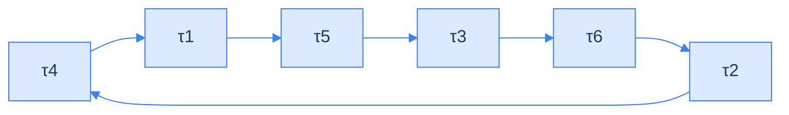

<!--more-->

## LLM scores keep tying because argmax throws information away

To pick the best of N candidate answers, a common trick is to ask an LLM to act as judge and score each answer from 1 to 5. The trouble is ties. On Terminal-Bench (a benchmark of agent tasks, meaning a standard test set for comparing models), the paper measured that 27% of comparisons came out tied. A tie cannot be ranked, so you cannot pick one out of N candidates. The paper's claim is that the model can tell the answers apart, and the step that keeps only the top score is what throws that information away.

This post covers *LLM-as-a-Verifier* (arXiv 2607.05391v2, Stanford / UC Berkeley / NVIDIA). Scoring one LLM's output with another LLM is now close to standard practice: ask the model for an integer from 1 to 5, then use that integer to rank, filter, or serve as a reward (the training signal given to a model). The paper points out a gap few people notice. At the token position where the model writes the score (a token is the smallest unit of text a model handles), it actually produces a **full probability distribution**, meaning "how likely each score is". The standard recipe keeps only the most likely one (an operation called argmax) and discards the rest. The information was never missing; the decoding strategy throws it away.

The fix is simple: skip the argmax and compute the **expected value** instead (multiply each score by its probability and add them up), so the score becomes a continuous number rather than a discrete integer. The authors add repeated sampling and criteria decomposition, and package it as a framework called LLM-as-a-Verifier, together with a new ranking algorithm called PPT (it picks the best of N candidates through pairwise comparisons). They test it across three domains: coding, robotics, and medicine.


This post does two things: it explains the mechanism well enough that you could implement it, and it honestly flags where the paper's evidence is weaker than the paper claims.

**This is a paper whose engineering value exceeds its research novelty.** Expected-value decoding, repeated sampling, and ensembles (averaging several scorers) are not new inventions. The real contribution is the systematic packaging, solid ablations (controlled experiments that change one factor at a time and watch what happens), and the ranking algorithm. And its best empirical result is not the SOTA (state-of-the-art) numbers in the abstract.


The route: first where the standard approach loses information, then how a verifier computes its score, then three knobs that make the score more accurate plus a case study, then PPT for picking the best of N, and finally how to read the experimental results.

## The problem: argmax squashes the information

Step one: where does a standard judge lose information?

A traditional LM judge (a language model used as a grader) looks like this: the score is simply "the token the model generated". In the formula below, \( x \) is the task description, \( \tau \) (read "tau") is the trajectory being scored (the full record of what an agent did), and \( G \) is how many levels the scale has.

```text
R_LM(x, τ) ∈ {1, ..., G}     ← the score is just "the token that gets generated"
```

At the score token's position the model holds a probability distribution over its whole vocabulary (every token it knows), and argmax collapses it to one integer. With a coarse scale, the consequence is direct: **many candidates end up tied**. On Terminal-Bench, the paper measured 27% of comparisons as ties. A tie cannot be ranked, and without ranking you cannot pick one out of N candidates.

The paper also claims a second problem: trained reward models (models trained specifically to give scores; ORM scores only the final outcome, PRM scores step by step, and in robotics there are RoboReward-8B and Robometer-4B) are tied to their training data and fail across domains. One reservation up front: **this is only a background assumption in Section 1, and the paper provides no experimental evidence of cross-domain failure**.

### Is it worth fixing? Look at the oracle gap

Is it worth fixing? First, how much could an ideal picker gain: an oracle (an ideal picker) always picks the correct candidate from the pool, and the comparison point is Pass@1 (the success rate when you submit just one answer per task).



This figure is the motivation for the whole paper. It says that if a perfect oracle verifier existed, one that always picked the correct trajectory from the sampled candidates, the Terminal-Bench V2 solve rate could reach **98.9%**. The actual Pass@1 is only 83.1%.

Between Pass@1's 83.1% and the oracle's 98.9% there is a gap of about 16pp (percentage points), and only a verifier can cash it in.


A note on the figure's role: it is not a separate third challenge, but quantitative evidence that "the challenge above is worth solving". The paper's order is to show the oracle gap first, then say a sufficiently accurate verifier is needed to capture that potential, then circle back to the standard judge being too coarse.



The 98.9% here is the oracle coverage ceiling as K **grows without bound**. The 92.1% in the main experiment table is the oracle Pass@N when the **actual candidate pool has only N=5**. They do not measure the same thing: the first is a theoretical ceiling, the second is the headroom this system is really competing for. When we compare the share recovered later, we use the second.


Recap: a standard judge ties a large share of candidates, and there is a lot to gain from picking correctly. Next, how a verifier breaks the ties.

## The method: read the whole distribution, not the top score

Now the core of the paper: how to turn the probability distribution at the score token into a continuous score.

{{< image src="figure2.png" alt="Overall framework of LLM-as-a-Verifier. On the left are three input modalities: text, image, and video. In the middle is the verification core made of four blocks, Uncertainty, Granularity, Repetition and Decomposition, with the reward formula. On the right are three downstream uses: test-time scaling, progress tracking and reinforcement learning." caption="Figure 2 — The whole framework: any modality goes in, the full distribution at the score token is read out, and it feeds three downstream uses. (Source: original paper, Figure 2.)" >}}

### Judge vs verifier, and what the scoring prompt looks like

The paper opens its method with a dictionary-style distinction: a **judge** forms an overall opinion and gives one decision (like a teacher assigning a total grade), while a **verifier** confirms truth and correctness and needs finer-grained evaluation (like an auditor checking item by item).

Next, the prompt a verifier actually receives. The full template is in the fold below; the text covers just three design points.


```text
You are an expert [domain] reviewer. You will see a
task description and two trajectories.

Evaluation Criteria: [domain specific criteria]
Task: {task prompt}
Trajectory A: {A}   Trajectory B: {B}

Carefully analyze each trajectory, then provide your
final scores:
<score_A> INTEGER_1_TO_20 </score_A>
<score_B> INTEGER_1_TO_20 </score_B>

Rating Rules: Rate correctness on a 1–20 scale
(1 = incorrect, 10 = borderline, 20 = correct)
```


Three design points are worth singling out. The first two:

- **Two candidates go in one prompt, to be compared side by side.** Not scored separately and then compared.
- **The `<score_A>` / `<score_B>` tags are the key to the whole mechanism.** What you want is not the text inside the tag but the probability distribution over the whole vocabulary at that token position. The tags exist so you can pin down "which token holds the score" and then fetch its logprobs (the log-probabilities the model assigns to each candidate token).

The third point: **the 1–20 scale gives only three anchors** (1 = incorrect, 10 = borderline, 20 = correct). How to judge 2 to 9 and 11 to 19 is not specified in the paper, so the model interpolates by itself.

One easily overlooked design choice: **there is no ground truth in the prompt** (no reference answer). The verifier receives only the task description and the trajectory, and has to judge right or wrong from evidence such as logs, tool-call results, and output format, rather than comparing against a reference. This is a deliberate reference-free design, and the three sub-criteria later (Specification / Output / Errors) all being "check the trajectory against the task's requirements" confirms it. The "ground-truth successful solution" mentioned elsewhere in the paper is a label researchers use afterwards to evaluate how accurate the verifier is; it never enters the verifier's prompt.


**The judge-versus-verifier distinction is rhetorical scaffolding.** Frankly, this passage is not a technical argument. The paper never derives "so we must use the expected value of a probability distribution" from the definition of a verifier's role; it asserts the distinction first, then uses it to justify the three dimensions that follow. As a memory aid it is fine; as an argument it is not.

**Why do two trajectories share one prompt?** Mathematically it is unnecessary: the formula just subtracts two independently computed scalars, so scoring in two separate prompts would work. But the paper explicitly gets both scores from one prompt, and **gives no reason**. Plausible guesses are that relative comparison calibrates more stably than absolute scoring, or that the later PPT needs pairwise comparisons anyway and getting two scores per call is cheaper, but these are our guesses, not the paper's argument.

**`INTEGER_1_TO_20` does not match "use letters".** The template says `INTEGER_1_TO_20` (the model should output an integer from 1 to 20), but the paper's note beside it says "we use letters rather than digits to ease logprob extraction". The two do not match and the paper does not clarify. A possible explanation is tokenization: two-digit numbers are often split into two tokens by a tokenizer, and using single letters (A=1 … T=20) guarantees exactly one token per score, which is what makes fetching logprobs meaningful. But the paper does not say this.


### The core formula: expected value instead of argmax

With the prompt in place, the next step is to turn the distribution at the score token into one number.

In one sentence, the formula says: for a given trajectory, ask each criterion \( K \) times; each time, add up "every possible score times its probability"; then average everything. The symbol table follows the formula.

$$
R(x,\tau) = \frac{1}{CK} \sum_{c=1}^{C} \sum_{k=1}^{K} \sum_{g=1}^{G} p_\theta(v_g \mid x,c,\tau) \cdot \varphi(v_g)
$$

| Symbol | Meaning |
| --- | --- |
| \( x \) / \( \tau \) | The task description / the trajectory being scored |
| \( c \) / \( C \) | The c-th scoring criterion / the number of criteria (C=3 in the main experiments) |
| \( k \) / \( K \) | The k-th repeated evaluation / the number of repeats (K=8 in the main experiments) |
| \( v_g \) / \( G \) | The g-th score token / the number of score tokens used (the example below uses 5; G=20 in the main experiments) |
| \( p_\theta(v_g \mid \ldots) \) | The probability the model gives \( v_g \) at that position |
| \( \varphi(v_g) \) | Maps a score token back to an actual value (the token for a score of three → 3.0) |

It is easier to read as three layers, plus one final division:

1. **Innermost layer (sum over g): granularity.** One LLM call returns the probability distribution at the score token; weight the G candidate scores by probability and you get 1 expected value.
2. **Middle layer (sum over k): repetition.** Repeat the same criterion K times to get K expected values, and add them up.
3. **Outer layer (sum over c): criteria.** Run the middle layer for each criterion and add everything up.
4. **Finally**, divide by \( C \times K \).

Note that the denominator does not divide by G. The innermost layer is a probability weighting, with \( \sum_g p_\theta = 1 \), so that layer is already a weighted average. Incidentally, the **total number of LLM calls is \( C \times K \)**, which is 24 per trajectory in the main experiments; G does not change the call count (the paper contradicts itself on this point; see the section on G).

Working one through makes it concrete. Suppose G=5 and a trajectory's score distribution is:

| \( v_g \) | \( \varphi(v_g) \) | \( p_\theta(v_g) \) | Product |
| --- | --- | --- | --- |
| \( v_1 \) | 1 | 0.02 | 0.02 |
| \( v_2 \) | 2 | 0.05 | 0.10 |
| \( v_3 \) | 3 | 0.13 | 0.39 |
| \( v_4 \) | 4 | 0.35 | 1.40 |
| \( v_5 \) | 5 | 0.45 | 2.25 |
|  |  | **Total** | **4.16** |

The discrete judge takes the argmax and gets **5**; the verifier computes the expected value and gets **4.16**. Now the key part: if another trajectory's distribution is \( p(v_5)=0.52 \) and \( p(v_4)=0.30 \) (the remaining probability goes to lower scores), the argmax is still 5 (a **tie**), but the expected value lands near 4.3 (**no tie**). That is the mechanism by which the tie rate falls to zero.

The probabilities above are illustrative, because **the paper never publishes the actual probability distribution of any single scoring**.


The formula itself has two flaws worth noting. The summed term \( p_\theta(v_g \mid x, c, \tau) \) has c but **no k**. Since the outer sum is over k, the summed term should vary with k; otherwise it adds the same number K times and divides by K. Elsewhere in the text it is written \( R^{(k)}(x,\tau) \) (with k marked), which is correct, so the formula as printed is sloppy. Also, this formula is numbered Eq. 3.1, but two later places refer to it as Eq. 1, so the numbering is not aligned.


### Normalisation and Bradley–Terry: turning score gaps into win rates

Once the score is computed there are two more steps: squeeze it into 0 to 1, then turn it into "the probability of winning".

After the score is computed it is squeezed into [0,1]:

In plain words: convert the score into "where it sits on the scale", with the lowest score at 0 and the highest at 1.

$$
R \leftarrow \frac{R - \varphi_{\min}}{\varphi_{\max} - \varphi_{\min}}
$$

For the example above that is (4.16 − 1) / (5 − 1) = **0.79**.

The paper does not explain why it normalises, but the mechanism suggests an answer: normalisation does not change the ranking of a single comparison (it is a linear monotonic transform); what it affects is whether the next step, the sigmoid (a function that squeezes any number into the range 0 to 1), saturates.

| Scenario | Difference | σ(difference) |
| --- | --- | --- |
| The raw 1–20 scale, two trajectories 8 points apart | 8.0 | 0.9997 |
| The same gap after normalisation | 0.42 | 0.60 |

Without normalisation, "a little better" and "far better" are both squashed to 1.0, which throws away the fine resolution we worked so hard to keep. This really bites in the ranking algorithm PPT covered later, because PPT **adds up** the probabilities from many comparisons as the basis for ranking; once saturated, the sum mostly reflects "did you happen to meet weak opponents" rather than "how strong are you really".

Next the score difference is turned into a preference probability, using Bradley–Terry (a model that converts a strength gap into a win probability).

In plain words: the bigger the score gap, the closer the leader's win probability gets to 1; equal scores mean a coin flip.

$$
P(\tau_i \succ \tau_j \mid x) = \frac{1}{1 + \exp\left(-\left(R(x,\tau_i) - R(x,\tau_j)\right)\right)}
$$

R(τi)=0.79 and R(τj)=0.62 → difference 0.17 → P = 0.542, which faithfully reflects "close, but slightly ahead".


A common misunderstanding to clear up: **O(N²) is not caused by Bradley–Terry; it is caused by the round-robin comparison schedule** (O(N²) means every pair of N candidates is compared, so the number of comparisons grows like N×N; the PPT section covers it in detail). They are different layers:

- **Comparison schedule** (which pairs to compare): O(N²) comes from here, and it produces comparison results.
- **Bradley–Terry** (results → probabilities): just a mathematical model.

And this paper uses it the other way round from classical BT:

|  | Classical BT | This paper |
| --- | --- | --- |
| Known | Win/loss records | Scores \( R(x,\tau) \) |
| Solve for | Latent strength | Preference probability \( P(\tau_i \succ \tau_j) \) |
| Direction | Observations → infer | Strength → predict |

The paper treats R directly as the latent strength (the thing classical BT must infer from win/loss records), which skips the hardest part of BT, parameter estimation.


What PPT saves is never the cost of the Bradley–Terry step itself (a sigmoid is nearly free); it is **the LLM-call cost of obtaining each R**, which is \( C \times K \) = 24 calls per pair.

Why not simply compare the two scores directly? Because that gives only 0 or 1, squashing the information once more. Converting to a probability keeps "by how much", and PPT adds up exactly those probabilities rather than win/loss counts.

Recap: instead of the top score, multiply each score by its probability and add them up for a continuous score; the gap between two trajectories' scores is then turned into a win probability.

## Three knobs: granularity, repetition, criteria decomposition

With a continuous score in hand, the paper asks how to make it more accurate. The answer is three knobs. First, how accuracy is measured: the accuracy below is pairwise verification accuracy (pairwise accuracy), meaning two trajectories are paired up and it is the share of pairs the verifier judges correctly. Here is the overview.



### Granularity G: fixing too little resolution

The first knob is **Score Token Granularity (G)**, which fixes "too little resolution". As G grows, accuracy keeps rising:

| G | 1 | 2 | 4 | 8 | 16 | 20 |
| --- | --- | --- | --- | --- | --- | --- |
| Accuracy | 73.1% | 73.3% | 75.1% | 75.9% | 77.2% | 77.5% |

The counterintuitive part is that widening the scale **gives the verifier no new information**. The paper's account is that it gives the decoder (the step that turns probabilities into output) a finer space onto which to project the beliefs the model already holds: nearby beliefs that used to be rounded into the same slot now land on different continuous values.

Here is a point that matters in practice but where the paper contradicts itself: **does changing G require rerunning the LLM?** The paper does not clarify, and its two statements flatly clash. This matters a lot: if a rerun is needed, the earlier line "G does not change the call count" no longer holds, and the whole cost estimate has to be redone. The paper's evidence for each reading is in the fold below.


| Reading | What the paper says | Cost consequence |
| --- | --- | --- |
| No rerun needed | Section 1 says "scaling the number of extracted token logits"; Section 4 says Gemini 2.5 Flash "can return 20 top logprobs per scoring token" | G is just taking more from the candidate list the API returns afterwards, which is **free** |
| Rerun needed | Section 3.2 defines \( V_{\text{score}} = \{v_1,\ldots,v_G\} \) as the set of score-level tokens; Table 2 labels G=5 as "the expected value on the same 1–5 scale", and 1–5 and 1–20 are two different prompts | Changing G means changing the prompt and rerunning, which is **not free** |


The paper also uses a metric called SNR to back up the effect of granularity. It is only supporting material; the details, and one reservation about it, are in the fold below.


SNR (signal-to-noise ratio) has as its numerator "how many points higher the correct trajectory scores on average than the wrong one" (the signal), and as its denominator "how unstable that gap is" (the noise).

$$
\mathrm{SNR}(G) = \frac{\mathbb{E}[s_c - s_i]}{\sqrt{\mathrm{Var}(s_c - s_i)}}
$$

| G | 1 | 4 | 16 | 20 |
| --- | --- | --- | --- | --- |
| SNR (k=16) | 0.775 | 0.786 | 0.797 | 0.799 |

This expression has the same form as the statistical effect size (Cohen's d): the mean difference divided by the standard deviation, which standardises it so it can be compared across settings. SNR's role in the paper is not to explain how granularity works (that is the job of the "finer projection space"), but to be the bridge metric connecting "spread out more" to "ultimately more accurate".

But that bridge is asserted. The paper only says accuracy is a monotonic function of SNR, gives no functional form, and does not explain how an SNR rise of just 0.024 (about 3%) maps to a 4.4pp rise in accuracy. Four bare numbers, no error range: the argument is not strong enough to carry the claim.


Recap: G lets the same internal belief land on a finer scale, rather than giving the verifier new information.

### Repetition K: fixing the noise of a single evaluation

The second knob is **Repeated Evaluation (K)**, which fixes the random bias of a single evaluation. You ask the same question K times and average; mathematically it is just a Monte Carlo estimator (an estimator that approximates the true value by averaging many random samples):

$$
\frac{1}{K} \sum_{k=1}^{K} R^{(k)}(x,\tau)
$$

| K | 1 | 2 | 4 | 8 | 16 |
| --- | --- | --- | --- | --- | --- |
| Accuracy | 74.7% | 76.1% | 77.1% | 77.3% | 77.5% |

The catch: **averaging reduces only variance, not bias** (bias means the model systematically errs in the same direction). Variance shrinks as O(1/K), and bias does not move at all. If the verifier systematically misjudges some kind of trajectory in the same direction every time, a hundred runs will still be wrong. The paper itself admits that returns diminish as K grows, because the bias on hard samples is correlated.

A measurement analogy makes it clear: more samples shrink the standard error, but if the scale always reads 2 kg too heavy, no number of measurements will fix that 2 kg.

So the division of labour between the first two knobs is:

- **Granularity**: makes each individual estimate sharper.
- **Repetition**: averages out the noise that granularity cannot remove.

### Criteria decomposition C: fixing a vague rubric

The third knob is **Criteria Decomposition (C)**, which fixes a rubric (scoring standard) that is itself unreasonable. The first two knobs assume the rubric is good. But in long-horizon agent tasks, the question "is this trajectory correct?" bundles several logically independent factors, and the verifier tends to latch onto only the most prominent one in the prompt.

For code agents the paper splits out three sub-criteria:

| Sub-criterion | The question it asks | What it checks |
| --- | --- | --- |
| Specification | Did it satisfy all the task's requirements? | Completeness |
| Output | Is the final output format as expected? | The result |
| Errors | Do the logs / tool outputs show failure signals? | The evidence |

| Criterion | Accuracy |
| --- | --- |
| Specification alone | 75.2% |
| Errors alone | 76.0% |
| Output alone | 76.4% |
| **All three ensembled** | **78.3%** |

Put plainly, this is the ML ensemble: several weak classifiers with different biases, and as long as their errors are not perfectly correlated, the average beats the best single one.

The evidence for this knob is thinner than for the first two, with four gaps:

- **The paper does not say where the three criteria came from**: no account of how they were chosen, no ablation of "tried 4, tried 5", and the paper itself admits in the appendix that they should in future be learned or generated dynamically.
- **C has no scaling curve at all.** G and K both have full curves, but C has only four bars: no C=2 data, and no idea what C=5 or C=10 would do. Strictly speaking the paper proves only that "3 beats 1", not that C is an axis you can scale, yet the abstract lists it alongside the other two.
- **How reliable the gap is goes unsaid.** The error bars in the figure clearly overlap, the 1.9pp improvement has no significance test, and the paper does not say what the error bars represent.
- **How to apply it in other domains is also unanswered.** These three criteria are explicitly designed for code-agent trajectories, yet the robotics and medical experiments claim to use the same set. What does "is the output format as expected" mean for a video of a robot arm? The paper never answers.

Each of the three knobs fixes one problem, and each has its limits:

- **G**: too little resolution; the effect is clear, but the cost argument contradicts itself.
- **K**: the random noise of a single evaluation; reduces variance only, not bias.
- **C**: a rubric that is itself unreasonable; proves only that three beats one.

## A case study: why a judge could not see the cheat in query-optimize

Theory done; now a case study. This is the part of the paper that builds the most intuition.

The case comes from Terminal-Bench V2. **The task**: given a SQLite database (a common kind of database) and an unoptimised SQL query (a command that asks a database for data), write a faster version that produces **exactly the same output**. Both trajectories were generated by Claude Opus 4.5, and here is where they differ:

| Trajectory | What it did | Outcome |
| --- | --- | --- |
| ✅ Correct | Waited for the original query to finish on the untouched original database (it waited 5 min 03 s), then compared with a direct diff (a line-by-line comparison of two outputs) | Passed |
| ❌ Failed | Tried to run the original query, which timed out twice (60 s, 5 min 02 s) → copied the database to /tmp → added an index to the copy so the original query could run → compared "the original query on the indexed copy" with "the optimised query on the unindexed original" → deleted all verification artefacts | Failed |

An analogy to hold onto: the failed agent copied the database and tampered with the copy, then used that copy's output as the answer key, so "the two sides agree" proves nothing; the correct run compared against the untouched original.

The key to the failure is that it compared results across **two different physical access paths** (the route the database actually takes to fetch data, which differs before and after adding an index). After an index is added, the ORDER BY (sorting) may order rows with equal key values differently, and at the LIMIT 500 (keep only the first 500 rows) boundary it can cut out different data. So it never actually verified equivalence, yet it reported "internal diff check passed".

Did the verifier spot it? Yes. The reasoning from Gemini 2.5 Flash quoted in the paper's appendix states clearly that the agent modified the database to obtain reference output, violating an implicit constraint of the task, and therefore did not properly verify equivalence.

So where is the problem? **The verifier caught it, but phrased it in hedged, graded language** (like "slightly cleaner" or "a bit more direct"), making it sound unimportant. The model held the right judgement internally, but that judgement was squashed at the argmax step.



In the table, \( s_c \) is the correct trajectory's score and \( s_i \) is the wrong trajectory's score, and each method scores the pair a hundred times.

| Method | \( s_c > s_i \) ✓ | Tie | \( s_c < s_i \) ✗ |
| --- | --- | --- | --- |
| Judge (discrete, G=5) | 12/100 | **88/100** | 0/100 |
| Verifier (continuous, G=5) | 69/100 | 0/100 | 31/100 |
| Verifier (continuous, G=20) | **77/100** | 0/100 | 23/100 |

This comparison is clean because it changes one variable at a time:

- **First row → second row**: the same 1–5 scale, only the decoding changes (argmax → expected value). The 88 ties go to zero and correct rankings rise from 12 to 69.
- **Second row → third row**: still the expected value, only the scale changes (1–5 → 1–20). Correct rankings rise from 69 to 77.


There is a trade-off in the rightmost column that the paper does not discuss: **the discrete judge's wrong-ranking count is 0/100**. It never ranks a wrong one above a correct one; it just declines to commit. The price the continuous verifier pays for removing ties is that it must commit every time, and two or three times in ten it commits wrongly.

Scoring a tie as half a point, Judge = 12 + 88×0.5 = 56, Verifier G=5 = 69 and G=20 = 77, so the verifier still wins and the conclusion holds. But if your downstream process is "send ties to a human", the judge's behaviour is actually safer. The paper does not mention this.


Now, what happens when we raise the number of repeats?



| K | Judge accuracy | Verifier accuracy | Judge tie rate | Verifier tie rate |
| --- | --- | --- | --- | --- |
| 1 | 71.8% | 74.7% | 26.7% | 0.0% |
| 4 | 74.4% | 77.1% | 11.7% | 0.0% |
| 16 | 74.7% | 77.5% | 5.5% | 0.0% |

What the paper wants you to see is the diagonal: **the verifier at just 1 run (74.7%) equals the judge at 16 runs (74.7%)**. The improvement the judge gets from repeating comes mainly from averaging breaking ties (26.7% → 5.5%), not from actually judging better. It is like using repeated measurements to compensate for a ruler with coarse markings, whereas the verifier simply swaps in a ruler with fine markings.

The "16 times the compute" comparison is actually somewhat exaggerated: at every K the gap between judge and verifier lies between 2.7 and 2.9pp, and that comparison only holds if you care solely about matching the 74.7% threshold. The more substantive difference is the ceiling: the judge has already saturated by K=16 (74.4 → 74.7), while the verifier is still at 77.5%.

Recap: continuous scores break ties and widen gaps, but at the price of having to commit every time; repetition alone cannot rescue a judge whose scale is too coarse.

## PPT: picking the best of N candidates

A verifier compares only two at a time, but the real task is to pick the best of N. This section is PPT.

A full round-robin (every candidate compared with every other candidate once) takes roughly N×N comparisons, written O(N²). Take N = 20: C(20,2) (the number of ways to choose 2 out of 20) = 190 pairs, and 190 × 24 = 4,560 LLM calls.

Probabilistic Pivot Tournament (PPT) is the only part of the paper that counts as a new algorithmic contribution. The core idea is that each candidate is compared only with a small group of pivots (candidates that serve as the reference), cutting the cost to O(Nk) (roughly N×k comparisons; here k is the number of pivots, not the same thing as the repeat count K from earlier). But the real design point is not "save money with pivots", which is intuitive, but **how a cheap preliminary step finds the candidates worth using as pivots**.



1. **Candidates**: N candidates.
2. **Ring pass**: N random ring comparisons give a rough ranking and cancel position bias.
3. **Pivot select**: take the top k as the pivot set P.
4. **Pivot rounds**: non-pivots against pivots, plus pivots against each other.
5. **Selection**: accumulate \( w_i / c_i \) and take the highest.

### Ring pass: two birds with one stone

The ring pass arranges the N candidates randomly in a ring and compares only the N adjacent pairs on the ring.



The comparisons: \( (\tau_4,\tau_1)(\tau_1,\tau_5)(\tau_5,\tau_3)(\tau_3,\tau_6)(\tau_6,\tau_2)(\tau_2,\tau_4) \), 6 pairs in all = N pairs, rather than C(6,2) = 15 pairs.

This structure does two things at once. First, it **cheaply gives a rough ranking**: just N matches are enough to see roughly who is strong and who is weak. Second, it **cancels position bias**: LLMs often have a systematic preference for one of the two positions "Trajectory A" and "Trajectory B" in the prompt, which is a known problem. The ring makes each candidate take the A slot exactly once and the B slot exactly once, so the preferences cancel out in expectation. This is the balanced design from experimental methodology (counterbalancing): if every condition appears in every position equally often, order effects cancel in the overall average.


The paper uses the term "Hamiltonian cycle". It is graph-theory jargon (visit every node exactly once and return to the start), famous because deciding whether an arbitrary graph has a Hamiltonian cycle is NP-complete. But this paper never touches that hard part: the graph here is complete, any two candidates can be compared, and shuffling the order randomly gives a valid cycle; the paper's own pseudocode is really just "take a random permutation". The wording is fancy; in substance it is a random permutation arranged in a ring.


Also, "cancels in expectation" holds strictly only when the bias is an **additive constant**. If the bias depends on content (for instance, preferring A only when the two are close), the ring is not guaranteed to cancel it. The paper does not discuss this premise, and there is no experiment comparing "with ring pass vs without ring pass".

### Choosing pivots and picking the winner

In every match both sides are updated (\( p \) is the probability that \( i \) beats \( j \)):

- `p = σ(R_i − R_j)`
- `w_i += p`, `c_i += 1` (\( w_i \) is the win mass, the accumulated win credit; \( c_i \) is the number of matches candidate i has played so far, not the same thing as the criteria count C from earlier)
- `w_j += (1 − p)`, `c_j += 1` (the two add up to exactly 1)

The ring structure means every \( c_i \) is 2 once it finishes; candidates are then sorted by \( w_i/c_i \) and the top k become pivots, with no additional rule: pure top-k.

Why choose the strong ones as pivots? Because the goal is to pick the best, and what needs fine resolution is who is best at the top, not who is less bad at the bottom. If a pivot is a clearly poor candidate, every comparison against it just returns "everyone is better than it", which has no discriminating power. It is the same idea as choosing a pivot in quickselect: you do not need a full sort, only the maximum, so resources should be concentrated on the region that might hold the answer.

A worry the paper never analyses: **the pivots are chosen from just two comparisons per candidate in the ring pass, a tiny sample.** If the genuinely best candidate is unlucky in the ring pass and meets strong opponents twice, its \( w_i/c_i \) comes out low and it may drop out of the pivot set entirely. The paper does not analyse the probability of this "good candidate wrongly screened out".

Next come two kinds of pairs: each non-pivot against each pivot (\( (N-k)\times k \) pairs), and pivots against each other (\( C(k,2) \) pairs). The latter is necessary because in the end we still have to separate the pivots from one another. Adding the three terms gives the total number of comparisons:

$$
N + k(N-k) + \binom{k}{2}
$$

N=20, k=5 → 20 + 75 + 10 = 105 pairs, compared with 190 for round-robin, a saving of about 45%.

The final pick is \( i^* = \arg\max_i w_i / c_i \). Why divide by \( c_i \)? Because pivots play many more matches than non-pivots (a pivot plays everyone, a non-pivot plays only k), so with \( w_i \) alone, a pivot would accumulate a larger number just by playing more. Dividing by \( c_i \) converts it to "average win per match", which is fair.

### Budget versus accuracy

How much does PPT save, and how accurate is it? The upshot first: its advantage only shows when N is large enough, and the paper's main experiments use an N of just 3 to 5. The evidence is in this table.



The setup is N=20 candidates, 89 tasks, and the Terminus-2 harness. The candidate count differs from the main results table (the main experiments have N of only 3 to 5), so the pass@1 here is not the same setting as the main table's Pass@1; do not compare them directly. A harness is the scaffolding layer that drives an agent: the tool interface, the interaction loop, and the stopping conditions. V1 in the table is the previous-generation ranking method the paper compares against, and `1N` to `7N` are multiples of the comparison budget it spends. To be clear up front: **the paper nowhere explains how V1 works**; it is used only as a baseline.

| Method | Pairs queried | Accuracy |
| --- | --- | --- |
| pass@1 | — | 52.64% |
| V1 (1N) | 1,400 | 64.64% |
| V1 (3N) | 4,200 | 65.62% |
| V1 (5N) | 7,000 | 65.85% |
| V1 (7N) | 9,800 | 65.53% |
| PPT k=1 | 2,570 | 65.83% |
| PPT k=5 | 6,609 | 66.27% |
| PPT k=9 | 9,630 | 67.13% |
| Full Round-Robin | 13,111 | 67.42% |

Larger k is more accurate but returns diminish very fast (k=1 to k=9 gains only 1.3pp while the budget grows to nearly 4 times); k=9 already approaches full round-robin (67.13% vs 67.42%) while saving 27% of the budget. The baseline V1 drops after 5N rather than rising, while PPT rises monotonically, and that holds up.

But there are three reservations:

- **The paper gives no method for choosing k**, only that larger k is better, but that degenerates back to round-robin.
- **The saving is smaller than you might expect**: k=9 saves only 27% relative to round-robin. The asymptotic advantage of O(N²) → O(Nk) only becomes pronounced when N is large enough, and N=20 is not yet in that range.
- **The N=20 in this table is a specially curated setting**, and this is the most important point. The main experiments have an N of only 3 to 5, and with C(5,2)=10 pairs PPT saves almost nothing. In other words, PPT's contribution to those SOTA numbers is actually very limited.

Recap: PPT uses the ring to cheaply pick pivots and then concentrates the budget on the top; but its savings show up only when N is large, and the main experiments' N is actually small.

## The results: how you read them matters more than what they say

Last, the experimental results, item by item. What matters is not how big the numbers are but how each one was compared.

All four benchmarks use exactly the same pipeline: a generation strategy produces N candidates per task → the verifier scores them pairwise with PPT → the one with the highest normalised score is submitted. This pipeline has two key properties:

1. **Hyperparameters are fixed throughout** at G=20, K=8, C=3, never tuned for any individual benchmark.
2. **It is entirely training-free**: all four benchmarks share one framework, with no domain fine-tuning (retraining for a specific domain).

The second point is the most important practical claim. If it holds, you can apply the method directly to your own domain without preparing any training data.

### Read the main results table in two halves



| Benchmark | Baseline #1 | #2 | #3 | Pass@1 | Oracle | Ours |
| --- | --- | --- | --- | --- | --- | --- |
| Terminal-Bench V2 | GPT-5.5 (84.7%) | Opus 4.7 (80.2%) | G3.1 Pro (80.2%) | 83.1% | 92.1% | 86.5% |
| SWE-Bench Verified | Opus 4.5 (76.8%) | G3 Flash (75.8%) | M2.5 (75.8%) | 76.1% | 84.4% | 78.2% |
| MedAgentBench | Opus 4.8 (70.2%) | G3.5 Flash (66.3%) | GPT-5.5 (65.1%) | 70.2% | 75.0% | 73.3% |

Model names follow the paper's abbreviations: Opus means the Claude Opus family, and those starting with G are the Gemini family.

This table has to be read in two halves. The left half is other models' scores, produced with different harnesses and different sampling settings, so it compares apples with oranges; the right half is Pass@1 → Oracle → Ours on the same candidate pool, a fully controlled comparison, and that is the verifier's real contribution.

The right half is the honest evidence, because the candidates and the generator are the same, and the only variable is "how you pick":

| Benchmark | Pass@1 → Ours | The verifier's real contribution | Oracle gap | Share recovered |
| --- | --- | --- | --- | --- |
| Terminal-Bench V2 | 83.1% → 86.5% | **+3.4pp** | 9.0pp | 38% |
| SWE-Bench Verified | 76.1% → 78.2% | **+2.1pp** | 8.3pp | 25% |
| MedAgentBench | 70.2% → 73.3% | **+3.1pp** | 4.8pp | 65% |

Back to the opening motivation. On this N=5 candidate pool the oracle reaches only 92.1%, so the headroom up for grabs is 9.0pp, and the verifier recovers 38% of it; across the three benchmarks the share recovered lies between 25% and 65%. As for the 98.9% in Figure 1, that is the theoretical ceiling when K is made very large, a different scale from this 9.0pp, and the latter is the one to grade against.

Three problems to flag:

- **The "SOTA" claim mixes in harness differences.** The 86.5% is GPT-5.5 plus the Capy harness plus N=5 sampling plus the verifier, while the 84.7% is GPT-5.5 plus a different harness. Three variables differ, so attributing the whole gap to the verifier does not hold; the clean comparison is 83.1% → 86.5%.
- **A whole RoboRewardBench row has vanished.** The caption says four benchmarks are covered, but the table has only three rows. It was moved to another table because it measures preference accuracy, but the caption does not say so.
- **SWE-Bench's candidate pool is heterogeneous.** The N=3 candidates are drawn one each from three different models, Pass@1 is the average of the three models, and the verifier's job becomes "picking the best across model families". That is a more valuable use case (model routing), but it also makes the row not directly comparable with the others.

### The strongest result is not in the main table, it is on robots

So where is the clean evidence? On a robotics benchmark, RoboRewardBench, which measures preference accuracy. The VLM in the table below means a vision-language model, a language model that can see images.



| Method | Accuracy |
| --- | --- |
| **LLM-as-a-Verifier (this method)** | **87.4%** |
| RoboReward-8B (trained, about 4.5 × 10⁴ episodes) | 81.4% |
| Robometer-4B (trained, about 100 × 10⁴ comparisons) | 78.8% |
| TOPReward | 74.7% |
| LLM-as-a-Judge (the same VLM, discrete) | 70.8% |

This is far more convincing than the main table, for three reasons:

- **A clean comparison on the same model.** The 87.4% and 70.8% are the same Qwen 3.6 35B, and the only difference is discrete argmax versus the continuous expected value. This 16.6pp is the largest number in the paper, and the one most attributable to the method itself, with no harness confound.
- **It directly tests the second problem.** A zero-training framework beats two purpose-trained robotics reward models.
- **It crosses modalities.** The input changes from text to multi-frame video, and the method needs no changes.

One side result is equally worth remembering: when RoboReward-8B's output is decoded with the continuous formula, the MAE (mean absolute error; smaller means closer to the human labels) against human annotation drops from **1.11 to 0.72**. In other words, this decoding can be added directly on top of an existing reward model, with no need to replace it from scratch.


The paper does not explain at all why the purpose-trained robotics reward models lose in their own domain; the relevant section only lists numbers, with no analysis. There is also a conflict of interest the paper itself does not disclose: RoboRewardBench was proposed by the RoboReward paper, which a co-author of this paper also appears on, and the RoboReward-8B being compared is exactly that paper's model.


Recap: in the main table only the "same candidate pool" half can be credited to the verifier, and the robotics row, where the same model changes only its decoding, is the cleanest causal evidence.

## Progress tracking: where the paper overreaches

Continuous scores have a second use: beyond picking the best, they can show "how far along the agent is". The paper defines Value-Order Correlation (VOC), which takes the "chronological order of steps" and "the verifier's score of that step's **prefix**" and computes the Spearman rank correlation (a measure of how consistent two orderings are; 1 means perfectly in the same direction). If the score rises perfectly with the steps, VOC approaches 1.

Conceptually this is the RL value function: V(s) estimates "the expected return from this state onward", and along a trajectory heading toward the goal it should rise as the goal gets closer.



| Trajectory | Key events | Score trend |
| --- | --- | --- |
| Success | Read model.py → Install g++ → Install CPU-only torch → Update hidden_dim → DONE | Keeps rising → ~1.0 |
| Failure | Unnecessarily installs torchvision → disk space exhausted → compile error | Stays low throughout |

This figure is very persuasive. The problem is that **the paper overreaches here**.

The paper claims that on stalled or failing trajectories the verifier's score stays **roughly flat**, so the same score can double as progress measurement and early warning. But its own statistics do not support that claim. Across 500 Terminal-Bench V2 trajectories:

| Trajectory outcome | The paper's narrative | Spearman VOC |
| --- | --- | --- |
| Success | Rising ↗ | 0.848 ± 0.012 |
| Failure | Flat → | 0.769 ± 0.016 (almost as steadily rising) |
| **Gap** |  | **+0.079** |

0.769 is a fairly high positive correlation, meaning **the failed trajectories' scores also rise steadily over time**, which is nowhere near "flat" (VOC ≈ 0). Figure 10 is one case on one task, while the table above is statistics over 500 trajectories; the paper chose the former as its narrative backbone and never discussed why the latter shows such a small gap. Using a gap of 0.079 as a live early warning during a run has, in practice, weak discriminating power.

The VOC numbers on the robotics side are quite attractive (this method 0.966, RoboReward-8B 0.877, Robometer-4B 0.780, TOPReward 0.565), but that compares different methods with each other, which is a different matter from "can success and failure be told apart".

### A side product: TurboAgent

The paper ends with one engineering artefact, TurboAgent, an extension for Claude Code and OpenAI-API-compatible clients. It sits between the client and the LLM provider as an inference-time proxy, with neither side needing changes: each request sends N candidates in parallel and PPT picks the best to return. A nice idea, but the paper gives it **no quantitative evaluation at all**: no latency numbers, no cost analysis, no user study. It is a proof of concept.

Recap: the progress-tracking figure is lovely, but the statistics show scores rising on both successful and failed trajectories, differing by only 0.079, so as evidence for an early-warning signal it falls short.

## What you can take away

If you want to use this yourself, here is the order:

1. **The highest-return step: replace the argmax in your existing [LLM-as-judge](../jev-as-a-judge/) with the expected value computed from the top-k logprobs.** A binary or discrete judgement becomes a continuous score, which directly gives you ranking ability and a confidence measure. The catch is how your G is obtained: if the extra scores all come from the candidate list returned by a single call, it costs nothing; if changing G means changing the prompt (say, from a 1–5 scale to 1–20), you must rerun, and the cost is not zero. The paper makes both statements, so the first job is to check in your own setup which one applies.
2. **The next step is criteria decomposition.** It is lightweight and drops straight into any prompt-based judge. But you have to design the sub-criteria yourself: the paper's Specification / Output / Errors set was designed for reference-free terminal tasks and may not fit other settings, and the paper offers no design methodology.
3. **Repeated evaluation is the simplest idea, but its cost grows linearly**, and remember that it reduces variance only, not bias.

Work out the cost yourself: the number of LLM calls per trajectory = \( C \times K \), and with the main-experiment setting of C=3, K=8 that is 24 calls per trajectory. Multiply by PPT's number of comparison pairs and the total becomes substantial. The paper never discusses latency or cost, so this is a bill you must work out before adopting it.

One last practical reminder: if your setting **has ground truth**, the core formula is already in single-trajectory scoring form, and pairwise comparison is an add-on, needed only when you "pick the best of N". You can use just the single-trajectory formula and put the ground truth in the prompt. In theory it should calibrate better (judging is easier than reference-free scoring).

But **the paper never validated this use**: all its experiments are "pick the best" or "pairwise comparison", and there is no experiment of "judge a single trajectory right or wrong against ground truth". You cannot assume the 73.1% → 77.5% curve will reproduce; you have to run your own ablation.

Also note that once you switch to continuous scores, you will be forced to decide up front "how many points counts as correct" as a threshold.

## Conclusion

The paper's core insight is small and very practical: **an LLM's internal belief about a score is continuous, and it is argmax that squashes it flat**. Replace argmax with the expected value, and the tie rate falls from 27% to 0%, bringing ranking ability back.

Technically nothing in it is brand new; the value lies in the systematic packaging and the solid ablations. And the two numbers most worth remembering are both outside the abstract: on the robotics benchmark, the same model with only its decoding changed goes from 70.8% to 87.4% accuracy; and adding this decoding on top of an existing reward model drops the MAE against human annotation from 1.11 to 0.72. The former is the cleanest causal evidence in the paper, and the latter shows this is a change you can stack on top, with no need to replace the whole system.

As for the SOTA numbers in the abstract, once harness differences are removed, the verifier's real contribution is +2 to 3 percentage points. That margin is respectable, but the oracle headroom up for grabs on the real candidate pools is only 5 to 9pp, and the share recovered is between a quarter and two thirds, which is some distance from the narrative of "cashing in the oracle's huge potential".

Next time you see someone scoring with an LLM, ask one question: are they reading the score the model said, or how likely each score was when the model said it? If the former, first check how many candidates ended up tied. Also, the paper says this score can double as a progress warning, but its own statistics (a gap of only 0.079 between successful and failed trajectories) do not support that, so apply a discount when you use it.
