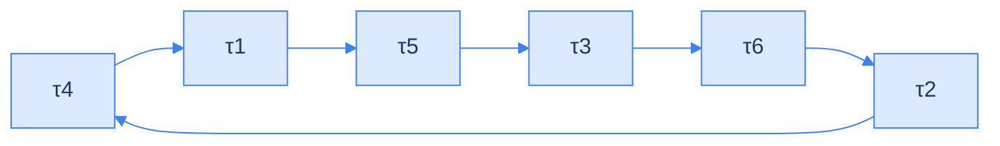

<!--more-->

## LLM 打分數老是平手，是 argmax 把資訊丟掉了

要從一堆候選答案裡挑出最好的那個，常見做法是請 LLM 當裁判，替每個答案打 1 到 5 分。問題出在平手：在 Terminal-Bench（一個考 agent 做任務的 benchmark，也就是拿來比較模型的標準測試題組）上，論文量到有 27% 的比較結果是平手。平手就分不出高下，也就沒辦法從 N 條候選裡挑出一條。這篇論文的看法是：模型其實分得出高下，是「取最高分」這個動作把資訊丟掉了。

這篇整理 *LLM-as-a-Verifier*（arXiv 2607.05391v2，Stanford / UC Berkeley / NVIDIA）。用 LLM 幫另一個 LLM 的輸出打分數，現在幾乎是標配：叫模型輸出一個 1 到 5 的整數，然後拿那個整數去排序、篩選、當 reward（訓練時給模型的獎勵訊號）。論文指出這個流程有個很少人注意的漏洞：模型在輸出分數的那個 token（模型處理文字的最小單位）位置，內部產生的是一個**完整的機率分佈**，也就是「每個分數各有多大機率」，但標準做法只取機率最高的那一個（這個動作叫 argmax），其餘全丟。資訊不是模型沒產生，是解碼策略把它丟掉的。

改法很單純：不取 argmax，改算**期望值**（把每個分數乘上它的機率再加總），分數從離散整數變成連續實數。作者把這個改動加上重複取樣、準則拆解，包成一個叫 LLM-as-a-Verifier 的框架，再配一個新的排名演算法 PPT（用成對比較，從 N 條候選裡挑出最好的一條），橫跨程式、機器人、醫療三個領域做了實驗。


這篇文章要做兩件事：把這套機制講清楚到你可以自己實作，以及誠實標出論文哪些地方的證據沒有它宣稱的那麼強。

**這是一篇工程價值高於研究新穎性的論文。** 期望值解碼、重複取樣、ensemble（把多個評分者的結果平均）都不是新發明，真正的貢獻在於系統化打包、扎實的 ablation（逐一改變單一因素、看結果如何變化的對照實驗），以及那個排名演算法。而它最漂亮的實證，其實不是摘要裡那些 SOTA（目前最佳成績）數字。


路線是這樣：先看標準做法在哪裡漏掉資訊，再看 verifier 怎麼算分數，接著是三個讓分數更準的旋鈕和一個案例，然後是從 N 條裡挑最好的 PPT，最後逐項檢查實驗結果該怎麼讀。

## 問題：資訊在 argmax 那一步被壓扁

第一步，先看標準 judge 到底在哪裡漏掉資訊。

傳統的 LM judge（用語言模型當裁判）長這樣：分數就是模型「生成出來的那個 token」。下式裡 \( x \) 是任務描述，\( \tau \)（讀作 tau）是被評分的軌跡（agent 做事的完整紀錄），\( G \) 是量表有幾級。

```text
R_LM(x, τ) ∈ {1, ..., G}     ← 分數就是「生成出來的那個 token」
```

模型在分數 token 的位置有一個涵蓋整個 vocabulary（模型認得的所有 token）的機率分佈，argmax 把它塌縮成一個整數。粗粒度的量表配上這種解碼方式，後果很直接：**大量候選解會打成平手**。在 Terminal-Bench 上，論文量到 27% 的比較結果是平手。平手就是不能排序，不能排序就沒辦法從 N 條候選裡挑一條。

論文另外主張了第二個問題：訓練式的 reward model（專門訓練來打分數的模型。ORM 只看最終結果打分，PRM 逐步驟打分，機器人領域則有 RoboReward-8B、Robometer-4B）會被訓練資料綁死，跨領域就失靈。這裡先標一個保留：**這只是 Section 1 的一句背景假設，論文沒有提供任何跨域失效的實驗數據**。

### 值得解決嗎？看 oracle 的落差

這個問題值得解嗎？先看一個理想的挑選者能帶來多少：oracle（理想的挑選者）每次都能從候選裡挑中對的那條，對照組是 Pass@1（每題只交一次答案的成功率）。



這張圖是整篇論文的動機基礎。它說的是：如果存在一個完美的 oracle verifier（每次都能從抽樣出來的候選裡挑中對的那條的理想挑選者），Terminal-Bench V2 的解出率可以到 **98.9%**。而實際的 Pass@1（每題只交一次答案的成功率）只有 83.1%。

Pass@1 的 83.1% 與 oracle 的 98.9% 之間，有約 16pp（百分點）的落差，這段全靠 verifier 去兌現。


要提醒的是這張圖的功能：它不是一個獨立的第三個挑戰，而是「上面那個挑戰值得解決」的量化證據。論文的行文順序是先給 oracle 落差，再說要拿到這段潛力得有夠準的 verifier，然後繞回標準 judge 不夠細緻。



這裡的 98.9% 是**放任 K 一路增大**時的 oracle 覆蓋率上限，後面主實驗表格裡那個 92.1% 則是**實際候選池只有 N=5** 時的 oracle Pass@N。兩個數字量的不是同一件事：前者是理論天花板，後者才是這套系統真正在爭取的空間。後面對照兌現比例時用的是後者。


小結：標準 judge 會把大量候選打成平手，而挑對的空間又很大。下一節看 verifier 怎麼把平手拆開。

## 方法：不取最高分，改讀整個機率分佈

接下來是整篇的核心：怎麼從分數 token 的機率分佈，算出一個連續的分數。



### judge 與 verifier，以及 scoring prompt 怎麼寫

論文在方法一開頭先做了一個字典式的區分：**judge** 是形成整體意見、給出一個決定（像老師打總分）；**verifier** 是確認真偽與正確性，需要更細緻的評估（像審計，逐項核對）。

接著看 verifier 實際收到的 prompt。完整範本收在下面的折疊裡，正文只講三個設計要點。


```text
You are an expert [domain] reviewer. You will see a
task description and two trajectories.

Evaluation Criteria: [domain specific criteria]
Task: {task prompt}
Trajectory A: {A}   Trajectory B: {B}

Carefully analyze each trajectory, then provide your
final scores:
<score_A> INTEGER_1_TO_20 </score_A>
<score_B> INTEGER_1_TO_20 </score_B>

Rating Rules: Rate correctness on a 1–20 scale
(1 = incorrect, 10 = borderline, 20 = correct)
```


三個設計要點值得單獨拿出來講。前兩個是：

- **一次 prompt 塞兩個候選解，對照著評。** 不是各自單獨評分再比大小。
- **`<score_A>` / `<score_B>` 這兩個標籤是整個機制的關鍵。** 真正要的不是標籤裡輸出的那串文字，而是該 token 位置上整個 vocabulary 的機率分佈。標籤存在的意義是讓你能精準定位「分數在第幾個 token」，才有辦法去撈 logprob（模型替每個候選 token 算出的對數機率）。

第三個要點：**1–20 分制只給了三個錨點**（1 = 錯、10 = 邊緣、20 = 對），中間的 2 到 9、11 到 19 怎麼判斷，論文沒說，靠模型自己內插。

這裡有個容易被忽略的設計：**prompt 裡沒有 ground truth**（標準答案）。verifier 只拿到任務描述和軌跡內容，必須自己從 log、工具呼叫結果、輸出格式這些證據判斷對錯，不是拿去跟標準答案比對。這是刻意的 reference-free 設計，後面三個子準則（Specification / Output / Errors）全都是「拿軌跡對照任務要求」也印證了這點。論文其他地方提到的 "ground-truth successful solution" 是研究者事後拿來評估 verifier 準不準的標籤，永遠不會進到 verifier 的 prompt 裡。


**judge 與 verifier 的區分，是修辭鋪墊。** 老實說，這段不是技術論證。論文並沒有從「verifier 的角色定義」推導出「所以必須用機率分佈的期望值」，它是先斷言了這個區分，再用來合理化接下來要推出的三個維度。當成一個記憶用的比喻可以，當成論證就不行。

**為什麼兩條軌跡要放在同一個 prompt？** 數學上不需要：公式只要兩個獨立算出的純量相減，分兩次 prompt 各自評分完全可行。但論文明講是同一個 prompt 一次拿兩個分數，而且**沒有解釋原因**。合理的猜測是相對比較比絕對評分校準更穩，或是後面的 PPT 本來就要成對比較、一次呼叫拿兩個分數更省，但這些都是我們的推測，不是論文的論述。

**`INTEGER_1_TO_20` 與「用字母」對不上。** 範本裡寫的是 `INTEGER_1_TO_20`（要模型輸出 1 到 20 的整數），但論文旁邊的註解卻說「我們用字母而非數字，以利抽取 logprob」。兩處對不上，論文沒澄清。可能的解釋是 tokenization：兩位數在 tokenizer 裡常被切成兩個 token，改用單一字母（A=1 … T=20）才能保證每個分數恰好一個 token，撈 logprob 才有意義。但論文沒有這樣說明。


### 核心公式：用期望值取代 argmax

有了 prompt，下一步是把分數 token 的機率分佈變成一個數字。

公式的意思，用一句話說：對同一條軌跡，每個準則各問 \( K \) 次，每次把「每個可能的分數乘上它的機率」加起來，最後全部平均。下面的符號表在公式之後。

$$
R(x,\tau) = \frac{1}{CK} \sum_{c=1}^{C} \sum_{k=1}^{K} \sum_{g=1}^{G} p_\theta(v_g \mid x,c,\tau) \cdot \varphi(v_g)
$$

| 符號 | 意義 |
| --- | --- |
| \( x \) / \( \tau \) | 任務描述 / 被評分的軌跡 |
| \( c \) / \( C \) | 第 c 個評分準則 / 準則總數（主實驗 C=3） |
| \( k \) / \( K \) | 第 k 次重複評估 / 重複次數（主實驗 K=8） |
| \( v_g \) / \( G \) | 第 g 個分數 token / 取用的分數 token 數（下面的例子用 5，主實驗 G=20） |
| \( p_\theta(v_g \mid \ldots) \) | 模型在該位置給 \( v_g \) 的機率 |
| \( \varphi(v_g) \) | 把分數 token 對應回實際數值（代表 3 分的 token → 3.0） |

拆成三層，再加上最後一步除法來看比較好懂：

1. **最內層（對 g 加總）：granularity。** 一次 LLM 呼叫，取得分數 token 位置的機率分佈，把 G 個候選分數做機率加權，得到 1 個期望值。
2. **中層（對 k 加總）：repetition。** 同一準則重複 K 次，得到 K 個期望值，加總。
3. **外層（對 c 加總）：criteria。** 每個準則各自跑完中層，全部加總。
4. **最後**除以 \( C \times K \)。

注意分母沒有除以 G。因為最內層是機率加權，\( \sum_g p_\theta = 1 \)，那一層本身已經是加權平均了。順帶一提，**總 LLM 呼叫次數是 \( C \times K \)**，主實驗每條軌跡 24 次；G 不影響呼叫次數（論文對這點的說法有矛盾，講 G 的那一節會看到）。

實際算一遍最有感。假設 G=5，某條軌跡的分數分佈是：

| \( v_g \) | \( \varphi(v_g) \) | \( p_\theta(v_g) \) | 乘積 |
| --- | --- | --- | --- |
| \( v_1 \) | 1 | 0.02 | 0.02 |
| \( v_2 \) | 2 | 0.05 | 0.10 |
| \( v_3 \) | 3 | 0.13 | 0.39 |
| \( v_4 \) | 4 | 0.35 | 1.40 |
| \( v_5 \) | 5 | 0.45 | 2.25 |
|  |  | **合計** | **4.16** |

離散 judge 走 argmax 拿到 **5**；verifier 算期望值拿到 **4.16**。現在關鍵來了：另一條軌跡如果分佈是 \( p(v_5)=0.52 \)、\( p(v_4)=0.30 \)（其餘機率分給更低的分數），argmax 一樣是 5（**平手**），但期望值會落在 4.3 附近（**不平手**）。平手率歸零的機制就是這麼來的。

上面那組機率是示意值，因為**論文從未公布任何一次評分的實際機率分佈**。


公式本身有兩個瑕疵值得記一下。被加總項 \( p_\theta(v_g \mid x, c, \tau) \) 裡有 c 卻**沒有 k**。既然外面在對 k 加總，被加總的東西理應隨 k 變化，否則就是把同一個數字加 K 次再除以 K。內文另一處寫成 \( R^{(k)}(x,\tau) \)（有標 k）才是對的，公式本身寫得不嚴謹。另外這條公式編號是 Eq. 3.1，但論文後面兩個地方又改稱它為 Eq. 1，標號沒對齊。


### 正規化與 Bradley–Terry：把分數差變成勝率

分數算出來之後還有兩步：先壓到 0 到 1，再轉成「誰贏的機率」。

分數算完之後會壓到 [0,1]：

白話說，就是把分數換算成「落在量表的哪個位置」：最低分是 0，最高分是 1。

$$
R \leftarrow \frac{R - \varphi_{\min}}{\varphi_{\max} - \varphi_{\min}}
$$

上例是 (4.16 − 1) / (5 − 1) = **0.79**。

論文沒解釋為什麼要正規化，但從機制推敲得出來：正規化不改變單次比較的排序（它是線性單調變換），真正影響的是下一步 sigmoid（把任意大小的數字壓到 0 到 1 之間的函數）會不會飽和。

| 情境 | 差值 | σ(差值) |
| --- | --- | --- |
| 1–20 原始量表，兩條差 8 分 | 8.0 | 0.9997 |
| 正規化後同樣差距 | 0.42 | 0.60 |

沒有正規化的話，「好一點」和「好很多」都會被壓成 1.0，等於把剛剛辛苦保留下來的細緻度又丟掉一次。這在後面會細講的排名演算法 PPT 裡才真正出問題，因為 PPT 是把多場比較的機率**累加**起來當排名依據；一旦飽和，累加值就幾乎只反映「你有沒有碰到弱對手」，而不是「你到底多強」。

接著把分數差轉成偏好機率，用的是 Bradley–Terry（一個把實力差距轉成勝率的模型）。

白話說：分數差越大，前者贏的機率越接近 1；兩者一樣，就是對半。

$$
P(\tau_i \succ \tau_j \mid x) = \frac{1}{1 + \exp\left(-\left(R(x,\tau_i) - R(x,\tau_j)\right)\right)}
$$

R(τi)=0.79、R(τj)=0.62 → 差值 0.17 → P = 0.542，忠實反映「差不多但略勝」。


有個常見的誤解要澄清：**O(N²) 不是 Bradley–Terry 造成的，是「循環賽這個比較排程」造成的**（O(N²) 指 N 條候選兩兩都比，次數大約是 N×N 的量級，後面 PPT 一節會細講）。兩者是不同層次的東西：

- **比較排程**（要比哪些配對）：O(N²) 出在這裡，它產生比較結果。
- **Bradley–Terry**（結果 → 機率）：只是一個數學模型。

而且這篇的用法跟經典 BT 是反過來的：

|  | 經典 BT | 本篇 |
| --- | --- | --- |
| 已知 | 勝負紀錄 | 分數 \( R(x,\tau) \) |
| 求 | 潛在實力值 | 偏好機率 \( P(\tau_i \succ \tau_j) \) |
| 方向 | 觀測 → 反推 | 實力 → 正推 |

論文直接把 R 當成 latent strength（潛在實力值，經典 BT 要從勝負紀錄反推的那個東西），等於跳過了 BT 最麻煩的參數估計。


PPT 要省的從來不是 Bradley–Terry 這一步的計算成本（sigmoid 幾乎免費），而是**取得每個 R 所需的 LLM 呼叫成本**，每一對就是 \( C \times K \) = 24 次。

那為什麼不乾脆直接比大小就好？因為那只會得到 0 或 1，資訊又被壓扁一次。轉成機率能保留「贏多少」，而 PPT 累加的正是機率而不是勝負。

小結：不取最高分，改把每個分數乘上它的機率再加總，得到連續分數；兩條軌跡的分數差，再轉成勝率。

## 三個旋鈕：粒度、重複、準則拆解

有了連續分數，論文接著問：怎麼讓它更準？答案是三個可以調的旋鈕。先說清楚「準」是怎麼量的：下面的準確率指配對驗證準確率（pairwise accuracy），也就是把兩條軌跡配成一對，verifier 判對的比例。先看全貌。



### 粒度 G：對付解析度不足

第一個旋鈕是 **Score Token Granularity（G，分數 token 的粒度）**，對付的是「解析度不足」。把 G 拉大，準確率一路上升：

| G | 1 | 2 | 4 | 8 | 16 | 20 |
| --- | --- | --- | --- | --- | --- | --- |
| 準確率 | 73.1% | 73.3% | 75.1% | 75.9% | 77.2% | 77.5% |

反直覺的地方在於：擴大量表**並沒有給 verifier 任何新資訊**。論文的說法是，它給了 decoder（把機率轉成輸出的那一步）一個更細的空間，去投射模型內部本來就有的信念：原本會被四捨五入到同一格的相近信念，現在落到不同的連續值上。

這裡有個實務上很要緊、但論文自相矛盾的點：**G 到底要不要重跑 LLM？** 論文沒有澄清，兩處講法直接打架。這件事影響很大：如果要重跑，前面「G 不影響呼叫次數」那句就不成立，整個成本評估要重算。兩種讀法各自的論文依據收在下面的折疊裡。


| 讀法 | 論文依據 | 成本後果 |
| --- | --- | --- |
| 不用重跑 | Section 1 說 "scaling the number of extracted token logits"；Section 4 說 Gemini 2.5 Flash「可以每個 scoring token 抽到 20 個 top logprob」 | G 只是事後從 API 回傳的候選清單多取幾個，**免費** |
| 要重跑 | Section 3.2 把 \( V_{\text{score}} = \{v_1,\ldots,v_G\} \) 定義成分數等級的 token 集合；Table 2 把 G=5 標為「同一個 1–5 量表上的期望值」，而 1–5 和 1–20 是兩個不同的 prompt | 換 G 就要換 prompt 重跑，**不免費** |


論文還用一個叫 SNR 的指標來佐證 granularity 的效果。它只是輔助，細節和一個保留意見收在下面的折疊裡。


SNR（訊噪比）的分子是「正確軌跡平均比錯誤軌跡高多少分」（訊號），分母是「這個差距有多不穩定」（雜訊）。

$$
\mathrm{SNR}(G) = \frac{\mathbb{E}[s_c - s_i]}{\sqrt{\mathrm{Var}(s_c - s_i)}}
$$

| G | 1 | 4 | 16 | 20 |
| --- | --- | --- | --- | --- |
| SNR (k=16) | 0.775 | 0.786 | 0.797 | 0.799 |

這個式子跟統計上的 effect size（Cohen's d）同形式：平均差距除以標準差，標準化之後才能跨情境比較。SNR 在論述裡的定位不是解釋 granularity 的作用機制（那是「更細的投射空間」在做的事），而是把「分得更開」和「最終更準」連起來的橋樑指標。

但這座橋是斷言出來的。論文只說準確率是 SNR 的單調函數，沒給函數形式，也沒解釋 SNR 僅漲 0.024（約 3%）為什麼能對應到準確率漲 4.4pp。四個裸數字，沒有誤差範圍，論述強度撐不太住。


小結：G 讓同樣的內部信念落在更細的刻度上，而不是給 verifier 新資訊。

### 重複 K：對付單次評估的隨機偏差

第二個旋鈕是 **Repeated Evaluation（K，重複評估）**，對付的是單次評估的隨機偏差。做法就是同一個問題問 K 次再取平均，數學上就是個 Monte Carlo estimator（用多次隨機取樣的平均去逼近真值的估計方法）：

$$
\frac{1}{K} \sum_{k=1}^{K} R^{(k)}(x,\tau)
$$

| K | 1 | 2 | 4 | 8 | 16 |
| --- | --- | --- | --- | --- | --- |
| 準確率 | 74.7% | 76.1% | 77.1% | 77.3% | 77.5% |

這裡的眉角是：**平均只降變異數，不降偏誤**（偏誤是指模型系統性地往同一個方向誤判）。變異數以 O(1/K) 縮小，偏誤完全不變。如果 verifier 對某類軌跡有系統性誤判、每次都往同一個方向錯，跑一百次還是錯。論文自己也承認 K 變大時報酬遞減，因為困難樣本上的偏誤是相關的。

拿量測來類比就很清楚：增加樣本數可以縮小標準誤，但如果秤本身永遠多 2 公斤，量再多次也修不掉那 2 公斤。

所以前兩個旋鈕的分工是：

- **Granularity**：讓每一個估計值本身更銳利。
- **Repetition**：把 granularity 消不掉的雜訊平均掉。

### 準則拆解 C：對付評分標準本身不合理

第三個旋鈕是 **Criteria Decomposition（C，準則拆解）**，對付的是評分標準本身不合理。前兩個旋鈕都假設 rubric（評分標準）本身是好的。但在長時序的 agent 任務裡，「這條軌跡正確嗎？」這個問題把好幾個邏輯上獨立的因素混在一起，verifier 往往只抓住 prompt 裡最顯眼的那一個。

論文對 code agent 拆出三個子準則：

| 子準則 | 要問的問題 | 檢查什麼 |
| --- | --- | --- |
| Specification | 有沒有滿足任務的所有要求？ | 完整性 |
| Output | 最終輸出格式是否符合預期？ | 結果 |
| Errors | log／工具輸出有無失敗訊號？ | 證據 |

| 準則 | 準確率 |
| --- | --- |
| Specification 單獨 | 75.2% |
| Errors 單獨 | 76.0% |
| Output 單獨 | 76.4% |
| **三者 ensemble** | **78.3%** |

說白了這就是 ML 的 ensemble：多個各有不同偏誤的弱分類器，只要錯誤不完全相關，平均起來就會優於單一最強者。

這一個旋鈕的證據比前兩個薄，有四個缺口：

- **三個準則怎麼來的，論文沒說**，沒有交代選擇過程，也沒有「試過 4 個、5 個」的 ablation，論文自己在附錄裡承認未來應該改成學習或動態生成。
- **C 根本沒有 scaling 曲線。** G 和 K 都有完整曲線，C 只有四根柱子，沒有 C=2 的資料，也不知道 C=5、C=10 會怎樣。嚴格講，論文只證明了「3 個比 1 個好」，沒證明 C 是一個可 scaling 的軸，但摘要就把它跟另外兩個並列。
- **差距有多可靠沒交代。** 圖裡誤差棒重疊得很明顯，1.9pp 的改善沒做顯著性檢定，也沒說明誤差棒代表什麼。
- **換到別的領域怎麼套用，也沒回答。** 這三個準則明說是為 code-agent 軌跡設計的，但機器人和醫療的實驗也宣稱用同一組。「輸出格式是否符合預期」對一段機器手臂的影片來說是什麼意思？論文從頭到尾沒給答案。

三個旋鈕各對付一個問題，也各有限制：

- **G**：解析度不足；效果明確，但成本論述自相矛盾。
- **K**：單次評估的隨機偏差；只降變異數，不降偏誤。
- **C**：評分標準本身不合理；只證明了三個比一個好。

## 一個案例：query-optimize 為什麼 judge 看不出來

理論講完，來看一個案例。這是全篇最能建立直覺的地方。

這個案例來自 Terminal-Bench V2。**任務**：給定一個 SQLite 資料庫（一種常見的資料庫）和一段沒優化過的 SQL 查詢（向資料庫要資料的指令），寫出效能更好、而且**輸出結果完全相同**的版本。兩條軌跡都由 Claude Opus 4.5 產生，差別在這裡：

| 軌跡 | 做法 | 結果 |
| --- | --- | --- |
| ✅ 正確 | 等原始查詢在未動過的原始資料庫上跑完（等了 5 分 03 秒），直接 diff 比對（逐行比對兩份輸出有沒有差別） | 通過 |
| ❌ 失敗 | 嘗試跑原始查詢，兩次都超時中斷（60 秒、5 分 02 秒）→ 把資料庫複製到 /tmp → 在複製品上加索引，讓原始查詢跑得動 → 拿「有索引副本上的原查詢」對比「未加索引的原始庫上的優化查詢」→ 刪掉所有驗證產物 | 失敗 |

先用一個比喻抓住重點：失敗的 agent 先複製了資料庫、在複製品上動手腳，再拿那份的輸出當標準答案來對，所以「兩邊一致」證明不了什麼；正確的那條是跟沒動過的原始版本比。

失敗的關鍵在於它是在**兩個不同的物理存取路徑**（資料庫實際取資料的路線，加了索引前後不同）上比較結果。加了索引之後，ORDER BY（排序）碰到相同鍵值的排序可能不一樣，在 LIMIT 500（只取前 500 筆）的邊界上就可能切出不同的資料。所以它從來沒有真正驗證等價性，但它自己回報「內部 diff 檢查通過」。

verifier 有看出來嗎？有。論文附錄引用的 Gemini 2.5 Flash 推理過程明確指出：agent 修改了資料庫來取得參考輸出，違反了任務的隱含限制，因此並未正確驗證等價性。

那問題出在哪？**verifier 抓到了，卻用帶保留、程度性的措辭表達**（像是「稍微乾淨一些」「略為直接一點」），講得像無關緊要。模型內部有正確判斷，但這個判斷在 argmax 那一步被壓扁了。



表中 \( s_c \) 是正確軌跡的分數，\( s_i \) 是錯誤軌跡的分數，每種方法各評分一百次。

| 方法 | \( s_c > s_i \) ✓ | 平手 | \( s_c < s_i \) ✗ |
| --- | --- | --- | --- |
| Judge（離散，G=5） | 12/100 | **88/100** | 0/100 |
| Verifier（連續，G=5） | 69/100 | 0/100 | 31/100 |
| Verifier（連續，G=20） | **77/100** | 0/100 | 23/100 |

這個對照設計很乾淨，因為它一次只動一個變因：

- **第 1 列 → 第 2 列**：同一個 1–5 量表，只換解碼方式（argmax → 期望值）。88 次平手歸零，正確排序從 12 上升到 69。
- **第 2 列 → 第 3 列**：同樣是期望值，只換量表（1–5 → 1–20）。正確排序從 69 上升到 77。


不過最右欄有個論文沒討論的 trade-off：**離散 judge 的排錯次數是 0/100**。它從不把錯的排在對的前面，它只是不表態。連續 verifier 消除平手的代價，是被迫每次都表態，其中二三成表錯了。

用「平手算半分」計分的話，Judge = 12 + 88×0.5 = 56，Verifier G=5 = 69，G=20 = 77，verifier 確實還是勝出，結論站得住腳。但如果你的下游流程是「平手就交給人審」，judge 的行為反而更安全。論文沒有提這一層。


再看拉高重複次數會怎樣。



| K | Judge 準確率 | Verifier 準確率 | Judge 平手率 | Verifier 平手率 |
| --- | --- | --- | --- | --- |
| 1 | 71.8% | 74.7% | 26.7% | 0.0% |
| 4 | 74.4% | 77.1% | 11.7% | 0.0% |
| 16 | 74.7% | 77.5% | 5.5% | 0.0% |

論文想讓你看的是對角線：**verifier 只跑 1 次（74.7%）就等於 judge 跑 16 次（74.7%）**。judge 靠重複評估得到的改善，主要機制是用平均打破平手（26.7% → 5.5%），而不是真的變會判斷。就像用重複測量去彌補一把刻度太粗的尺，而 verifier 是直接換一把刻度細的。

「16 倍運算」這個對比其實有點誇大：judge 和 verifier 在每個 K 下的差距都落在 2.7 到 2.9pp 之間，那個對比只在你剛好只在乎「追平 74.7%」這個門檻時才成立。更實質的差別是天花板不同：judge 在 K=16 已經飽和（74.4 → 74.7），verifier 還停在 77.5%。

小結：連續分數把平手拆開、拉大差距，但代價是每次都得表態；光靠重複評估救不了刻度太粗的 judge。

## PPT：從 N 條候選裡挑最好的那條

verifier 一次只能比兩條，但實際任務是從 N 條裡選最好的。這一節是 PPT。

完整循環賽（每條候選都和其他每一條各比一次）的比較次數大約是 N×N 的量級，記作 O(N²)。以 N = 20 為例：C(20,2)（20 條裡挑 2 條的配法）= 190 對，190 × 24 = 4,560 次 LLM 呼叫。

Probabilistic Pivot Tournament（PPT）是全篇唯一算得上演算法新貢獻的部分。核心想法是每條候選只跟一小群 pivot（當作比較基準的候選）比，成本降到 O(Nk)（大約 N×k 次；這裡的 k 是 pivot 的數量，跟前面重複評估的 K 不是同一個東西）。但真正的設計重點不是「用 pivot 省錢」，那很直觀，而是**怎麼用一個便宜的前置步驟，找出值得當 pivot 的候選**。



1. **Candidates**：N 條候選。
2. **Ring pass**：隨機環狀比較 N 場，得到粗略排名，並消除位置偏誤。
3. **Pivot select**：取前 k 名為 pivot 集合 P。
4. **Pivot rounds**：非 pivot 對 pivot，加上 pivot 彼此互比。
5. **Selection**：累積 \( w_i / c_i \)，取最高者。

### Ring pass：一石二鳥

Ring pass 把 N 條候選隨機排成一個環，只比較環上相鄰的 N 對。



比較：\( (\tau_4,\tau_1)(\tau_1,\tau_5)(\tau_5,\tau_3)(\tau_3,\tau_6)(\tau_6,\tau_2)(\tau_2,\tau_4) \)，共 6 對 = N 對，而非 C(6,2) = 15 對。

這個結構同時做到兩件事。第一是**便宜取得粗略排名**，只花 N 場就能大致看出誰強誰弱。第二是**消除位置偏誤**：LLM 對 prompt 裡「Trajectory A」和「Trajectory B」這兩個位置常有系統性偏好，這是已知問題。環狀結構讓每條候選恰好當一次 A、當一次 B，偏好在期望值上互相抵消。這其實就是實驗設計裡的平衡設計（counterbalancing）：讓每個條件在每個位置出現一樣多次，順序效應就會在整體平均中抵銷。


論文用了「Hamiltonian cycle」這個詞。這是圖論術語（每個節點恰好經過一次並回到起點），因為「判斷任意圖是否存在 Hamiltonian cycle」是 NP-complete 而有名。但這篇完全沒碰到那個難點：這裡是完全圖，任兩條都可以比較，隨便打亂順序就是一個合法的環，論文自己的偽代碼寫的其實就是「取一個隨機排列」。用詞偏華麗，實質是隨機排列成環。


另外，「在期望值上抵消」只在**偏誤是加性常數**的時候嚴格成立。如果偏誤跟內容有關（例如只在兩條差不多時才偏好 A），環狀結構不保證能抵消。論文沒討論這個前提，也沒有做「有 ring pass vs 無 ring pass」的對照實驗。

### Pivot 選擇與最終選出

每場比較兩邊都更新（\( p \) 是 \( i \) 贏 \( j \) 的機率）：

- `p = σ(R_i − R_j)`
- `w_i += p`、`c_i += 1`（\( w_i \) 是 win mass，累積的勝分；\( c_i \) 是第 i 條累計比過的場次，跟前面的準則數 C 不是同一個東西）
- `w_j += (1 − p)`、`c_j += 1`（兩者相加恰為 1）

環狀結構讓跑完之後每條的 \( c_i \) 都是 2，然後按 \( w_i/c_i \) 排序取前 k 名當 pivot，沒有額外規則，純粹 top-k。

為什麼挑表現好的當 pivot？因為目標是選出最好的那條，需要細分的是頂端誰最好，不是墊底誰比較不爛。如果 pivot 挑到明顯很差的候選，所有比較都只會得到「大家都比它好」這種沒有鑑別力的結果。這跟 quickselect 選 pivot 的思路一樣：不需要完全排序，只要找最大者，資源就該集中在可能是答案的那一區。

一個論文完全沒分析的疑慮：**pivot 是根據 ring pass 裡僅僅兩場比較選出來的，樣本量極小。** 如果某條真正最好的候選在 ring pass 中運氣不好、兩場都碰到強對手，它的 \( w_i/c_i \) 就會偏低，可能直接落榜、進不了 pivot 集合。論文沒有分析這個「好候選被誤篩掉」的機率。

接著比兩類配對：非 pivot 對每個 pivot（\( (N-k)\times k \) 對），以及 pivot 彼此互比（\( C(k,2) \) 對）。後者是必要的，因為最後還得在 pivot 之間分高下。三項加起來，就是總比較次數：

$$
N + k(N-k) + \binom{k}{2}
$$

N=20, k=5 → 20 + 75 + 10 = 105 對，對照循環賽 190 對，省約 45%。

最終選出是 \( i^* = \arg\max_i w_i / c_i \)。為什麼要除以 \( c_i \)？因為 pivot 參與的場次遠多於非 pivot（pivot 跟所有人比，非 pivot 只跟 k 個比），只看 \( w_i \) 的話，pivot 光靠場次多就會累積出比較大的數字。除以 \( c_i \) 換算成「平均每場贏多少」才公平。

### 預算對準確率

PPT 到底省多少、準多少？先講結論：它的優勢要在 N 夠大時才看得到，而論文主實驗的 N 只有 3 到 5。證據在這張表。



設定是 N=20 候選、89 題、Terminus-2 harness，候選數跟主結果表不同（主實驗的 N 只有 3 到 5），所以這裡的 pass@1 跟主結果表的 Pass@1 不是同一個設定，不要直接拿來比。harness 指的是驅動 agent 的那層腳手架：工具介面、互動迴圈、終止條件。表裡的 V1 是論文拿來對照的前一代排名方法，`1N` 到 `7N` 指的是它花掉的比較預算倍率。要先說清楚的是，**論文全文沒有解釋 V1 怎麼運作**，只把它當基準線用。

| 方法 | 查詢配對數 | 準確率 |
| --- | --- | --- |
| pass@1 | — | 52.64% |
| V1 (1N) | 1,400 | 64.64% |
| V1 (3N) | 4,200 | 65.62% |
| V1 (5N) | 7,000 | 65.85% |
| V1 (7N) | 9,800 | 65.53% |
| PPT k=1 | 2,570 | 65.83% |
| PPT k=5 | 6,609 | 66.27% |
| PPT k=9 | 9,630 | 67.13% |
| Full Round-Robin | 13,111 | 67.42% |

k 愈大愈準但報酬遞減得很快（k=1 到 k=9 只漲 1.3pp，預算卻變成將近 4 倍）；k=9 已經逼近完整循環賽（67.13% vs 67.42%），預算省 27%。基準線 V1 在 5N 之後不升反降，PPT 則是單調上升，這點是站得住的。

但有三個保留意見：

- **論文沒給選 k 的方法論**，只說 k 愈大愈好，但那樣就退化回循環賽了。
- **省下的幅度沒有想像中大**：k=9 相對循環賽只省 27%。O(N²) → O(Nk) 的漸進優勢要 N 夠大才明顯，N=20 還不到那個區間。
- **這張表的 N=20 是特別策展的設定**，這點最重要。主實驗的 N 只有 3 到 5，C(5,2)=10 對，PPT 幾乎省不了什麼。換句話說，那些 SOTA 數字裡，PPT 的貢獻其實很有限。

小結：PPT 用環狀比較便宜地挑出 pivot，再集中預算在頂端；但它的省錢效果要 N 夠大才明顯，主實驗的 N 其實很小。

## 實驗結果：怎麼讀比讀到什麼更重要

最後逐項檢查實驗結果。重點不是數字多大，而是每個數字是怎麼比出來的。

四個 benchmark 用完全相同的流程：生成策略對每題產生 N 條候選 → verifier 用 PPT 兩兩評分 → 選出正規化分數最高者提交。這套流程有兩個關鍵性質：

1. **超參數全程固定**在 G=20、K=8、C=3，沒有針對個別 benchmark 調過。
2. **完全 training-free**，四個 benchmark 共用同一個框架，沒有任何領域 fine-tuning（針對特定領域再訓練）。

第二點是最重要的實務主張。如果成立，代表你可以直接套到自己的領域，不需要準備訓練資料。

### 主結果表要分兩半讀



| Benchmark | Baseline #1 | #2 | #3 | Pass@1 | Oracle | Ours |
| --- | --- | --- | --- | --- | --- | --- |
| Terminal-Bench V2 | GPT-5.5 (84.7%) | Opus 4.7 (80.2%) | G3.1 Pro (80.2%) | 83.1% | 92.1% | 86.5% |
| SWE-Bench Verified | Opus 4.5 (76.8%) | G3 Flash (75.8%) | M2.5 (75.8%) | 76.1% | 84.4% | 78.2% |
| MedAgentBench | Opus 4.8 (70.2%) | G3.5 Flash (66.3%) | GPT-5.5 (65.1%) | 70.2% | 75.0% | 73.3% |

模型名稱沿用論文的縮寫寫法：Opus 是 Claude Opus 系列，G 開頭的是 Gemini 系列。

這張表要分兩半讀。左半是其他模型的成績，用的是不同的 harness、不同的抽樣設定，是蘋果比橘子；右半是同一個候選池上的 Pass@1 → Oracle → Ours，是完全可控的對照，這才是 verifier 的功勞。

右半才是誠實的證據，因為同一批候選、同一個生成器，唯一變因是「怎麼挑」：

| Benchmark | Pass@1 → Ours | verifier 真正貢獻 | Oracle 落差 | 兌現比例 |
| --- | --- | --- | --- | --- |
| Terminal-Bench V2 | 83.1% → 86.5% | **+3.4pp** | 9.0pp | 38% |
| SWE-Bench Verified | 76.1% → 78.2% | **+2.1pp** | 8.3pp | 25% |
| MedAgentBench | 70.2% → 73.3% | **+3.1pp** | 4.8pp | 65% |

回頭對照一開始的動機。在這個 N=5 的候選池上，oracle 只到 92.1%，可搶的空間是 9.0pp，而 verifier 兌現了其中的 38%；三個 benchmark 加起來，兌現比例落在 25% 到 65% 之間。至於圖 1 那個 98.9%，那是把 K 放大到很大時的理論天花板，跟這裡的 9.0pp 不是同一個尺度，真正拿來評分的應該是後者。

三個問題要標出來：

- **「SOTA」宣稱混雜了 harness 差異。** 86.5% 是 GPT-5.5 加上 Capy harness 加上 N=5 抽樣加上 verifier，而 84.7% 是 GPT-5.5 加上另一個 harness。三個變因不同，把差距全歸給 verifier 不成立，乾淨的比較是 83.1% → 86.5%。
- **RoboRewardBench 整列消失了。** caption 說涵蓋四個 benchmark，表格只有三列。它因為衡量的是 preference accuracy 而被移到另一張表，但 caption 沒說明。
- **SWE-Bench 的候選池是異質的。** N=3 是從三個不同模型各抽一條，Pass@1 是三模型平均，verifier 的任務其實變成「跨模型家族挑最好」。這是更有價值的應用場景（模型路由），但也讓它跟其他列不可直接比較。

### 最強的結果不在主表，在機器人上

那乾淨的證據在哪？在機器人的 benchmark RoboRewardBench 上，量的是 preference accuracy（偏好準確率）。下表的 VLM 指能看影像的語言模型。



| 方法 | 準確率 |
| --- | --- |
| **LLM-as-a-Verifier（本方法）** | **87.4%** |
| RoboReward-8B（訓練過，約 4.5 萬 episode） | 81.4% |
| Robometer-4B（訓練過，約 100 萬筆比較） | 78.8% |
| TOPReward | 74.7% |
| LLM-as-a-Judge（同一個 VLM，離散） | 70.8% |

這比主表有說服力得多，理由有三個：

- **同一個模型的乾淨對照。** 87.4% 和 70.8% 是同一個 Qwen 3.6 35B，唯一差別是離散 argmax 對上連續期望值。這 16.6pp 是全篇最大、也最能歸因給方法本身的數字，完全沒有 harness 混雜。
- **直接驗證了第二個問題。** 一個零訓練的框架打贏兩個專門訓練的機器人 reward model。
- **跨模態。** 輸入從文字換成多幀影片，方法完全不用改。

還有一個附帶結果同樣值得記住：把 RoboReward-8B 的輸出改用連續公式解碼，與人類標註的 MAE（平均絕對誤差，越小越接近人類）從 **1.11 降到 0.72**。也就是說，這套解碼方式可以直接加在既有的 reward model 上，不是非得從頭換掉。


論文完全沒有解釋，為什麼專門訓練的機器人 reward model 會在自己的領域輸掉。相關那節只列數字，沒有任何分析。另外有一層利益關係論文自己沒揭露：RoboRewardBench 是共同作者也掛名的 RoboReward 論文提出的，被比較的 RoboReward-8B 正是那篇的模型。


小結：主表只有「同一候選池」那一半能歸功給 verifier，而機器人這一列是同一個模型只改解碼方式，是最乾淨的因果證據。

## 進度追蹤：論文講過頭的地方

連續分數還有第二種用法：不只能挑最好的，還能反映「agent 做到哪了」。論文定義了 Value-Order Correlation（VOC），把「步驟的時間順序」跟「verifier 對該步驟**前綴**的分數」算 Spearman 等級相關（衡量兩組排序有多一致，1 代表完全同向）。分數完美隨步驟遞增，VOC 就趨近 1。

概念上這等同 RL 的 value function：V(s) 估「從此狀態出發的預期回報」，在往目標推進的軌跡上應該隨著接近目標而上升。



| 軌跡 | 關鍵事件 | 分數走向 |
| --- | --- | --- |
| 成功 | Read model.py → Install g++ → Install CPU-only torch → Update hidden_dim → DONE | 持續上升 → ~1.0 |
| 失敗 | 不必要地裝 torchvision → 磁碟空間耗盡 → 編譯錯誤 | 一路偏低 |

這張圖很有說服力。問題是**論文在這裡講得過頭了**。

論文主張 verifier 在停滯或走向失敗的軌跡上分數**大致持平**，因此同一個分數可以兼作進度量測與早期預警。但它自己的統計數字不支持這個說法。在 500 條 Terminal-Bench V2 軌跡上：

| 軌跡結果 | 論文的敘事 | Spearman VOC |
| --- | --- | --- |
| 成功 | 上升 ↗ | 0.848 ± 0.012 |
| 失敗 | 持平 → | 0.769 ± 0.016（幾乎一樣在升） |
| **落差** |  | **+0.079** |

0.769 是相當高的正相關，代表**失敗軌跡的分數也在隨時間穩定上升**，離「持平」（VOC ≈ 0）差得很遠。圖 10 是單一任務的單一案例，上表是 500 條軌跡的統計，論文選擇用前者當敘事主軸，卻沒討論後者為什麼落差這麼小。用 0.079 的落差做執行中的即時預警，鑑別力其實很弱。

機器人那邊的 VOC 數字倒是很漂亮（本方法 0.966，RoboReward-8B 0.877，Robometer-4B 0.780，TOPReward 0.565），但那是不同方法之間的比較，跟「成功 vs 失敗能不能區分」是兩回事。

### 附帶產物：TurboAgent

論文最後還附了一個工程產物 TurboAgent，給 Claude Code 及 OpenAI-API 相容客戶端用的擴充，以推論時的代理層（proxy）形式夾在客戶端與 LLM 供應商之間，兩邊都不用改：每個請求平行送出 N 條候選，用 PPT 選最好的回傳。想法不錯，但論文對它**沒有任何量化評估**：沒有延遲數字、沒有成本分析、沒有使用者研究，就是個概念驗證。

小結：進度追蹤的圖很漂亮，但統計數字顯示成功與失敗軌跡的分數都在上升，只差 0.079，拿來做早期預警證據不足。

## 可以帶走的東西

如果你想自己用，順序是這樣：

1. **投資報酬率最高的一步：把現有 [LLM-as-judge](../jev-as-a-judge/) 的 argmax 換成讀 top-k logprobs 算期望值。** 二元或離散判斷變成連續分數，直接獲得排序能力與信心度。前提是看你的 G 怎麼取得：如果多取的分數都來自同一次呼叫回傳的候選清單，就是零成本；如果換 G 就得換 prompt（例如從 1–5 量表換成 1–20），就要重跑，成本不是零。論文兩種講法都有，所以第一件事是在自己的環境確認是哪一種。
2. **次一步是 criteria decomposition。** 輕量、可以直接套進任何 prompt-based judge。但子準則要自己設計：論文那組 Specification / Output / Errors 是為 reference-free 的 terminal 任務設計的，不見得適用其他情境，而論文也提供不了設計方法論。
3. **Repeated evaluation 概念最簡單，但成本線性增加**，而且記得它只降變異數、不降偏誤。

成本要自己算清楚：每條軌跡的 LLM 呼叫次數 = \( C \times K \)，主實驗設定 C=3, K=8，所以每條軌跡 24 次。再乘上 PPT 的比較對數，總量會很可觀。論文從未討論延遲與成本，這是套用前必須自己算的一筆帳。

最後一個實務提醒：如果你的情境**有 ground truth**，核心公式本來就是單條評分的形式，成對比較是外加的，只在「從 N 條選最好」時才需要。你可以只用單條評分那條公式，把 ground truth 放進 prompt。理論上會更好校準（判斷任務比 reference-free 簡單）。

但**論文從未驗證過這個用法**：所有實驗都是「選最好」或「兩兩比較」，沒有任何「單條對照 ground truth 判對錯」的實驗。不能假設 73.1% → 77.5% 那條曲線會重現，得自己跑 ablation。

另外要注意，改成連續分數之後，你會被迫提前決定「多少分算對」的閾值。

## 結論

這篇論文的核心洞見很小、也很實在：**LLM 打分數時內部的信念是連續的，是 argmax 把它壓扁的**。把 argmax 換成期望值，平手率從 27% 降到 0%，排序能力就回來了。

技術上沒有一項是全新的，價值在於系統化打包和扎實的 ablation。而最值得記住的兩個數字都不在摘要裡：機器人 benchmark 上同一個模型只改解碼方式，準確率從 70.8% 跳到 87.4%；把這套解碼加在既有的 reward model 上，與人類標註的 MAE 從 1.11 降到 0.72。前者是全篇最乾淨的因果證據，後者說明這是個可以疊加的改動，不是非得整套換掉。

至於摘要裡那些 SOTA 數字，扣掉 harness 差異之後，verifier 真正的貢獻是 +2 到 3 個百分點。這個幅度不難看，但實際候選池上可搶的 oracle 空間也就 5 到 9pp，兌現了四分之一到三分之二，跟「把 oracle 的巨大潛力兌現」的敘事還有距離。

下次看到有人用 LLM 打分數，可以問一個問題：他讀的是模型說出來的分數，還是模型說出這個分數時，每個分數各有多大機率？如果是前者，先檢查有多少候選被打成了平手。另外，論文說這個分數可以兼作進度預警，但它自己的統計（成功與失敗軌跡只差 0.079）並不支持，用的時候要打折扣。
