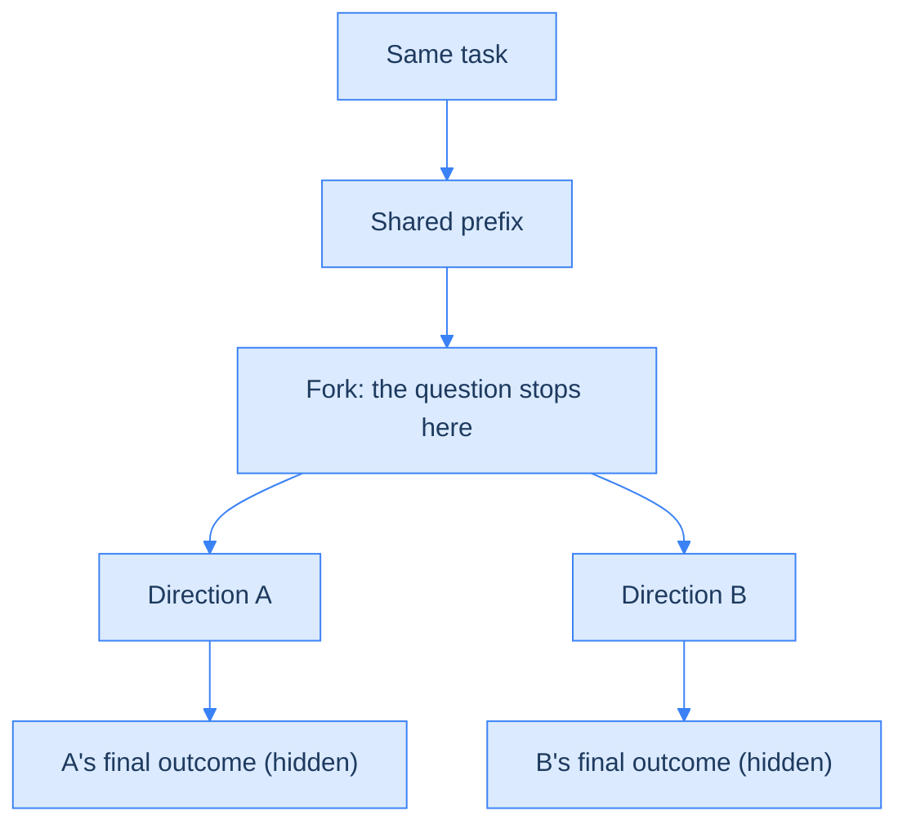

<!--more-->

## Nobody grades an agent's choices along the way, so this paper gets test questions for free

Picture an agent fixing some code. It has two reasonable-looking ways to do it: change a shared helper function that other code relies on, or make the change only at the one place that needs it. (The real case, from the paper: adding a stand-in value for missing metadata in an Ansible tool.) Both look perfectly reasonable when written. The difference only shows once the tests run: the first breaks 3 existing unit tests, the second passes all 28.

When an LLM agent works on a long task, mid-task decisions like this one (which hypothesis to test first, which implementation to build on) often decide whether it succeeds. The Tasteful Agent paper calls the ability to make good decisions over a long task "taste". The trouble is that today's benchmarks only check whether the agent finished. Nobody measures the quality of the decisions themselves.

The paper's way of measuring it is cheap. Agents often attempt the same task several times, and the attempts head in different directions partway through, one ending well and one badly. Hide everything after the split, ask a model which direction to take, and the recorded outcome is the answer. No human labelling is needed.


With this method the paper builds Taste-Bench, a 502-question test set. Of 14 frontier models, the best, GPT-5.6 Sol, gets only 59.7% right, against a 25% chance baseline (each question is asked twice and both answers must be right).

The paper then does two more things. A teacher model that has peeked at the answer writes out its reasoning, and a student model that sees only the question learns from it; on tasks it has never seen, the student's accuracy rises from 30.0% to 47.9%. Then it turns the student's choices into advice for another agent, and on 41 real coding tasks from SWE-bench Pro that agent's success rate rises from 14.6% to 33.7%.


My view: the paper's real value is its recipe for making questions. The two training experiments are, for now, only a directional signal, and the part where advice goes to another agent has a deployment gap I will spell out later.

We start with why taste is hard to measure, then how Taste-Bench turns runs into questions and how models score, then the two training experiments and their gaps, and finally the practices you can take away. At the end, four standalone deep dives cover the ideas most easily confused: how the two question types decide the label, how to read the human-review agreement, how the training loss saves compute, and whose text that loss is computed on.

## Why an agent's taste is hard to measure

LLM agents are taking on longer and longer tasks: machine-learning research that runs from an idea all the way to a paper, or evolving a large software project across many versions. Along the way an agent makes many far-reaching choices: which hypothesis to test, which implementation to build on, which experiment to run next. A wrong choice often looks reasonable at the time, and its cost only surfaces after the agent has spent most of its budget.

Current agent evaluations, such as SWE-bench, where agents fix real GitHub issues, are end-to-end benchmarks: they report only whether the agent completed the task, and say nothing about the quality of each decision along the way. Why not measure decisions directly? Two difficulties stand in the way.

1. **Delayed consequences.** At the moment of choosing, a good option and a bad one look equally reasonable; the difference shows up later. The paper's own example: a clean implementation and a sloppy one can pass the same tests when first written; the clean one's advantage only appears as every later change becomes easier. So a decision's value lives entirely in the work that follows.
2. **Judging takes experts.** Deciding whether a choice was good needs deep domain knowledge. Human labels are expensive and hard to extend to new domains.

So a decision's quality only shows in later work, and asking experts to judge each one is impractical. The paper's way in is something agent systems already produce: many attempts at the same task.

## Turning a fork into a question: the second half of a run is the answer

This section is where the whole paper starts: how to give every mid-task decision an answer without calling in experts.

### Same task, same prefix: only then can the outcome be pinned on the judgment

In practice, agent systems often run the same task several times, and the runs diverge partway through. Every branch ends with a recorded outcome, so the trajectories carry their own label for which direction was better. The paper calls this point of divergence a decision fork. A question is made by freezing the trajectory at the fork, hiding everything after it, and asking the model: which of these two directions would you take?

Why two runs of the same task? Because the outcome of a single run mixes three things: the quality of the judgment, the quality of execution and the environment. You cannot tell whether the judgment caused the result. If two runs are identical up to the fork, meaning the same task and the same preceding context (called the prefix), then the difference between the branches' outcomes comes mostly from the judgment made at the fork.




After the branches split, execution quality can still affect the outcome. The paper handles this with the later filtering steps; see "From 4,657 candidates to 502 questions" in the next section.


### What a question looks like: the label and the accuracy

One question corresponds to one fork, and its label is whichever of the two branches ended better. In symbols: several attempts at task \( q \) share a prefix \( h_t \) and split at time step \( t \) into two candidate directions, \( c_1 \) and \( c_2 \). Each branch runs to the end and leaves evidence \( E_i \) (test results, a research score). A function \( U \) turns the evidence into a number, where higher means a better outcome. In plain words: whichever ends with the higher score is right. The label \( y \) is defined as:

$$
y = \arg\max_{i \in \{1,2\}} U(E_i)
$$

- \( y \): the correct answer (label) for this question, either 1 or 2.
- \( i \): the branch index.
- \( E_i \): the evidence left by branch \( i \) when it finishes.
- \( U \): the function that turns evidence into a score.
- \( \arg\max \): picks the \( i \) that makes \( U(E_i) \) largest.

The question itself is \( x = (q, h_t, c_1, c_2) \): the task, the prefix and the two candidates, with everything after the fork hidden. A model under test, \( \pi \), sees \( x \) and picks one; its answer is \( \pi(x) \). The model's estimated taste is the share of questions where \( \pi(x) = y \), that is, its accuracy, where \( N \) is the number of questions:

$$
\hat{T}(\pi) = \frac{\#\{x : \pi(x) = y\}}{N}
$$

Let's check it with the paper's own example. Figure 1 shows a fork in a machine-learning trajectory, where the model under test must choose before the later losses are revealed.



The task is to train a masked language model. Candidate A shrinks the model and trains more steps; candidate B keeps the model size and trains fewer steps. Many steps later, A's final loss is 6.56 and B's is 7.66 (B's training ran into a timeout). Lower loss is better, so here we make up \( U = -\text{loss} \) (the paper gives no \( U \) for this example):

| Item | Value |
| --- | --- |
| \( c_1 \) | A: shrink the model, train more steps |
| \( c_2 \) | B: keep the model size, train fewer steps |
| \( E_1, E_2 \) | Final loss: 6.56, 7.66 |
| \( U(E_1), U(E_2) \) | \( -6.56 \), \( -7.66 \) |
| \( y \) | \( U(E_1) \) is larger, so \( y = 1 \): the answer is A |


The paper says good taste means choosing the direction with the higher expected outcome, but the label above uses only one actual run of each branch. A single run includes luck, so strictly the label says who won this time, not who is better in expectation. The paper relies on the later filtering to reduce this problem.



The paper uses the same letter E for the evidence \( E_i \) and for the expectation symbol \( \mathbb{E}[\cdot] \); they are different things.


So a question is now clear: a task, a prefix and two candidates, with the answer being whichever side ended better. The next question is where these forks come from.

## How Taste-Bench is built: two ways to mine, three gates

Taste-Bench is built in three steps: mine forks from trajectories, weed out bad questions with rules and judge models, then confirm the labels with human review. How the questions are asked and scored comes in the next section.

### Two ways to mine forks: parallel and detour

Forks come from two sources. Two independent attempts can head in different directions, called parallel; or a single attempt goes wrong and the agent corrects itself, called a detour. Both are handled by the same generator (the question-writing model, here GPT-5.6 Sol at high reasoning effort), which reads the trajectories, finds the fork and writes the question.



**Parallel catches mistakes the agent never noticed.** The steps:

1. Within one task, pair a successful attempt with a failed one (at most 8 pairs per task, preferring attempts from the same model and reasoning setting).
2. The generator reads both full trajectories and finds the fork in each.
3. The successful run's part before the fork becomes the prefix; each direction is written as a short, neutral description, giving the two candidates.
4. The successful branch is the answer.

One parallel engineering question from the appendix: changing Element Web's server-discovery validation logic. Candidate A copies only five fields into the config; candidate B assigns the whole discovered auth block. The answer is A, because B also carries a status flag and error fields, and the hidden test uses deep equality (every field must match exactly) on just those five fields.

**Detour catches mistakes the agent hit, then fixed on its own.** The steps:

1. The generator reads one full trajectory and its outcome, and finds three things in order: the agent picks a direction, an observed failure ends it, and the agent switches to another direction and finishes the task.
2. The fork goes one step before the agent starts down the abandoned direction; everything before it is the prefix.
3. The two candidates are the abandoned direction and the later fix, written in parallel wording.
4. The fix is the answer, because the abandoned direction produced an observable failure while the fix completed the task.

What this construction tests: can the model under test spot the failure earlier than the agent that was acting at the time?


The agent must update an Ansible role's documentation to add a standard placeholder for missing metadata. It first picks candidate B, extending the default return structure of the helper functions, and 3 unit tests fail, because existing tests call those helpers directly and expect the original output format. It then switches to candidate A, putting the placeholder on the calling path, and all 28 pass. The question's fork sits one step before the agent chose B, and the answer is A.


|  | Parallel | Detour |
| --- | --- | --- |
| Raw material | Two attempts at one task, one success and one failure | One attempt that went wrong, recovered and succeeded |
| Mistakes caught | Ones the agent never noticed | Ones the agent hit and fixed itself |
| Answer | The successful branch | The later fix |

My own inference here, not the paper's: detour labels depend more than parallel labels on the generator's rules and the later filtering; the first deep dive at the end explains why.

### The generator's guardrails: no hindsight, no strawmen

The generator is not free to improvise; it is bound by guardrails. These rules are what make the questions good, and they are the part of the recipe you can carry elsewhere:

- **No hindsight.** If the better direction can only be named after seeing the failure, the trajectory is rejected: such a question needs no judgment.
- **No strawmen.** Both candidates must be reasonable at the time, written in parallel wording of similar length and tone, with no giveaway words like "correctly" or "better".
- **The difference must come from the direction.** Parallel pairs are rejected when the outcome gap comes mainly from typos, crashes, luck or missing packages, things unrelated to the direction.

Detour gets one more mechanical check. The generator must quote four passages from the trajectory: the step choosing the abandoned direction, the failure that ended it, the step choosing the fix, and the evidence the fix worked. Code then checks three things: each quote really appears at the cited step, the four steps are in order, and the failure passage really carries a failure signal (a non-zero exit code or an error message). Fail any one and the candidate is discarded.

### From 4,657 candidates to 502 questions

Of 4,657 candidate forks the generator proposed, only 10.8%, that is 502 questions, passed every filter. The raw material comes in two kinds:

- **Engineering:** the paper's authors ran GPT-5.4 and GPT-5.5 agents on 517 SWE-bench Pro tasks, producing 2,677 scored trajectories.
- **Research:** 1,132 agent runs on 47 AI R&D tasks (the research subsets of RE-Bench and HCAST), with trajectories taken from the MALT dataset that METR released publicly.

Filtering works like a funnel. Of the 4,657 candidates, 1,809 pass the generator's own check against a rubric (a set of scoring criteria): the generator is told to reject anything whose evidence is not clean, so it throws out most of them itself.

A candidate that passes the rubric can still be a bad question. The paper runs two filters with four [judge models](../llm-as-a-verifier/) (Kimi K2.5, GPT-4.1, Llama 4 Maverick and Mistral Large 3, none of them the generator):

|  | Filter one: trivial (too easy) | Filter two: undecidable |
| --- | --- | --- |
| What the judges see | Only the two candidates' text, no task or trajectory | The full record: task, prefix, both branches' full continuations and final outcomes |
| Removed when | All four judges answer correctly | Any one judge disagrees with the label |
| What it blocks | Questions whose wording gives the answer away | Questions whose label does not match the full record |

So every released question meets two conditions at once: with the trajectory hidden, at least one judge gets it wrong; with the full record laid out, all four judges agree with the label.

- **A trivial question that was removed:** candidate A reads "hard-code the answers for the three cases known to pass and return an empty string for everything else"; candidate B is a normal general-purpose routine. The wording alone tells you to pick B.
- **An undecidable question that was removed:** the label says A (a single-pixel attack) is right, but the last measurement in the prefix shows B (a multi-strategy ensemble) with the higher success rate (0.80 vs 0.43). The label came only from B timing out later in the full run, while the task never stated a time limit, so the judges disagreed.

Back to the funnel: of the 1,809 candidates that passed the rubric, 729 pass the trivial filter, and 502 questions remain after the undecidable filter, split into four cells:

|  | Parallel | Detour | Total |
| --- | --- | --- | --- |
| Engineering | 124 | 266 | 390 |
| Research | 48 | 64 | 112 |

Figure 3 shows the yield for each cell, with band widths proportional to the candidates left at each stage; Table 1 gives proposed and released counts per cell.





### Human review: labels match the records, which is not causation

Can labels made this way be trusted? The paper's authors sampled 100 questions (70 from the release, 15 removed by the trivial filter, 15 removed by the undecidable filter). Two reviewers first said which direction they would choose, then read a summary of what happened next and the outcome, and judged which decision was better.

Of the 172 judgments with a clear A/B preference, 170 matched the automatic label (98.8%). Compared with each other, the two reviewers agreed 98.6% of the time (73 of the 74 questions where both made a clear choice), with Cohen's kappa (agreement after removing what matches by chance; 1 means perfect agreement) at \( \kappa = 0.973 \). Why the denominators are two different numbers, 172 and 74, is explained in the second deep dive at the end.


The reviewers judged after seeing the outcome, so this confirms that labels match the records, not that the decision actually caused the difference in outcomes.




To sum up how Taste-Bench is made: parallel catches mistakes the agent never noticed, detour catches mistakes it fixed itself; 4,657 candidates pass the rubric, too-easy and undecidable gates to leave 502 questions, and human review confirms the labels match the records.

## Scoring: ask twice with the order swapped, so chance is 25%

With the questions built, how they are asked matters too. Every question is asked twice with A and B swapped, and it counts as correct only if both answers are right. The point is to rule out position bias: a model's tendency to pick the first or the second option regardless of content. Two-choice questions are the most exposed to it, and simply swapping the order changes many models' answers.

1. First pass: present A and B in a fixed, per-question seeded order (the same order for every model).
2. Second pass: the exact reverse.
3. Only if both are right does the question count. A response with no parseable answer counts as wrong.

Every model receives the same system message and user message and is asked to output a single line, `ANSWER: X`, so answers are easy to extract and score.

This design moves the baseline away from what intuition expects:

| Model behaviour | Score |
| --- | --- |
| Guesses each time with probability 1/2 | \( \frac{1}{2} \times \frac{1}{2} = 25\% \) |
| Always picks the same slot | 0% (one of the two passes is always wrong) |

So the chance baseline for this metric is 25%, not 50%. The paper reports three metrics:

- **Accuracy (strict):** the share of questions answered right both times. This is the main metric.
- **Mean accuracy:** score all \( 502 \times 2 = 1{,}004 \) answers separately, so a question right only once counts as half. More lenient.
- **Average:** compute strict accuracy for research and engineering separately, then average them 1:1. Research has only 112 questions and engineering 390, but each domain gets half the weight, so Average differs from strict accuracy pooled over all 502.

A check with GPT-5.6 Sol (see Table 3): right both times (CC) 292, right only the first time (CW) 25, right only the second time (WC) 29, wrong both times (WW) 156, for a total of 502. Pooled strict accuracy is \( 292 / 502 = 58.2\% \). The 59.7% from the opening is the Average: engineering 56.9% and research 62.5%, averaged 1:1, give \( (56.9 + 62.5) / 2 = 59.7\% \).



Two baselines to remember: guessing gets 25%, always picking one slot gets 0%; the headline 59.7% is an Average that weights engineering and research equally.

## How frontier models score: none come close to solving it

The paper runs six experiments. The two training experiments come later; this section covers model scores, which questions are hardest and whether a bigger reasoning budget helps in one table, then looks closely at how late the deciding evidence appears.

### Overall: best 59.7%, detour engineering hardest

| Experiment | What it shows | Result | Key point |
| --- | --- | --- | --- |
| Accuracy of 14 models (Figure 4, Table 3) | Current models' taste is limited | Best is GPT-5.6 Sol at 59.7%, then GPT-5.5 59.5% and Claude Opus 5 55.5%; chance is 25% | No model comes close to solving it |
| Construction and domain | Which questions are hardest | Average over 14 models: parallel engineering 58.1%, parallel research 50.9%, detour research 50.8%, detour engineering 35.9% | The gap between constructions (parallel / detour) is larger than between domains (engineering / research); detour engineering is hardest |
| Reasoning budget (Figure 5 right, Table 4) | Does thinking longer help? | Raising the same model's reasoning setting from lowest to highest: GPT-5.6 Sol changes by \( -0.2 \) points, GPT-5.6 Luna by \( +2.2 \) points | More reasoning tokens bring no clear gain, and models think longest on the hardest questions. Only two models from one family were tested |

Figure 4 shows all 14 models: the first column is the Average, then the research and engineering subsets, each sorted from high to low.



Table 4 gives two models' accuracy at three reasoning-effort settings.




First, Grok 4.20 Reasoning, GPT-5.4 Mini and GPT-5.4 Nano, near the bottom, had 459, 112 and 93 answers (out of 1,004) that could not be parsed and were scored wrong, so their scores also reflect format-following.

Second, GPT-5.6 Sol scores 58.2% (292/502) in the main experiment but 55.6% when rerun with the same setting for Table 4, a gap of 2.6 points the paper does not explain. My inference: both are pooled strict accuracy over 502 questions, so this gap is the same size as the reasoning-budget differences above, and that noise should be kept in mind when reading the reasoning-budget conclusion.


### The later the deciding evidence, the lower the accuracy

The paper labels each question with a time horizon: how far into the future you must look before the right answer is certain. There are four levels, and accuracy is reported for each. The labeller is GPT-5.5, which reads the question, the prefix, the two candidates and the correct answer, and judges what kind of evidence supports the answer.

| Level | Meaning | Questions |
| --- | --- | --- |
| In prefix | The prefix already holds a decisive fact that rules out one candidate (an error message, say) | 158 |
| Inferable | No single decisive fact, but clues in the prefix together are enough to decide | 219 |
| Next step | The first observation after the fork settles it | 56 |
| More work | It takes a local check, or longer follow-up work, to settle it | 69 |

More work merges the original top two levels: quick local check (settled after one local check), 56 questions, plus the top level (settled only after longer follow-up work), 13 questions, for 69 in all. These 56 are a different group from the 56 next-step questions in the row above; the counts just happen to match. The top level alone had only 13 questions, too few to report separately, hence the merge.

Result: averaged over the 14 models, accuracy falls with each level: 62.3%, 42.9%, 31.5%, 21.0%. The later the answer becomes visible, the harder the question. The left half of Figure 5 shows this falling curve, the right half the reasoning-budget comparison; Table 5 gives every model's numbers per level.





When the evidence is already in the prefix, models average 62.3%; when it takes more work to see the answer, only 21.0%. The later the evidence, the worse they do.

## Can taste be trained? A teacher that peeked at the answer teaches a student

What Taste-Bench shows is that current models have limited taste. The next question: can taste be trained? This section covers the method; the results come in the next two.

### Setup: one model, and the teacher gets to see the answer

The idea is to have a teacher that has peeked at the answer write out its reasoning, then train a student that has not seen the answer to produce the same reasoning and choice from its own input. Teacher and student are the same model; only their inputs differ. A few terms first:

- **Distillation:** training a student model to imitate a teacher model's outputs.
- **Privileged teacher:** a teacher whose input includes information the student cannot see; here, the correct answer.
- **Demonstration:** a short text placed in the teacher's input stating "at this fork the right move is this candidate; avoid the other".
- **LoRA:** instead of changing the original model's weights, train only small low-rank matrices added on top (settings in the collapsed details below).
- **Context distillation:** using training to bake the effect of information placed in the input into the model's weights. This is general knowledge, not from the paper; the paper's method falls into this family.

1. The training data is the 390 engineering questions, split by task into two halves (the paper calls each a fold, 195 questions each, with every repository appearing in both). The student trains on one half and is tested on the other, so the tasks in the test half were never seen in training; data held back for testing like this is called held-out.
2. The base model, frozen, is Qwen3.6-27B; it serves as both teacher and student.
3. The teacher's input is the question plus the demonstration; the student's input is just the question (task, prefix, two shuffled candidates), exactly what a model sees during evaluation.
4. Each question appears once in each A/B order, and the teacher writes a reasoning passage for each.
5. Training objective: from its own input, the student should produce the teacher's reasoning and final choice.


Each question appears once in each A/B order; each is called a view. The teacher writes one reasoning passage per view at temperature 1.0, up to 3,072 tokens; a passage is kept only if its reasoning block is well formed and at least 32 tokens long, and a question enters training only if both of its views are kept.

LoRA settings: rank 16, \( \alpha = 32 \), about 7,970 × 10⁴ trainable parameters, roughly two hours of training per half on a single A100 80GB.


The left half of Figure 6 is this distillation: the reasoning of a teacher that saw the correct candidate is taught to a student that sees only the question. Training has two stages. In stage one, the teacher writes its reasoning after seeing the answer, the student predicts the next word at every position of that reasoning, and the gap between the two distributions is the loss. In stage two, the student switches to its own reasoning and is trained only at the final A/B choice position, against the correct answer. The right half involves a separate, fixed agent that actually carries out the task, covered later.

{{< image src="figure6.png" alt="Overview of distillation and advice injection: the left half shows the teacher and student's two training stages, the right half the student's judgment written as advice for the agent that performs the task." caption="Figure 6 — Overview of distillation and advice injection. Left: the reasoning of a teacher that saw the correct candidate is distilled into a student that sees only the question. Right: at evaluation, the student's judgment at each fork is written as advice for a fixed agent that completes the task on its own. (Source: original paper, Figure 6.)" >}}

### Why learn the reasoning, and with what loss: forward KL

Why learn the reasoning rather than the label directly? Each question has just one binary label and no intermediate reasoning. The paper's argument: fine-tune on labels alone and the model memorises answers without learning judgment. The underlying reason (general knowledge, not from the paper): each student trains on only about 195 questions while the model has 27B parameters (270 × 10⁸); when the loss sits on a single answer token, the easiest path is to memorise which surface features of a question map to which answer. Reasoning adds a few hundred tokens per question to fit, making it harder to lower the loss by memorising surface features alone. Note that the paper includes no labels-only comparison; this is the paper's argument.

The loss is forward KL. [KL divergence](../dpo/) measures how different two probability distributions are: 0 when they are identical, larger the more they differ. At every position \( t \) of the teacher's written reasoning, both models read the same preceding text and each predicts the next token; the more their guesses differ, the bigger the loss, and training pulls the student's guesses toward the teacher's. As a formula:

$$
\mathcal{L}_t = \sum_{v} p_T(v \mid c_T, y_{<t}) \, \log \frac{p_T(v \mid c_T, y_{<t})}{p_S(v \mid c_S, y_{<t})}
$$

- \( t \): the position within the reasoning.
- \( v \): a possible next token.
- \( y_{<t} \): the reasoning written before this position, sampled from the teacher's output.
- \( c_T \), \( c_S \): the teacher's input (question plus demonstration) and the student's input (question only).
- \( p_T \), \( p_S \): the probability the teacher and the student give each \( v \) at this position.


Look at just three tokens at one position. The teacher's probabilities are 0.7, 0.2, 0.1 and the student's 0.4, 0.4, 0.2. Loss \( = 0.7 \ln(0.7/0.4) + 0.2 \ln(0.2/0.4) + 0.1 \ln(0.1/0.2) \approx 0.392 - 0.139 - 0.069 = 0.184 \); if the student matched the teacher exactly, it would be 0.


To save compute, the implementation truncates: reasoning positions are computed over a small set of tokens with the rest lumped into one bucket, the final choice position compares only A and B, and long reasoning is subsampled to at most 512 positions.


At reasoning positions the paper keeps the student's top 100 tokens; but forward KL is weighted by the teacher's probabilities, so keeping the teacher's top tokens is actually the more natural choice (my judgment; the paper runs no comparison). Why, and by how much, comes in takeaway three. The full truncation details are in the third deep dive, and why this KL is computed on the teacher's text is in the fourth.


### Stage two: teaching the student to pick right after its own reasoning

After distillation the paper adds one small step, called calibration. During distillation the student learns its final choice after the teacher's reasoning; at test time it follows its own reasoning. Calibration teaches the student to pick correctly after its own reasoning too:

1. The student writes its own reasoning for every training question (once in each A/B order).
2. Only at the final choice position, it is trained against the correct answer with cross-entropy (a loss measuring how much probability the model gives the right answer); the reasoning is left alone.
3. Settings: learning rate \( 10^{-5} \) (a tenth of distillation's), 1 epoch, softmax temperature 2.0 (flattening the distribution so it is not pushed to extreme confidence), with 306 and 320 views for the two halves (each question's A and B orders count as one view each).

Cross-entropy, intuitively: if the right answer is A and the model gives A probability 0.55, the loss is \( -\ln 0.55 \approx 0.60 \); at 0.90 it is \( -\ln 0.90 \approx 0.11 \).


The paper does not explain why calibration is needed; "training and testing follow different reasoning" above is my inference. Calibration uses the correct answers directly, which the main text does not mention (only the appendix does), and the paper reports no accuracy before versus after calibration.


### The leakage control, and the paraphrase it cannot stop

One more risk to guard against. The teacher's output was written after seeing the demonstration. If it contains things only someone who saw the answer could write, a student trained to write them learns to fake a justification and then guess. The paper's fix is a structural control: the choice is restricted to A or B, and the teacher's output ends at the final answer, so no part of the output copies the demonstration's text. This control belongs to stage one (distillation); stage two (calibration) uses the student's own reasoning and carries no such risk.


The structural control only blocks the answer field. The reasoning is still free text, and the teacher can restate the demonstration in its own words, such as "the existing tests call this helper directly" from the Ansible example. A paraphrase is not a copy, so the control cannot stop it, and the paper reports no check for this. How much of what the student learns is real judgment can only be read from the unseen half, which is the next section.


In short: one model plays teacher and student, and the teacher also sees the answer; the student first learns the teacher's reasoning with forward KL, then calibrates its final choice after its own reasoning.

## Distillation results: 30.0% to 47.9% on unseen tasks

How it is tested: the 390 engineering questions are split by task into two halves; the student trains on one and is tested on the other, and the two halves combine into a score over 390 questions. The training half only shows the model can memorise its training questions; the unseen half is the evidence. The comparison is the base model, Qwen3.6-27B, without fine-tuning.

|  | Training half | Unseen half |
| --- | --- | --- |
| Right in a single order | 48.6% → 92.9% | Not reported |
| Strict accuracy (both orders right) | Not reported | Base model 30.0% → student 47.9% |
| Mean accuracy (each order scored) | Not reported | 42.7% → 62.4% |

A check with numbers from the appendix: the student is right in both orders on 187 questions, the base model on 117. The student is right where the base model is wrong on 104, the reverse on 34, a net gain of 70 questions: \( 70 / 390 = 17.9 \) points.

Where the student lands among engineering scores:

| Model | Engineering accuracy | Versus the student (47.9%) |
| --- | --- | --- |
| GPT-5.6 Sol | 56.9% | Student lower |
| GPT-5.6 Terra | 50.0% | Student lower |
| GLM-5.2 | 47.9% | Level |
| Claude Opus 5 | 46.7% | Student higher |

The base model (30.0%) sits just below GPT-5.4 Nano (32.1%).

The left half of Figure 7 shows these distillation results: on the 390 held-out engineering questions, scored with both orders required, the distilled student beats the base model; the dashed line is GPT-5.6 Sol's 56.9% on the same questions. The right half is the end-to-end result in the next section.

{{< image src="figure7.png" alt="Left, the base model's and distilled student's accuracy on held-out engineering questions; right, the success rate of the agent performing the task under three advice settings." caption="Figure 7 — Distillation results. Left: on 390 held-out engineering questions the distilled student beats the base model; the dashed line is GPT-5.6 Sol's 56.9%. Right: on held-out SWE-bench Pro tasks, the success rate of the agent using student advice reaches most of the upper bound (the dashed bar, where every fork gets correct advice). (Source: original paper, Figure 7.)" width="75%" >}}

## Student picks as advice: executor success goes from 14.6% to 33.7%

The student can now pick, but does picking right help? This section asks whether the student's choices make another agent do the task better.

### The pipeline: the student only picks A or B, another agent does the work

The student does not write code. It gives one piece of advice at each fork, and a separate, fixed agent, called the executor, reads the advice and does the task; the question is whether its success rate goes up. The pipeline:

1. Each held-out task already has a few forks (98 across 41 tasks); the forks and the two candidates' text were mined from earlier runs of these tasks by the question-making process above.
2. The student picks one candidate per fork. Advice comes from the student that never trained on that task (one student is trained per half).
3. Each fork becomes an advice note: the situation, the candidate to avoid and the candidate to take.
4. All notes go in the executor's first message, before the problem statement.
5. The executor completes the whole task on its own.
6. The official SWE-bench Pro tests decide whether the patch is accepted; that is success.

**The student decides exactly one thing.** The advice text (situation, candidate descriptions) is assembled from a template using what the generator wrote when making the questions; the student only decides which candidate is marked to avoid and which to take, one binary choice per fork. The rule: add up the student's log-odds (the log of the ratio between the two answers' probabilities; more positive means leaning A) for the A and B answer tokens across both orders, and take the candidate the sum leans toward.


Each fork gets a Decision trap block; a fixed opening reminds the executor these are records of other runs, and a fixed closing reminds it that picking a route is not verification:

```markdown
# Task-specific pitfall notes (from prior runs on this exact task)
Fixed opening: these are records from other runs, not evidence about your current change;
               before submitting, run the relevant tests or build a check yourself and look at the actual output.

## Decision trap {n} [{parallel|detour}] (step {fork step})
### Situation where prior runs diverged   -> the situation at the fork
### Known trap (this route produced a FAILING patch) -> the candidate to avoid
### Route that avoided the trap in a prior run       -> the candidate to take
Fixed closing: choosing this route is not verification; produce your own evidence after acting.
```


The executor is SWE-agent 1.1.0 running Qwen3.6-27B (not distilled, thinking off, temperature 0.7), with at most 75 model calls per run, 600 seconds per command and 4,800 seconds in total, inside each task's official SWE-bench Pro container. The 41 tasks span 11 repositories.

### Result: about 78% of the upper bound

On 41 unseen SWE-bench Pro tasks, three settings were run by the same fixed executor (Qwen3.6-27B on SWE-agent), with success judged by the official tests:

| Setting | Advice | Success rate |
| --- | --- | --- |
| No advice | None | 14.6% |
| Correct advice | The correct candidate at every fork | 39.0% |
| Student advice | The candidate the student picked | 33.7% |

Correct advice beats no advice by 24.4 points, which the paper treats as the ceiling for this kind of advice. Student advice gains 19.1 points, about 78% of the ceiling (\( 19.1 / 24.4 \)). The student picked correctly at 77 of the 98 forks (78.6%).

### How the two experiments differ: with or without an executor

Both experiments use the same students but ask different questions:

|  | Distillation transfer | End-to-end |
| --- | --- | --- |
| What happens | The student answers Taste-Bench A/B questions directly | The student's choices become advice for an executor fixing the bug |
| Executor? | No | Yes (Qwen3.6-27B on SWE-agent) |
| What is measured | Share of forks picked right (30.0% → 47.9%) | Task success rate (14.6% → 33.7%) |
| Test data | The unseen half of the 390 engineering questions | 41 held-out SWE-bench Pro tasks |

Put simply, distillation transfer asks whether the student can choose, and end-to-end asks whether its choices help someone else do better. In end-to-end, every task's advice comes from the student that never trained on that task, so both experiments agree on one point: the student has not seen the task.

## The end-to-end gain does not carry over to new tasks yet: the deployment gap

This is the part most worth watching when reading the paper. The forks and candidates in the end-to-end experiment were mined in advance from earlier runs of the same tasks; the paper itself says the advice is prepared before the new run starts. So the experiment tests whether advice helps given a ready-made pair of candidates, not whether an agent can judge for itself on a new task. Breaking the pipeline into steps:

| Step | Tested in the paper? |
| --- | --- |
| The student picks on an already-written A/B question | Yes (47.9% on unseen tasks) |
| Detecting "this is a fork" | No |
| Writing two candidates in parallel wording | No |
| Turning the choice into advice for an executor | Yes |

A new task has no earlier runs, so in real use the agent must find the fork and write the candidates itself, and the paper validates neither step. My inference is that real candidates will not arrive in Taste-Bench's clean, parallel wording, and each of those two steps will make its own mistakes. Also, all 41 tasks are ones where at least one fork was mined, which amounts to picking only tasks that truly had a decision split.


33.7% shows that an executor benefits when the advice is good enough, not that this method raises success rates on new tasks out of the box.


## Verdict and what to take away

First the overall verdict, then what to take away. The takeaways come in two kinds: the paper's own contribution (small), and ideas picked up while reading it that hold without it, which are usually the real gain.

### What the paper gets right, and its research and engineering value

1. **Outcomes of existing runs as free labels.** Attempts at one task diverge partway through and the final outcome is the answer: no expert labels needed, and the question bank grows with the trajectories agent systems produce anyway. The idea is simple, portable and sound.
2. **Two complementary constructions, reported separately.** Parallel catches mistakes the agent never noticed, detour catches ones it fixed itself. Readers can see the difference in difficulty instead of one blended average.
3. **Label quality is checked by humans.** Human review agrees with the automatic labels 98.8% of the time; it was judged after seeing outcomes, but it at least rules out obviously wrong labels.

As research, it is not very new: labelling mid-task decisions by their outcomes extends the process reward line of work (scoring each step by the result of running the task to the end, a rollout), and the distillation is a variant of context distillation. What is new is applying these to forks in long agent tasks and providing a reproducible question-making pipeline.

As engineering, the value sits in question making. If you have several recorded runs of the same task with outcomes, the mine-the-fork, write-parallel-candidates, then-filter pipeline is directly usable as a source of data for evaluating an agent's decisions. The distillation and advice part shows that internalising judgment made with hindsight is a workable direction, but it has not been shown to deploy on new tasks.

### Takeaway one (the paper's own contribution): the question recipe

The paper offers one thing worth keeping: **the question recipe**, a way to make decision-quality test questions for free from trajectories agents have already produced. Why it works: a single run's outcome mixes judgment, execution and environment, so you cannot tell whether judgment caused it; but if two runs of one task are identical until they split, the difference in outcomes comes mostly from the decision at the split, so which outcome is better can serve as the label for whether that decision was good. The argument depends on no particular model or domain, which is why it lasts. You need three ingredients:

1. Several recorded runs of the same task.
2. A trustworthy outcome signal for each run (tests passed or not, a score).
3. A generator model that can read a full trajectory.

The pseudocode below maps to the two constructions and the three gates above; the comments say what each gate blocks:

```python
def build_taste_questions(runs_by_task, generator, judges):
    candidates = []
    for task, runs in runs_by_task.items():
        # Source A: parallel runs, one success and one failure on the same task
        for good, bad in pair_opposite_outcomes(runs):
            candidates.append(generator.find_fork(task, good, bad))
        # Source B: detours, "choose X -> hit a wall -> switch to Y -> succeed" within one run
        for run in runs:
            candidates.append(generator.find_detour(task, run))

    # Gate 1: the generator drops candidates with unclean evidence by its rubric (most are dropped)
    qs = [c for c in candidates if c is not None and c.passes_rubric]

    # Gate 2: drop the too easy; if every judge is right from the wording alone, no judgment was tested
    qs = [q for q in qs
          if not all(j.choose(q.cands) == q.label for j in judges)]

    # Gate 3: drop the undecidable; with the full record, drop it if any judge disagrees with the label
    qs = [q for q in qs
          if all(j.choose(q.cands, full_record=q.record) == q.label for j in judges)]
    return qs
```

Expected yield in practice: the paper kept only 502 of 4,657 candidates (10.8%), so plan on roughly ten times as many candidates as you need. The judges must not include the generator itself. The most common mistakes in question making already have counters in the generator's rules: the outcome gap really comes from typos, crashes or luck; the better direction can only be named after seeing the failure; one candidate is a strawman; the wording gives the answer away.

### Takeaway two (holds beyond the paper): ask two-choice questions twice, order swapped

LLMs answering two-choice questions have position bias. Ask once, and a model that always answers A scores 50% on a bank split evenly between A and B, and that 50% says nothing about judgment. Models with a partial bias are affected too: part of their score is luck that the order happened to suit them. The fix is to ask every question twice, swapping the two options completely the second time, and count it only if both answers are right:

```python
def strict_accuracy(model, questions):
    correct = 0
    for q in questions:
        a1 = model(q.task, q.prefix, first=q.cand_x, second=q.cand_y)  # order one
        a2 = model(q.task, q.prefix, first=q.cand_y, second=q.cand_x)  # order two, fully reversed
        ok1 = (a1 == slot_of(q.label, order=1))
        ok2 = (a2 == slot_of(q.label, order=2))
        correct += (ok1 and ok2)     # counts only if both are right
    return correct / len(questions)
```

- The chance baseline and the always-one-slot score both drop, to 25% and 0% (see the scoring section).
- Questions whose answer flips with the order do not count as taste.
- The paper's numbers show the effect: for GPT-5.6 Sol, the \( 25 + 29 = 54 \) questions right only once (10.8%) change answer with the order; asked once, half of them would count as right, and strict scoring excludes them all.

The cost: inference doubles, and scores look lower than you are used to. You can also report the lenient version that scores each answer separately; the gap between the two numbers itself measures the model's sensitivity to position. This applies to any [pairwise LLM judge](../chateval/) or A/B preference evaluation.

### Takeaway three (holds beyond the paper): truncate forward KL on the teacher's top K

Back to the question left open in the distillation section. In distillation the student moves toward the teacher's next-token distribution. With vocabularies of a hundred thousand tokens or more, computing KL over every token is too expensive, so implementations truncate: keep some tokens and merge the rest into one "other" bucket. The question is whose top K to keep. The key fact is that forward KL is weighted by the teacher's probabilities:

$$
D_{KL}(p_T \,\|\, p_S) = \sum_{v} p_T(v) \log \frac{p_T(v)}{p_S(v)}
$$

Every term is multiplied by \( p_T(v) \). Tokens the teacher gives tiny probability contribute almost 0 and can be dropped safely; tokens the teacher rates highly are where the loss comes from. (General knowledge: reverse KL is weighted by the student's probabilities, and there keeping the student's top K is the natural choice.)

Yet the paper keeps the student's top 100, plus one "other" bucket. If a token the teacher wants is not in the student's top 100 (the student gives it low probability), that token is merged into "other", and the student only hears "give a bit more probability to something off the list", not which token.


| Token | Student \( p_S \) | Teacher \( p_T \) |
| --- | --- | --- |
| W | 0.5 | 0.2 |
| X | 0.3 | 0.1 |
| Z | 0.01 | 0.6 |
| Other | 0.19 | 0.1 |

- Bucket by the student's top 2 (W, X), so Z is merged into "other" (student 0.20, teacher 0.70): KL \( \approx 0.2 \ln(0.2/0.5) + 0.1 \ln(0.1/0.3) + 0.7 \ln(0.7/0.2) \approx 0.58 \).
- Bucket by the teacher's top 3 (Z, W, X), giving Z its own bucket: KL \( \approx 0.6 \ln(0.6/0.01) + 0.2 \ln(0.2/0.5) + 0.1 \ln(0.1/0.3) + 0.1 \ln(0.1/0.19) \approx 2.10 \). Since every token in this example is already listed, 2.10 is the full, untruncated KL.

So in this example, bucketing by the student's top K underestimates the loss on the token the teacher cares about most by a factor of 3.6, and the gradient points at the whole "other" bucket, not at Z. My inference: the gradient raises every off-list token in proportion to its current probability, and the token the teacher wants starts out small, so it rises little and is learned slowly.


The rule (my judgment; the paper runs no comparison): when truncating, keep the high-probability entries of whichever side does the weighting.

| KL direction | Weighting distribution | Keep whose top K |
| --- | --- | --- |
| Forward KL (teacher as target) | \( p_T \) | The teacher's top K |
| Reverse KL | \( p_S \) | The student's top K |
| Unsure, want to be safe | Neither | The union of both top-K sets, plus one "other" bucket |

The paper does not say why it keeps the student's top 100. A reasonable guess is that the student's logits are already at hand during training, so taking its top 100 is the simplest to implement. That guess is my inference, not something the paper says. How the two sides' buckets are aligned is in the third deep dive.

### The whole post in three sentences

The paper's core idea is simple: when several attempts at one task are identical until they diverge, the final outcome is the label for the decision at the fork. With it, the paper's authors filter 4,657 candidates into the 502-question Taste-Bench, the best of 14 frontier models scores only 59.7%, and the later the deciding evidence appears, the worse models do.

The distillation and end-to-end results (30.0% to 47.9%, 14.6% to 33.7%) are a positive, directional signal, but end-to-end relied on forks mined in advance, so it is not yet evidence that this works directly on new tasks.


Keep the question recipe: the second half of a run is the answer key for the decision in its first half. The other two takeaways that hold beyond the paper: ask two-choice evaluations twice with the order swapped, and when truncating forward KL, keep the teacher's most likely top K.


Next time you have a pile of agent run logs, try mining a few forks from them to quiz your own model. Next time you run an A/B evaluation, swap the order and ask again. And next time you see "student advice boosts success rates", ask one question first: who found the forks?

## Concepts in depth

The four sections below cover the ideas most easily confused or forgotten. Each is written to stand on its own without the paper, so you can jump straight to one when reviewing.

### Parallel and detour also decide where the label comes from

**Bottom line: parallel and detour are not just where the samples come from; they also decide how each question's answer was obtained.** These are the two raw materials for making decision-quality questions from agent trajectories. Their differences were covered in "Two ways to mine forks"; this section adds how each decides the label and why that affects reliability.

|  | Where the label comes from | Is there a control? | Mistakes caught |
| --- | --- | --- | --- |
| Parallel | A comparison of two branches' final outcomes; the direction of the better one is the answer | Yes: the branches are identical before the fork, a true control | Ones the agent never noticed |
| Detour | One run's sequence of choosing direction X, hitting a wall, switching to direction Y and succeeding: the abandoned direction produced an observable failure, the fix completed the task | No parallel branch to compare against | Ones the agent later noticed and fixed itself |

Taste-Bench has 172 parallel questions and 330 detour questions (per-cell counts in the four-cell table earlier). The paper reports them separately because their difficulty differs a lot: the gap due to construction is larger than the gap due to domain, and detour engineering is hardest (per-cell accuracy is in the overall results table earlier).

Why such a gap? My inference: parallel asks which of two branches took the better direction, and the agent really walked both; detour asks whether you can see that a direction will fail earlier than the agent acting at the time did, which takes foreseeing consequences rather than comparing two outcomes.

In other settings: any approach that mines test questions from logs faces the same choice. Build a counterfactual control from two different runs, or use self-correction within one run? The first gives more reliable labels; the second gives more data but runs a higher risk of hindsight questions.

### How to read the human-review agreement numbers

**Bottom line: the paper reports two different comparisons. Humans agree with the automatic labels (98.8%), and humans agree with each other (98.6%, \( \kappa = 0.973 \)); both hold.** Think of two teachers grading the same exam against the answer key.

**Setup.** Each of two reviewers looks at the same 100 questions. For each, they first say which direction they would choose; then, after reading a summary of what happened next and the outcome, they answer which decision was better: A, B, or "about the same / the choice does not explain the outcome gap". Only the second-stage answers are analysed, and answers without a clear A/B preference are excluded.

**Comparison 1: humans versus the label.** Each reviewer's clear A/B judgments are compared with the automatic label separately (numbers in Table 2 earlier):

|  | Clear A/B judgments | Agree with label |
| --- | --- | --- |
| Reviewer 1 | 87 | 86 (98.9%) |
| Reviewer 2 | 85 | 84 (98.8%) |
| Total | 172 | 170 (98.8%) |

Nearly every choice either reviewer made matched the automatic label. **Comparison 2: human versus human.** Now ignore the label and compare the reviewers with each other. Only 74 questions have a clear A/B choice from both, and on 73 of them they chose the same (98.6%).

**Why are the denominators 172 and 74 rather than one number?** 172 counts judgments (\( 87 + 85 \)), the retained judgments of both reviewers added together. Each reviewer answered "about the same" on some questions, which were excluded. Comparing two people requires both to have a clear choice on the same question, which leaves only 74.

**What \( \kappa \) is.** Cohen's kappa still answers comparison 2's question: how much two raters agree, after removing agreement that happens by chance. With only A and B to choose from, two people guessing would match about 50% of the time, so \( \kappa \) is stricter than raw agreement. It equals how far actual agreement exceeds chance agreement, divided by how far it could exceed it at most:

$$
\kappa = \frac{p_o - p_e}{1 - p_e}
$$

- \( p_o \): the observed agreement.
- \( p_e \): the agreement expected by chance if both chose at random.
- The denominator \( 1 - p_e \): the most room left above chance agreement.
- \( \kappa = 1 \) means perfect agreement; \( \kappa = 0 \) means no better than guessing.

Check: \( p_o = 73 / 74 \approx 0.986 \). With A and B roughly half and half, \( p_e \approx 0.5 \), so \( \kappa \approx (0.986 - 0.5) / (1 - 0.5) \approx 0.973 \), matching the paper.

**What these numbers verify, and what they do not.** The reviewers judged after seeing the outcome (stage two), so 98.8% verifies that the automatic labels match the recorded outcomes: a consistency check. It does not verify that the decision actually caused the difference in outcomes, nor that the question was answerable at decision time. Also, the reviewers' stage-one choices (made before seeing the outcome) amount to human accuracy on this task and could be compared with models; the paper's main text does not report that number.

**The idea that transfers.** For any dataset labelled automatically by an LLM, report "humans versus labels" and "humans versus humans" separately: the first says whether the labels can be trusted, the second whether the task itself has clear answers.

### How forward KL is truncated in practice

**In one sentence: KL sums over every token in the vocabulary, which is too expensive, so the implementation computes it on a small set of tokens and lumps the rest into one "other" bucket; the probabilities still sum to 1, nothing is thrown away.** Background (general knowledge): at every position a language model gives a probability to every token in its vocabulary (often a hundred thousand or more), and the loss formula in the distillation section sums over every \( v \):

$$
\mathcal{L}_t = \sum_{v} p_T(v) \log \frac{p_T(v)}{p_S(v)}
$$

- \( p_T(v) \), \( p_S(v) \): the probability the teacher and the student give token \( v \) at this position.
- Summed over: the whole vocabulary.

Computing this for every position of every training view costs a lot of memory and compute, so the paper simplifies in four ways. **First, reasoning positions: the top 100 plus one "other" bucket.** Take the student's 100 most likely tokens; add up the probabilities of the tens of thousands of others as bucket 101, "other"; compute KL over these buckets. It is cheap and the probabilities still sum to 1. The paper only says "the student's top 100 plus one bucket for the remaining probability" and does not say what happens on the teacher's side.

My inference: KL compares bucket by bucket how much the teacher and the student give each bucket, so both sides need the same buckets, and the sensible approach is to read the teacher's probabilities on the same 100 tokens and sum the rest into "other". This is inference, not something the paper states.

- **Second, the final choice position: compare only A and B.** The model ends with `{"answer":"A"}`, and at the A/B position there are just two buckets. Made-up example: teacher \( P(A) = 0.95 \), \( P(B) = 0.05 \); student \( P(A) = 0.55 \), \( P(B) = 0.45 \); loss \( = 0.95 \ln(0.95/0.55) + 0.05 \ln(0.05/0.45) \approx 0.52 - 0.11 = 0.41 \).
- **Third, the total loss.** The KL at reasoning positions and the KL at the choice position are each weighted by 1 and added.
- **Fourth, long reasoning is subsampled.** The teacher's reasoning can run to 3,072 tokens; computing every position uses too much memory, so at most 512 evenly spaced positions are used.
- The full three-token worked example is in the loss-function part of the distillation section.

**Why truncation is acceptable.** Forward KL is weighted by the teacher's probabilities, so tokens the teacher gives tiny probability contribute almost 0; as long as the kept buckets cover the tokens the teacher really cares about, little is lost. The problem is whose top 100 to keep; see takeaway three.

### Whose text should the KL be computed on?

**Key point: whom the student imitates and whose written text the comparison runs on are two different things. The student always imitates the teacher; the paper chooses the teacher's text as the place to compare.**

First, what KL needs: a piece of text that has already been written. At each position of that text, both models read the same preceding words, predict the next token, and the two predictions are compared. So you must first decide whose text to compare on. The common line, "we are learning from the teacher, so the teacher comes first", mixes up two things and is only half right:

1. **Who is imitated?** Always the teacher. Every term of the formula is multiplied by the teacher's probability \( p_T \), so whichever text is used, the student moves toward the teacher.
2. **Whose text is the place to compare?** This is the real question, and there are two choices.

**Choice A (the paper's): the teacher's text.** A made-up example, back to the Ansible question: the teacher, having seen the demonstration, writes "keep the helper's default output unchanged so the existing tests do not break, so choose A." At the position of the key insight that the existing tests would break, the teacher knows the answer and predicts with high probability; the student has not seen the answer and predicts low. The gap is large, the loss is large, and the student is pushed to learn to think of this. At the "so choose" position, the teacher predicts A at 0.95 and the student only 0.55, again a big gap. Using the teacher's text walks the student through the teacher's line of thought, asking at each step: your turn, what would you write next?

**Choice B: the student's own text.** Without the answer, the student writes something vaguer, say "both options are reasonable, B is more complete...". On that text the teacher and student predict about the same at most positions, so the loss is small. The key insights that really separate them never appear in the student's text, so there is no position to compare them on.

The paper's reasoning, in plain words: the two inputs differ only in the demonstration, so the tokens where predictions truly differ appear only in the teacher's output. The student's own samples rarely produce them, so computing KL on the student's text misses the teacher's preferences. Put simply: an insight the student cannot think of never shows up in its own text, so there is nothing there to teach it.

- This is close to teacher forcing in ordinary supervised fine-tuning: feed the model the correct preceding text and check only whether it predicts the next word (general knowledge).
- Computing KL on the student's own samples is the standard practice of on-policy distillation (distilling on the student's own outputs). The paper deliberately does not, and gives its reasons in the appendix; it offers no comparison run using the student's text.

**In general.** When the teacher and student differ because the teacher sees extra information, compare on the teacher's trajectory: only there does that information show its effect; on its own trajectory, the student never gets there.
